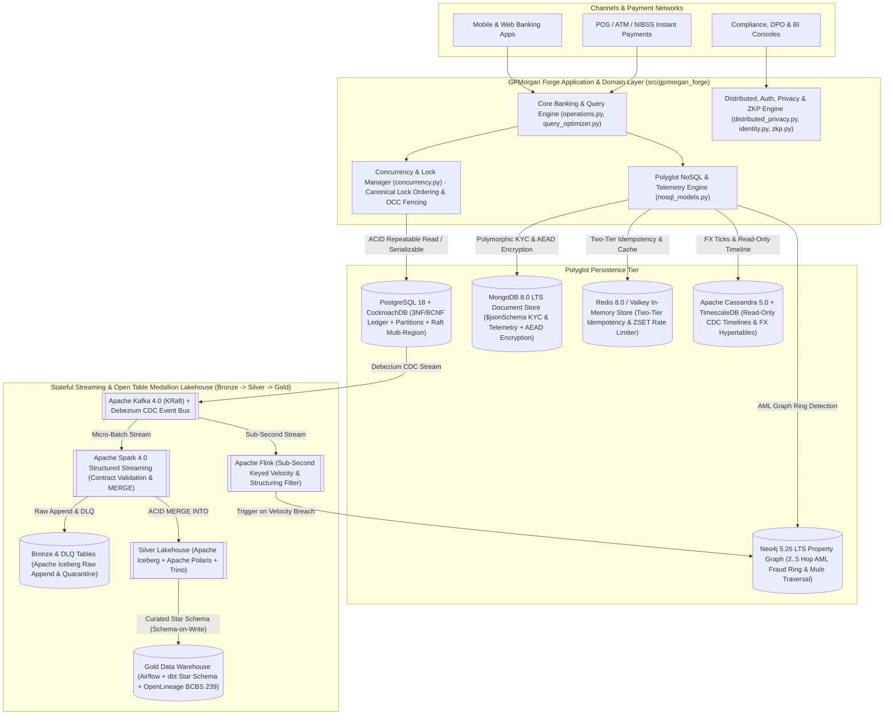
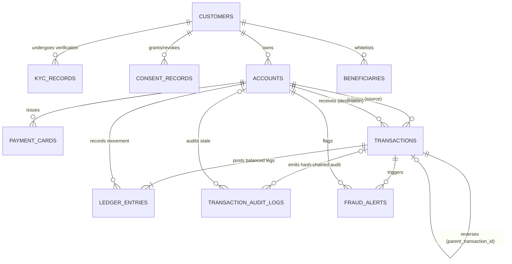
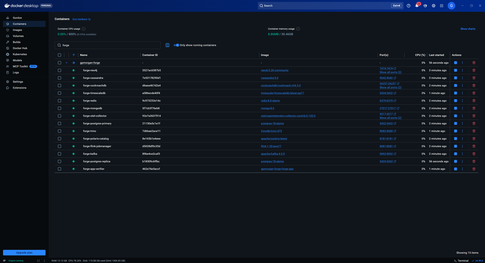

# GPMorgan Forge: Core Banking & Polyglot Financial Data Platform

[](#7-verification-testing--100-coverage-suite)
[-brightgreen)](#7-verification-testing--100-coverage-suite)
[](#6-quickstart-with-uv--modern-docker-composeyaml)
[](#2-polyglot-system-architecture)
[](#2-polyglot-system-architecture)
[](#2-polyglot-system-architecture)
[](#2-polyglot-system-architecture)
[](#2-polyglot-system-architecture)
[](#2-polyglot-system-architecture)
[](#2-polyglot-system-architecture)
[](#2-polyglot-system-architecture)
[](#2-polyglot-system-architecture)
[](#2-polyglot-system-architecture)
[](#5-security-privacy--regulatory-compliance)

**GPMorgan Forge** is a production-grade, multi-currency financial technology and core banking data platform. It implements an end-to-end **Polyglot Persistence & Open Table Medallion Lakehouse Architecture** spanning **Python 3.15**, **PostgreSQL 18 + CockroachDB** (3NF/BCNF double-entry ACID general ledger, declarative range/hash partitioning, multi-region active-active Raft `SERIALIZABLE` consensus, RBAC/ABAC/RLS), **MongoDB 8.0 LTS** (`$jsonSchema`-validated KYC & telemetry documents with AEAD field-level encryption), **Neo4j 5.26 LTS** (index-free adjacency AML fraud ring & shared-device mule detection), **Redis 8.0 / Valkey** (two-tier atomic idempotency locks paired with `uq_transactions_idempotency_key`, read-through balance caching & sliding-window rate limiting), **Apache Cassandra 5.0** (read-only, append-only CDC customer transaction timeline projections), **TimescaleDB** (hypertable FX liquidity ticks & continuous aggregates), and **Apache Kafka 4.0 + Apache Flink + Apache Spark 4.0 + Apache Iceberg (Apache Polaris) + Trino + Airflow/dbt + OpenLineage + OpenTelemetry** (stateful stream processing, open-table time-travel Lakehouse, federated SQL, and BCBS 239 / NDPA 2023 lineage).

---

## 1. Repository Navigation & Deliverables Map

| Deliverable / Document | Path | Focus Area & Key Engineering Artefacts |
| :--- | :--- | :--- |
| **Portfolio 1: Database Design & Modelling** | [`portfolio-1-database-design/`](portfolio-1-database-design/README.md) | 10-table 3NF/BCNF schema ([`schema.sql`](portfolio-1-database-design/schema.sql)), multi-currency seed data ([`seed_data.sql`](portfolio-1-database-design/seed_data.sql)), double-entry ledger invariant, SHA-256 hash-chained audit logs, ER diagram |
| **Portfolio 2: Query Processing & Optimisation** | [`portfolio-2-query-optimisation/`](portfolio-2-query-optimisation/README.md) | Covering/partial/GIN indexes & materialised views ([`indexes_and_views.sql`](portfolio-2-query-optimisation/indexes_and_views.sql)), 6 analytical SQL workloads ([`queries.sql`](portfolio-2-query-optimisation/queries.sql)), `EXPLAIN (ANALYZE, BUFFERS)` benchmarks ([`execution_plans_evidence.md`](portfolio-2-query-optimisation/execution_plans_evidence.md)) |
| **Portfolio 3: Transactions & Concurrency Control** | [`portfolio-3-transactions-concurrency/`](portfolio-3-transactions-concurrency/README.md) | Atomic double-entry transfers, `SAVEPOINT` batch settlement, optimistic `version` fencing, canonical lock ordering, contra-entry reversals ([`transactions_and_locks.sql`](portfolio-3-transactions-concurrency/transactions_and_locks.sql), [`concurrency_evidence.md`](portfolio-3-transactions-concurrency/concurrency_evidence.md)) |
| **Portfolio 4: NoSQL & Polyglot Persistence** | [`portfolio-4-nosql/`](portfolio-4-nosql/README.md) | MongoDB 8.0 LTS `$jsonSchema` KYC & telemetry ([`mongodb_document_model.js`](portfolio-4-nosql/mongodb_document_model.js)), Neo4j 5.26 LTS Cypher fraud rings ([`neo4j_fraud_graph.cypher`](portfolio-4-nosql/neo4j_fraud_graph.cypher)), Redis 8.0 / Valkey two-tier idempotency & rate limiting ([`redis_caching_patterns.conf`](portfolio-4-nosql/redis_caching_patterns.conf)), Apache Cassandra 5.0 append-only timeline ([`cassandra_timeline_projection.cql`](portfolio-4-nosql/cassandra_timeline_projection.cql)), TimescaleDB hypertables |
| **Portfolio 5: Distributed, Cloud & Privacy** | [`portfolio-5-distributed-cloud/`](portfolio-5-distributed-cloud/README.md) | Range & hash partitioning + CockroachDB multi-region + TimescaleDB ([`partitioning_and_sharding.sql`](portfolio-5-distributed-cloud/partitioning_and_sharding.sql)), Kafka 4.0 + Flink + Spark 4.0 + Apache Iceberg (Apache Polaris) + Trino + Airflow/dbt + OpenLineage Lakehouse ([`lakehouse/`](portfolio-5-distributed-cloud/lakehouse/README.md)), 5-role RBAC/ABAC/RLS, RFC 6238 TOTP & OIDC JWT MFA ([`identity.py`](src/gpmorgan_forge/identity.py)), dynamic masking, NDPA 2023 / GDPR erasure, Differential Privacy, `secp256k1` ZKPs ([`zkp.py`](src/gpmorgan_forge/zkp.py)) & OpenTelemetry ([`security_rbac_rls_privacy.sql`](portfolio-5-distributed-cloud/security_rbac_rls_privacy.sql)) |
| **Final LMS Portfolio Documentation** | [`docs/FINAL_PORTFOLIO_DOCUMENTATION.md`](docs/FINAL_PORTFOLIO_DOCUMENTATION.md) | Executive summary, organisation statement, Portfolio 1-5 evidence synthesis, technical reflection, references, AI declaration |
| **Business & Data Requirements (BDR)** | [`docs/BDR.md`](docs/BDR.md) | Stakeholder matrix, functional/non-functional requirements, SLOs, 4-tier data classification & dictionary |
| **Architecture Decision Records (ADRs)** | [`docs/adr/`](docs/adr/0001-double-entry-immutable-ledger.md) | ADRs 0001 through 0006 covering double-entry ledger, polyglot persistence, concurrency, partitioning, Lakehouse, and zero-trust privacy |
| **Production Deployment & HA Runbook** | [`docs/PRODUCTION_DEPLOYMENT.md`](docs/PRODUCTION_DEPLOYMENT.md) | Multi-AZ HA topology, KMS/TLS 1.3 hardening, PostgreSQL 18 tuning, zero-downtime partition/view maintenance, and PITR failover drills |
| **Developer Onboarding & Git Workflow** | [`docs/DEVELOPER_ONBOARDING.md`](docs/DEVELOPER_ONBOARDING.md), [`docs/GIT_WORKFLOW.md`](docs/GIT_WORKFLOW.md) | Toolchain setup (`uv`, `compose.yaml`, `lefthook`), branching strategy, Conventional Commits, and CI pipeline |

---

## 2. Polyglot System Architecture



---

## 3. Comprehensive Catalog of Database Entities & Banking Operations

### 3.1 Relational Core Entities (10 Normalized Tables in 3NF/BCNF)



### 3.2 Implemented Banking Operations ([`src/gpmorgan_forge/operations.py`](src/gpmorgan_forge/operations.py))

1. **Customer Onboarding, KYC Verification & Privacy Consent Governance** (`onboard_customer`, `verify_kyc_document`, `record_consent` in [`operations.py`](src/gpmorgan_forge/operations.py)):
   - Salted SHA-256 hashing of Nigerian BVN and identity document references (`bvn_sha256`, `document_ref_hash`), progressive KYC tier upgrades (`TIER_1` $\to$ `TIER_2` $\to$ `TIER_3`), and explicit opt-in/opt-out consent recording under `NDPA_2023` and `GDPR`.
2. **Multi-Currency Account Lifecycle, Card Issuing & Beneficiary Whitelisting** (`create_account`, `set_account_status`, `issue_payment_card`, `whitelist_beneficiary` in [`operations.py`](src/gpmorgan_forge/operations.py)):
   - Supports `CHECKING`, `SAVINGS`, `TREASURY`, `ESCROW`, and `SETTLEMENT_GL` accounts across `NGN`, `USD`, `GBP`, and `EUR` with NUBAN 10-digit validation, PCI-DSS v4.0 masked PANs (`XXXX-XXXX-XXXX-1234`), and SHA-256 card tokens.
3. **Atomic Double-Entry Fund Transfers, Deposits & Withdrawals** (`transfer_funds`, `process_deposit`, `process_withdrawal` in [`operations.py`](src/gpmorgan_forge/operations.py)):
   - Enforces idempotency deduplication, currency matching, daily transfer limits, non-negative customer balance invariants, balanced `DEBIT`/`CREDIT` postings in `ledger_entries`, automated AML high-value fraud alert emission (`CBN_LARGE_VALUE_THRESHOLD`), and SHA-256 hash-chained `transaction_audit_logs`.
4. **Compensating Contra-Entry Reversals & Cryptographic Ledger Reconciliation** (`reverse_failed_transaction`, `audit_account_balances` in [`operations.py`](src/gpmorgan_forge/operations.py)):
   - Reverses settled transactions by posting compensating contra-entries (`parent_transaction_id`) without mutating historical ledger rows, and audits live account balances against $\sum (\text{CREDIT} - \text{DEBIT})$ alongside full SHA-256 audit hash-chain continuity.

---

## 4. Concurrency, Polyglot NoSQL & Distributed Lakehouse Highlights

- **Deadlock-Free Pessimistic & Optimistic Concurrency** ([`src/gpmorgan_forge/concurrency.py`](src/gpmorgan_forge/concurrency.py)):
  - Canonical ascending-UUID lock ordering (`compute_canonical_lock_schedule`, `_lock_accounts_canonically`) eliminates AB-BA circular wait deadlocks.
  - Monotonic `version` fencing (`simulate_optimistic_concurrency_conflict`) prevents Lost Updates under concurrent read-modify-write contention.
  - `SAVEPOINT` batch settlement (`execute_batch_transfers_with_savepoints`) isolates failed legs within multi-recipient payroll batches without aborting valid sibling transfers.
- **NoSQL Document, Key-Value, Graph, Wide-Column & Time-Series Engines** ([`src/gpmorgan_forge/nosql_models.py`](src/gpmorgan_forge/nosql_models.py)):
  - **MongoDB 8.0 LTS** (`DocumentStoreEngine`): Enforces `$jsonSchema` validation and `AEAD_AES_256_GCM` field-level encryption on `kyc_verifications` and 90-day TTL `device_telemetry_events`.
  - **Redis 8.0 / Valkey** (`KeyValueStoreEngine`): Enforces two-tier atomic idempotency (`SET ... NX EX` fast-path + PostgreSQL/CockroachDB `uq_transactions_idempotency_key` durable fallback), read-through balance caching, and `ZSET` sliding-window API rate limiting.
  - **Neo4j 5.26 LTS** (`GraphFraudEngine`): Detects 2-5 hop circular money-laundering rings (`detect_circular_transfer_loops`), shared-device mule rings (`detect_shared_device_mule_clusters`), and collaborative filtering recommendations (`recommend_financial_products`).
  - **Apache Cassandra 5.0** (`WideColumnTimelineEngine`, [`cassandra_timeline_projection.cql`](portfolio-4-nosql/cassandra_timeline_projection.cql)): Strictly read-only, append-only customer transaction timeline projections keyed by `((account_id, bucket_month), created_at DESC, transaction_id ASC)`.
  - **TimescaleDB** (`TimeSeriesTelemetryEngine`): Range-chunked hypertables (`create_hypertable`) and continuous aggregates (`time_bucket`) for high-frequency FX liquidity ticks.
- **Partitioning, CockroachDB Multi-Region, Flink, Open Table Lakehouse, Privacy & Observability** ([`src/gpmorgan_forge/distributed_privacy.py`](src/gpmorgan_forge/distributed_privacy.py), [`src/gpmorgan_forge/identity.py`](src/gpmorgan_forge/identity.py), [`src/gpmorgan_forge/zkp.py`](src/gpmorgan_forge/zkp.py)):
  - Quarterly range partitioning (`transactions_partitioned`), modulus-4 hash sharding (`accounts_sharded`), lag-aware read-replica routing, and **CockroachDB** multi-region active-active Raft `SERIALIZABLE` routing (`DistributedClusterRouter`).
  - **Apache Flink** stateful sub-second velocity engine (`FlinkStatefulVelocityEngine`) filtering Kafka 4.0 streams before triggering Neo4j Cypher traversals.
  - Open Table Medallion Lakehouse (`MedallionLakehousePipeline`, [`lakehouse/`](portfolio-5-distributed-cloud/lakehouse/README.md)) combining **Apache Iceberg** time-travel snapshots (`FOR SYSTEM_VERSION AS OF`) and native table branching/tagging, **Apache Polaris** REST catalog governance (RBAC & vended cloud storage credentials), **Trino** zero-ETL federated SQL, **Apache Airflow + dbt** Gold Star-Schema transformations, and **OpenLineage** dataset and run-level provenance (**BCBS 239 / NDPA 2023 / GDPR**).
  - Zero-Trust RBAC/ABAC/RLS (`AccessControlEngine`), RFC 6238 TOTP & OIDC RS256/EdDSA JWT step-up MFA (`TotpVerifier`, `OidcTokenValidator`), Privacy Engineering (`DataPrivacyEngine`), non-interactive `secp256k1` Pedersen + CDS94 Zero-Knowledge Range Proofs (`KycCredentialIssuer`, `prove_eligibility`, `verify_eligibility`), and OpenTelemetry distributed tracing (`DatabaseTelemetryTracer`).

---

## 5. Security, Privacy & Regulatory Compliance

| Regulation / Standard | Technical Enforcement in GPMorgan Forge | Implementation File |
| :--- | :--- | :--- |
| **NDPA 2023 & EU GDPR (Right to Erasure)** | Irreversible cryptographic PII redaction (`anonymise_customer_pii` / `DataPrivacyEngine.anonymise_customer_record`) revokes active consents and redacts customer PII while preserving statutory double-entry `ledger_entries` | [`security_rbac_rls_privacy.sql`](portfolio-5-distributed-cloud/security_rbac_rls_privacy.sql), [`distributed_privacy.py`](src/gpmorgan_forge/distributed_privacy.py) |
| **NDPA 2023 & GDPR (Tenant & ABAC Isolation)** | PostgreSQL Row-Level Security (`ENABLE ROW LEVEL SECURITY` + `FORCE ROW LEVEL SECURITY`) restricting `forge_customer` (`pol_customers_customer_isolation`, `pol_accounts_customer_isolation`) and `forge_compliance_dpo` (`pol_customers_dpo_jurisdiction`) alongside `AccessControlEngine` | [`security_rbac_rls_privacy.sql`](portfolio-5-distributed-cloud/security_rbac_rls_privacy.sql), [`distributed_privacy.py`](src/gpmorgan_forge/distributed_privacy.py), [`identity.py`](src/gpmorgan_forge/identity.py) |
| **PCI-DSS v4.0 (Cardholder Data Protection)** | Cleartext PAN storage prohibited via `chk_payment_cards_masked_pan`; only SHA-256 `card_token` and `masked_pan` (`XXXX-XXXX-XXXX-1234`) persisted and exposed via `v_masked_payment_cards` and `v_masked_customers` | [`schema.sql`](portfolio-1-database-design/schema.sql), [`security_rbac_rls_privacy.sql`](portfolio-5-distributed-cloud/security_rbac_rls_privacy.sql) |
| **CBN AML/CFT, Differential Privacy & ZKPs** | Append-only `ledger_entries` and `transaction_audit_logs` protected by `BEFORE UPDATE OR DELETE` triggers (`trg_immutable_ledger_entries`, `trg_immutable_audit_logs`); Laplace Differential Privacy and `secp256k1` Zero-Knowledge Proofs for KYC claims | [`schema.sql`](portfolio-1-database-design/schema.sql), [`distributed_privacy.py`](src/gpmorgan_forge/distributed_privacy.py), [`zkp.py`](src/gpmorgan_forge/zkp.py) |
| **BCBS 239 (Risk Data Aggregation & Lineage)** | Point-in-time historical reproducibility (`FOR SYSTEM_VERSION AS OF`) via **Apache Iceberg** & **Apache Polaris** REST catalog, **Trino** zero-ETL federation, **Airflow + dbt** Gold Star-Schema marts, and **OpenLineage** dataset and run-level provenance | [`distributed_privacy.py`](src/gpmorgan_forge/distributed_privacy.py), [`lakehouse/`](portfolio-5-distributed-cloud/lakehouse/README.md), [`0005-lakehouse-kafka-spark-architecture.md`](docs/adr/0005-lakehouse-kafka-spark-architecture.md) |

---

## 6. Quickstart with `uv` & Modern Docker (`compose.yaml`)

### Local Python 3.15 Setup

```bash
# Clone the repository and enter the workspace
git clone https://github.com/D0nG4667/gpmorgan-forge-de-portfolio.git
cd gpmorgan-forge-de-portfolio

# Install dependencies and virtual environment
uv sync --all-extras --dev

# Run the automated portfolio evidence generator and verifier
uv run python -m gpmorgan_forge.evidence_generator --verify
```

### Containerized Polyglot Stack (`compose.yaml`)

```bash
# Copy environment template to local git-ignored .env (optional: compose.yaml also includes safe defaults)
cp .env.example .env

# Generate local ECDSA P-256 CA and server SAN certificates for PostgreSQL 18 TLS 1.3 enforcement
uv run python scripts/generate_dev_tls.py

# Validate Compose specification
docker compose -f compose.yaml --profile full config -q

# Launch PostgreSQL 18 primary (with auto-loaded schemas) and Redis 8.0
docker compose --profile core up -d

# Launch all 8 relational, distributed SQL & NoSQL engines (PostgreSQL 18 Primary/Replica,
# CockroachDB, MongoDB 8.0, Neo4j 5.26, Redis 8.0, Cassandra 5.0 & TimescaleDB)
docker compose --profile core --profile nosql --profile distributed up -d

# Optional: Pull the ~4 GB Big Data Lakehouse images sequentially (--parallel 1 prevents
# Docker Hub 300s Bearer token timeouts on multi-GB pulls), then launch all 17 services
docker compose --parallel 1 --profile full pull
docker compose --profile full up -d
```



---

## 7. Verification, Testing & 100% Coverage Suite

The test suite in [`tests/`](tests/conftest.py) follows a strict **3-Tier Test Pyramid Architecture** ([`tests/unit/`](tests/unit/__init__.py), [`tests/integration/`](tests/integration/__init__.py), and [`tests/e2e/`](tests/e2e/__init__.py)) enforcing **100% line and branch coverage** across [`src/gpmorgan_forge/`](src/gpmorgan_forge/__init__.py):

```bash
# 1. Python & Markdown linting + formatting check
uv run ruff check .
uv run ruff format --check .
uv run rumdl check .

# 2. Strict static type checking
uv run mypy src tests

# 3. Full test pyramid (unit + integration + e2e) with 100% line + branch coverage gate
uv run pytest --cov=src/gpmorgan_forge --cov-branch --cov-report=term-missing --cov-fail-under=100

# 4. Run individual test tiers by marker
uv run pytest -m unit
uv run pytest -m integration
uv run pytest -m e2e

# 5. Repository hygiene, relative link & Conventional Commit audit
uv run python scripts/verify_commit_msg.py --audit-repo
```
