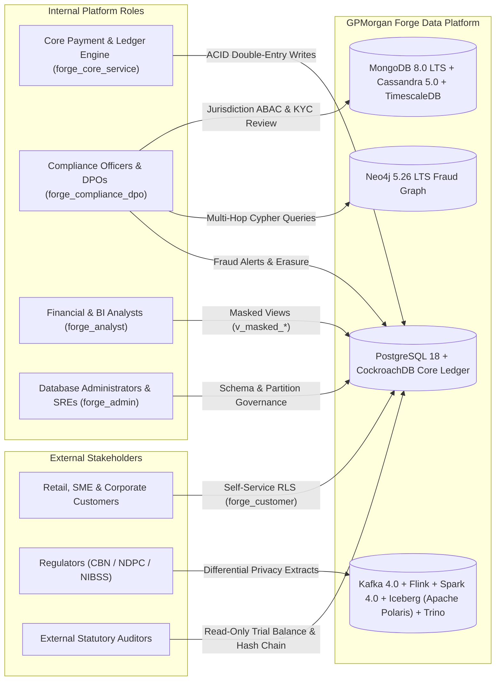

# Business & Data Requirements Document (BDR): GPMorgan Forge

**Document Identifier**: `BDR-GPMF-2026-001`  
**Platform Domain**: Tier-1 Digital Banking & Financial Technology Core Platform  
**Regulatory Jurisdiction**: Central Bank of Nigeria (CBN), Nigeria Data Protection Act (NDPA 2023), EU GDPR, BCBS 239, PCI-DSS v4.0  
**Status**: Approved & Implemented

---

## 1. Executive Summary & Business Vision

**GPMorgan Forge** is a cloud-native, multi-currency financial technology and core banking platform engineered to process high-velocity retail, SME, corporate, and institutional banking operations across West Africa and global settlement corridors (`NGN`, `USD`, `GBP`, `EUR`). The platform provides customer onboarding with tiered Know-Your-Customer (KYC) verification, privacy consent governance, multi-currency checking/savings/escrow/treasury/settlement accounts, double-entry general ledger accounting, payment card issuance, beneficiary whitelisting, real-time AML/fraud graph scoring, compensating contra-entry reversals, and statutory audit reporting.

To satisfy the competing demands of strict financial correctness (zero balance drift), sub-50ms payment latency, petabyte-scale historical telemetry, and real-time multi-hop fraud ring detection, GPMorgan Forge adopts a **Polyglot Persistence & Open Table Medallion Lakehouse Architecture** anchored by an ACID-compliant **PostgreSQL 18 + CockroachDB** core ledger, complemented by **MongoDB 8.0 LTS** for polymorphic KYC and telemetry documents with AEAD field-level encryption, **Neo4j 5.26 LTS** for real-time fraud graph analytics, **Redis 8.0 / Valkey** for two-tier idempotency locks (`SET NX EX` + `uq_transactions_idempotency_key`), rate limiting, and sub-millisecond caching, **Apache Cassandra 5.0** for read-only, append-only customer transaction timeline projections, **TimescaleDB** for high-frequency FX liquidity ticks, and an **Apache Kafka 4.0 + Apache Flink + Apache Spark 4.0 + Apache Iceberg (Apache Polaris) + Trino + Airflow/dbt + OpenLineage** Medallion Lakehouse pipeline.

---

## 2. Stakeholder Matrix & Data Access Profiles

| Stakeholder Group | Primary Responsibilities | Database Role / Access Mechanism | Privacy & Security Constraints |
| :--- | :--- | :--- | :--- |
| **Retail, SME & Corporate Customers** | View balances, fund accounts, transfer funds, manage cards & beneficiaries, manage consents | `forge_customer` + PostgreSQL RLS (`app.current_customer_id` on `customers` & `accounts`) | Strictly isolated to own `customer_id` rows across `customers` and `accounts`; zero visibility into other tenants |
| **Core Payment & Ledger Engine** | Execute atomic transfers, deposits, withdrawals, contra-entry reversals, and append ledger/audit entries | `forge_core_service` | `SELECT`, `INSERT`, `UPDATE` on operational tables; append-only (`INSERT`) on `ledger_entries` and `transaction_audit_logs` |
| **Compliance Officers & DPOs** | Review KYC verification records, investigate AML fraud alerts, audit ledger integrity, process NDPA/GDPR erasure requests | `forge_compliance_dpo` + PostgreSQL ABAC RLS (`app.actor_country`) + `AccessControlEngine` | Scoped by country jurisdiction on `customers`; authorised for `anonymise_customer_pii` erasure workflow; cannot mutate account balances |
| **Financial & BI Analysts** | Run aggregate liquidity, cohort, and corridor volume analytics on read replicas and masked views | `forge_analyst` | Raw PII tables (`customers`, `kyc_records`, `payment_cards`) explicitly revoked; SQL `GRANT`s expose dynamically masked views (`v_masked_customers`, `v_masked_payment_cards`), while `AccessControlEngine` (`READ_MATERIALISED_VIEW`) permits non-PII aggregate rollups (`mv_daily_corridor_settlement`) |
| **Database Administrators & SREs** | Schema migrations, declarative partition management, index tuning, backup/recovery, replication monitoring | `forge_admin` | Full DDL and operational supervision with every action recorded in immutable audit logs |

---

## 3. Functional Data Requirements (FR)

| ID | Category | Requirement Description | Target Subsystem | Verification Artifact |
| :--- | :--- | :--- | :--- | :--- |
| **FR-01** | Customer, KYC & Consent Lifecycle | Store customer profiles with unique external ref, email, E.164 phone, and SHA-256 BVN hash (`bvn_sha256`), supporting progressive KYC tiers (`TIER_1`..`TIER_3`), verification records (`kyc_records`), and regulatory consents (`consent_records`). | PostgreSQL (`customers`, `kyc_records`, `consent_records`) & MongoDB (`kyc_verifications`) | [`schema.sql`](../portfolio-1-database-design/schema.sql), [`mongodb_document_model.js`](../portfolio-4-nosql/mongodb_document_model.js) |
| **FR-02** | Multi-Currency Accounts & Beneficiaries | Manage `CHECKING`, `SAVINGS`, `TREASURY`, `ESCROW`, and `SETTLEMENT_GL` accounts across `NGN`, `USD`, `GBP`, and `EUR` with NUBAN 10-digit numbers, daily transfer limits, and whitelisted `beneficiaries`. | PostgreSQL (`accounts`, `beneficiaries`) | [`models.py`](../src/gpmorgan_forge/models.py) |
| **FR-03** | Double-Entry Atomic Transfers & Reversals | Every transfer, deposit, withdrawal, or contra-entry reversal must generate a `transactions` header, two balanced `DEBIT`/`CREDIT` rows in `ledger_entries`, and a SHA-256 hash-chained `transaction_audit_logs` record. | PostgreSQL (`transactions`, `ledger_entries`, `transaction_audit_logs`) | [`operations.py`](../src/gpmorgan_forge/operations.py) |
| **FR-04** | Payment Card Tokenisation | Issue payment cards storing only SHA-256 `card_token` and PCI-DSS v4.0 `masked_pan` (`^XXXX-XXXX-XXXX-[0-9]{4}$`), with spending limits and lifecycle status controls. | PostgreSQL (`payment_cards`) | [`operations.py`](../src/gpmorgan_forge/operations.py) |
| **FR-05** | Real-Time AML Fraud Alerts & Graph Detection | Emit `fraud_alerts` on high-value transfers (`CBN_LARGE_VALUE_THRESHOLD`), detect 2-5 hop circular money-laundering rings (`detect_circular_transfer_loops`), and cluster shared-device mule accounts (`detect_shared_device_mule_clusters`). | PostgreSQL (`fraud_alerts`) & Neo4j (`Customer`, `Account`, `Device`, `FinancialProduct`) | [`neo4j_fraud_graph.cypher`](../portfolio-4-nosql/neo4j_fraud_graph.cypher), [`nosql_models.py`](../src/gpmorgan_forge/nosql_models.py) |
| **FR-06** | Right-to-Erasure, Masking, DP & ZKPs | Fulfil NDPA 2023 / GDPR erasure requests via `anonymise_customer_pii` while preserving statutory `ledger_entries`, enforce dynamic masking, inject Laplace Differential Privacy noise, and verify Zero-Knowledge Proofs (ZKPs). | PostgreSQL & Python Privacy Engine | [`security_rbac_rls_privacy.sql`](../portfolio-5-distributed-cloud/security_rbac_rls_privacy.sql), [`distributed_privacy.py`](../src/gpmorgan_forge/distributed_privacy.py) |

---

## 4. Non-Functional Requirements (NFR) & Service Level Objectives (SLOs)

| Metric / Dimension | Target SLO | Architectural Pattern Used |
| :--- | :--- | :--- |
| **Ledger Consistency** | `100%` strict zero-sum & hash-chain integrity | Canonical ascending-UUID `SELECT ... FOR UPDATE` + Optimistic `version` fencing + `REPEATABLE READ` / `SERIALIZABLE` isolation |
| **P99 Transfer Latency** | `< 35 ms` (intra-region OLTP commit) | Covering B-Tree indexes (`INCLUDE`), Redis 8.0 `SET NX EX` idempotency fast-path |
| **Fraud Ring Traversal Latency** | `< 15 ms` for 2-5 hop cyclic detection | Neo4j 5.26 LTS index-free adjacency (`O(k)` hop complexity vs. `O(N^k)` relational joins) |
| **Recovery Point Objective (RPO)** | `0 seconds` (Zero data loss for committed txns) | Synchronous primary-to-standby WAL streaming replication (`synchronous_commit = on`) |
| **Recovery Time Objective (RTO)** | `< 30 seconds` automated failover | Lag-aware `DistributedClusterRouter` with automatic read-replica failover to `postgres-primary` when lag `> 100 ms` |
| **Historical Data Retention** | `7 Years` online/warm + cold archive | Quarterly declarative range partitioning (`transactions_partitioned`), modulus-4 hash sharding (`accounts_sharded`), and S3/HDFS Bronze Data Lake |

---

## 5. Comprehensive Data Dictionary & Classification Catalog

All data elements in GPMorgan Forge are classified into four sensitivity tiers in accordance with **NDPA 2023** and **PCI-DSS v4.0**:

- **Tier 4 (Restricted / Secret)**: Cryptographic hashes (`bvn_sha256`, `document_ref_hash`), `card_token`, AEAD-encrypted national IDs (`ENCv2:...`). Encrypted at rest (`AES-256`) and never exposed in cleartext views.
- **Tier 3 (Confidential PII / Financial)**: Customer names, emails, phone numbers, exact account balances, transfer amounts, and ledger postings. Protected by Row-Level Security (RLS) and dynamic masking.
- **Tier 2 (Internal Operational)**: Consent records, fraud alert scores, partition telemetry, device session metadata.
- **Tier 1 (Public / Reference)**: ISO-4217 currency enums, NIBSS bank codes, financial product catalog nodes.

| Entity / Table | Primary Key | Normalization Form | Storage Engine | Partitioning / Indexing Strategy | Sensitivity Tier |
| :--- | :--- | :--- | :--- | :--- | :--- |
| `customers` | `customer_id` (`UUID`) | 3NF / BCNF | PostgreSQL 18 | Unique `external_ref`, `email`, `phone_e164`, `bvn_sha256`; covering index `(segment, kyc_tier, risk_rating DESC) INCLUDE (full_name, country_code)` | Tier 4 (Restricted PII) |
| `kyc_records` | `kyc_id` (`UUID`) | 3NF / BCNF | PostgreSQL 18 | Unique `document_ref_hash`; FK to `customers(customer_id)` | Tier 4 (Restricted PII) |
| `consent_records` | `consent_id` (`UUID`) | 3NF / BCNF | PostgreSQL 18 | Append/audit consent history (`regulation_code`, `purpose_code`, `consent_granted`); FK to `customers(customer_id)` | Tier 2 (Internal Compliance) |
| `accounts` | `account_id` (`UUID`) | 3NF / BCNF | PostgreSQL 18 | Unique `account_number`; Hash Sharded (`accounts_sharded` modulus 4: `p0..p3`) | Tier 3 (Confidential) |
| `beneficiaries` | `beneficiary_id` (`UUID`) | 3NF / BCNF | PostgreSQL 18 | Unique `(customer_id, bank_code, account_number)` | Tier 3 (Confidential) |
| `payment_cards` | `card_id` (`UUID`) | 3NF / BCNF | PostgreSQL 18 | Unique `card_token`; `CHECK` on `masked_pan` (`^XXXX-XXXX-XXXX-[0-9]{4}$`) | Tier 4 (PCI-DSS Restricted) |
| `transactions` | `transaction_id` (`UUID`) | 3NF / BCNF | PostgreSQL 18 | Range Partitioned (`transactions_partitioned` by `created_at`); covering, partial & GIN indexes | Tier 3 (Confidential) |
| `ledger_entries` | `entry_id` (`UUID`) | 3NF / BCNF | PostgreSQL 18 | Unique `(transaction_id, entry_sequence)`; covering index `(account_id, created_at, entry_sequence) INCLUDE (...)`; immutable trigger | Tier 3 (Confidential) |
| `transaction_audit_logs` | `log_id` (`BIGINT IDENTITY`) | Append-Only | PostgreSQL 18 | Unique `curr_hash`; SHA-256 hash chain (`prev_hash -> curr_hash`); immutable trigger | Tier 4 (Restricted Audit) |
| `fraud_alerts` | `alert_id` (`UUID`) | 3NF / BCNF | PostgreSQL 18 | Partial index `pidx_fraud_alerts_unresolved_critical` on `(severity, risk_score DESC, created_at DESC) WHERE is_resolved = FALSE` | Tier 2 (Internal Risk) |
| `kyc_verifications` | `_id` (`ObjectId`) | Document Tree | MongoDB 8.0 LTS | `$jsonSchema` validation + AEAD field-level encryption; unique `customer_id` | Tier 4 (Restricted PII) |
| `device_telemetry_events` | `_id` (`ObjectId`) | Document Tree | MongoDB 8.0 LTS | Compound index `(device_fingerprint, captured_at DESC)`; 90-day TTL index on `captured_at` (`expireAfterSeconds: 7776000`) | Tier 2 (Internal Telemetry) |
| `FraudGraph` | `customer_id` / `account_number` | Property Graph | Neo4j 5.26 LTS | Uniqueness constraints on `:Customer`, `:Account`, `:Device` (with `:FinancialProduct` catalog nodes); risk score & segment indexes | Tier 3 (Confidential) |
| `customer_transaction_timeline` | `((account_id, bucket_month), created_at, transaction_id)` | Wide-Column Projection | Apache Cassandra 5.0 | Partitioned by `(account_id, bucket_month)` with `CLUSTERING ORDER BY (created_at DESC, transaction_id ASC)` (read-only CDC view) | Tier 3 (Confidential) |
| `fx_liquidity_ticks` | `(tick_time, corridor_pair)` | Hypertable | TimescaleDB | Range-chunked hypertable (`create_hypertable`) + continuous aggregate `mv_fx_liquidity_hourly` (`time_bucket`) | Tier 2 (Internal Telemetry) |
| `silver_transactions` | `reference_code` (merge key; Iceberg `snapshot_id` metadata) | Open Table Format | Apache Iceberg (Apache Polaris) | ACID snapshot isolation, REST catalog RBAC & vended credentials, native Iceberg table branching (`FOR SYSTEM_VERSION AS OF`) + OpenLineage BCBS 239 provenance | Tier 3 (Confidential) |
