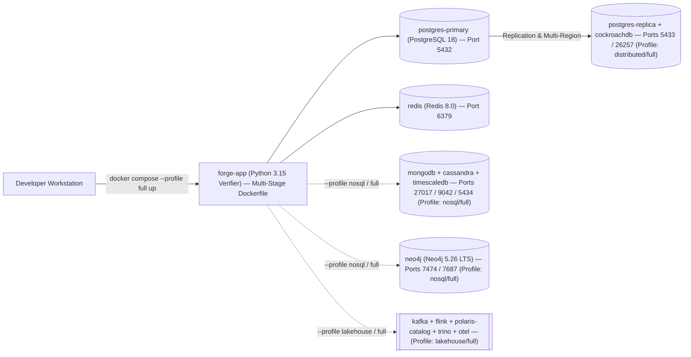

# Developer Onboarding Guide — GPMorgan Forge

Welcome to the **GPMorgan Forge** core banking and financial technology data platform repository. This guide walks you through setting up your local environment, starting the containerized polyglot persistence stack, running the 100%-coverage verification suite, and regenerating empirical execution evidence.

---

## 1. Prerequisites & Toolchain

Ensure the following tools are installed on your workstation:

| Tool | Minimum Version | Purpose | Verification Command |
| :--- | :--- | :--- | :--- |
| **Python** | `3.15` (Latest Stable) | Core banking domain runtime & evidence engine | `python --version` |
| **uv** | `0.11+` | Fast, deterministic Python dependency & virtualenv manager | `uv --version` |
| **Docker & Compose** | Docker `29+` / Compose `v2.35+` | Multi-container orchestration via modern `compose.yaml` | `docker compose version` |
| **Git** | `2.47+` | Version control & branch management | `git --version` |
| **Rumdl** | `0.3+` (installed via `uv`) | Fast Rust-powered Markdown linter (`[tool.rumdl]` in `pyproject.toml`) | `uv run rumdl --version` |
| **Lefthook** | `1.11+` (optional local binary) | Fast Git hook runner (`pre-commit`, `commit-msg`, `pre-push`) | `lefthook version` |

---

## 2. Quickstart Setup (Under 2 Minutes)

### Step 1: Synchronize the Python Environment

```bash
# Create the Python 3.15 virtual environment and install all runtime and dev dependencies
uv sync --all-extras --dev
```

### Step 2: Install Git Hooks (Lefthook)

```bash
# Activate pre-commit, commit-msg, and pre-push quality gates
lefthook install
```

### Step 3: Run Quality Gates & 100% Coverage Test Pyramid

```bash
# 1. Lint and check Python & Markdown formatting
uv run ruff check .
uv run ruff format --check .
uv run rumdl check .

# 2. Run strict static type analysis
uv run mypy src tests

# 3. Run full 3-tier test pyramid (unit + integration + e2e) with 100% line and branch coverage gate
uv run pytest --cov=src/gpmorgan_forge --cov-branch --cov-report=term-missing --cov-fail-under=100

# 4. Run individual test tiers selectively via strict markers
uv run pytest -m unit
uv run pytest -m integration
uv run pytest -m e2e

# 5. Verify empirical portfolio evidence and repository standards
uv run python -m gpmorgan_forge.evidence_generator --verify
uv run python scripts/verify_commit_msg.py --audit-repo
```

---

## 3. Running the Containerized Polyglot Stack (`compose.yaml`)

This repository follows the modern [Compose Specification](https://docs.docker.com/compose/intro/compose-application-model/) using [`compose.yaml`](../compose.yaml) (replacing legacy `docker-compose.yml` files).



### Configure Local Environment & Validate Compose Configuration

```bash
# Copy tracked environment template to local git-ignored .env
cp .env.example .env

# Validate Compose configuration
docker compose -f compose.yaml --profile full config -q
```

### Start the Core Relational & Cache Stack

```bash
# Starts PostgreSQL 18 Primary (auto-initializing Portfolio 1, 2, 3, and 5 SQL scripts) and Redis 8.0
docker compose --profile core up -d
```

When the `postgres-primary` container starts for the first time, it automatically executes:

1. [`portfolio-1-database-design/schema.sql`](../portfolio-1-database-design/schema.sql)
2. [`portfolio-1-database-design/seed_data.sql`](../portfolio-1-database-design/seed_data.sql)
3. [`portfolio-2-query-optimisation/indexes_and_views.sql`](../portfolio-2-query-optimisation/indexes_and_views.sql)
4. [`portfolio-5-distributed-cloud/partitioning_and_sharding.sql`](../portfolio-5-distributed-cloud/partitioning_and_sharding.sql)
5. [`portfolio-5-distributed-cloud/security_rbac_rls_privacy.sql`](../portfolio-5-distributed-cloud/security_rbac_rls_privacy.sql)

### Start the Full Polyglot, Distributed SQL, Streaming & Lakehouse Stack

```bash
# Starts all 14 services: PostgreSQL 18 (Primary & Replica), CockroachDB, MongoDB 8.0 LTS,
# Neo4j 5.26 LTS, Redis 8.0, Apache Cassandra 5.0, TimescaleDB, Apache Kafka 4.0 (KRaft),
# Apache Flink, Apache Polaris REST Catalog, Trino, OpenTelemetry Collector & App Verifier
docker compose --profile full up -d
```

### Tear Down Cleanly

```bash
docker compose --profile full down -v
```

---

## 4. Module Architecture Map

| Module Path | Responsibility | Related Portfolio |
| :--- | :--- | :--- |
| [`src/gpmorgan_forge/models.py`](../src/gpmorgan_forge/models.py) | SQLAlchemy 2.1 `Mapped[]` declarative entities for all 10 normalized tables (`Customer`, `KYCRecord`, `ConsentRecord`, `Account`, `Beneficiary`, `PaymentCard`, `Transaction`, `LedgerEntry`, `TransactionAuditLog`, `FraudAlert`) | Portfolio 1 |
| [`src/gpmorgan_forge/operations.py`](../src/gpmorgan_forge/operations.py) | Customer onboarding, KYC verification, consent recording, account/card/beneficiary lifecycle, double-entry transfers/deposits/withdrawals, contra-entry reversals, and cryptographic balance/hash-chain auditing | Portfolio 1 & 3 |
| [`src/gpmorgan_forge/query_optimizer.py`](../src/gpmorgan_forge/query_optimizer.py) | Analytical window queries (`get_account_running_balance_statement`, `detect_outbound_velocity_anomalies`), corridor rollups (`compute_corridor_settlement_rollup`), and `EXPLAIN` execution plan comparator (`inspect_query_execution_plan`) | Portfolio 2 |
| [`src/gpmorgan_forge/concurrency.py`](../src/gpmorgan_forge/concurrency.py) | Canonical ascending-UUID lock ordering (`compute_canonical_lock_schedule`), Optimistic Concurrency Control (`simulate_optimistic_concurrency_conflict`), and `SAVEPOINT` batch settlement (`execute_batch_transfers_with_savepoints`) | Portfolio 3 |
| [`src/gpmorgan_forge/nosql_models.py`](../src/gpmorgan_forge/nosql_models.py) | MongoDB 8.0 LTS `$jsonSchema` & AEAD encryption (`DocumentStoreEngine`), Redis 8.0 / Valkey Two-Tier idempotency, caching & ZSET rate limiting (`KeyValueStoreEngine`), Neo4j 5.26 LTS fraud & recommendation graph (`GraphFraudEngine`), Apache Cassandra 5.0 read-only CDC timeline (`WideColumnTimelineEngine`), and TimescaleDB FX hypertables (`TimeSeriesTelemetryEngine`) | Portfolio 4 |
| [`src/gpmorgan_forge/distributed_privacy.py`](../src/gpmorgan_forge/distributed_privacy.py) | Range/hash partition, lag-aware replica & CockroachDB multi-region router (`DistributedClusterRouter`), Apache Flink stateful velocity filter (`FlinkStatefulVelocityEngine`), Kafka 4.0 + Spark 4.0 + Apache Iceberg (Apache Polaris) + Trino + Airflow/dbt + OpenLineage Lakehouse (`MedallionLakehousePipeline`), OpenTelemetry tracer (`DatabaseTelemetryTracer`), RBAC/ABAC/RLS (`AccessControlEngine`), and masking/NDPA erasure/DP/ZKP (`DataPrivacyEngine`) | Portfolio 5 |
| [`src/gpmorgan_forge/evidence_generator.py`](../src/gpmorgan_forge/evidence_generator.py) | Automated end-to-end verification CLI across all 5 portfolios | All Portfolios |

---

## 5. Test Pyramid Architecture Map (`tests/`)

| Test Tier / Path | Pytest Marker | Verification Scope |
| :--- | :--- | :--- |
| [`tests/conftest.py`](../tests/conftest.py) | Fixture Layer | Shared in-memory relational `db_session` and pre-populated multi-account `seeded_session` fixtures |
| [`tests/unit/`](../tests/unit/__init__.py) | `@pytest.mark.unit` | Isolated unit tests for SHA-256 hash chaining ([`test_domain_models_and_crypto.py`](../tests/unit/test_domain_models_and_crypto.py)) and NoSQL/RBAC/privacy primitives ([`test_nosql_and_privacy_primitives.py`](../tests/unit/test_nosql_and_privacy_primitives.py)) |
| [`tests/integration/`](../tests/integration/__init__.py) | `@pytest.mark.integration` | Stateful multi-component tests for core banking & double-entry ledger ([`test_core_banking_and_ledger_ops.py`](../tests/integration/test_core_banking_and_ledger_ops.py)), query plans & concurrency ([`test_query_optimizer_and_concurrency.py`](../tests/integration/test_query_optimizer_and_concurrency.py)), and Neo4j AML graphs & Lakehouse ([`test_polyglot_graph_and_lakehouse.py`](../tests/integration/test_polyglot_graph_and_lakehouse.py)) |
| [`tests/e2e/`](../tests/e2e/__init__.py) | `@pytest.mark.e2e` | End-to-end verification of `evidence_generator --verify`, SQL/NoSQL/Cypher/Redis DDL & DML, `compose.yaml`, `Dockerfile`, and repository Markdown links ([`test_portfolio_evidence_and_artifacts.py`](../tests/e2e/test_portfolio_evidence_and_artifacts.py)) |
