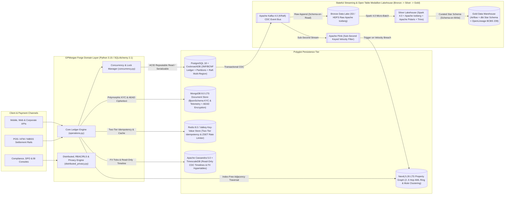
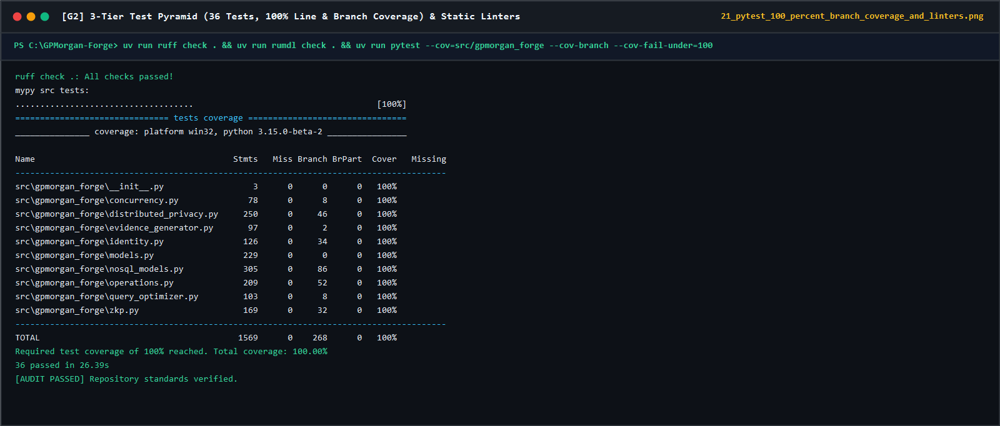

# MIT 8103 Advanced Database Systems: Final Portfolio Documentation

**Institution**: MIVA Open University, School of Post Graduate Studies  
**Programme**: Master of Information Technology (MIT)  
**Academic Session**: 2026/2027 Academic Session, First Semester (September 2026 Cohort)  
**Course Code & Title**: MIT 8103: Advanced Database Systems  
**GitHub Repository URL**: <https://github.com/D0nG4667/GPMorgan-Forge-Portfolio>  
**Selected Case Study / Organisation**: **Bank / Fintech Platform** (**GPMorgan Forge Multi-Currency Core Banking & Polyglot Financial Intelligence Platform**)

---

## 1. Executive Summary & Selected Organisation Statement

Modern financial institutions cannot rely on a single monolithic storage paradigm (Kleppmann, 2017; Petrov, 2019). They must simultaneously guarantee zero-defect double-entry monetary accounting, sub-millisecond payment authorisation, schema-flexible document persistence for multi-jurisdiction Know-Your-Customer (KYC) onboarding and device telemetry, real-time multi-hop anti-money-laundering (AML) ring detection, petabyte-scale analytical reporting, and defense-in-depth regulatory compliance under the **Nigeria Data Protection Act (NDPA) 2023** (Federal Republic of Nigeria, 2023), the **European Union General Data Protection Regulation (GDPR)** (European Parliament & Council of the European Union, 2016), **Central Bank of Nigeria (CBN)** AML/CFT directives (Central Bank of Nigeria, 2022), and **PCI-DSS v4.0** (PCI Security Standards Council, 2022). This portfolio designs, implements, and empirically verifies the data architecture for **GPMorgan Forge** across five progressive database engineering pillars.

### 1.1 Organisation Name & Operational Scenario

**GPMorgan Forge** is a high-assurance, multi-currency digital banking, core double-entry general ledger, real-time payment processing, and financial crime intelligence platform operating across Nigeria (`NGN`) and international settlement corridors (`USD`, `GBP`, `EUR`). The platform serves retail account holders, small and medium-sized businesses (SMEs), corporate treasuries, and institutional settlement counterparties.

### 1.2 Nature of the Business & Polyglot System Architecture

GPMorgan Forge processes high-concurrency deposits, withdrawals, domestic and cross-border interbank transfers, payment card authorisations, and compensating contra-entry transaction reversals. To align each workload with its optimal computational complexity and consistency model (Abadi, 2012; Özsu & Valduriez, 2020), the platform implements a **Polyglot Persistence & Medallion Lakehouse Architecture**:



### 1.3 Users of the Database

Database access is governed by a defense-in-depth combination of **Role-Based Access Control (RBAC)**, **Attribute-Based Access Control (ABAC)**, and **PostgreSQL 18 Row-Level Security (RLS)** ([`security_rbac_rls_privacy.sql`](../portfolio-5-distributed-cloud/security_rbac_rls_privacy.sql)):

| Database Role / Persona | Operational Responsibilities | Enforced Privileges, RLS & Masking Scope |
| :--- | :--- | :--- |
| **Retail, SME & Corporate Customers** (`forge_customer`) | View account balances, fund wallets, initiate transfers, whitelist beneficiaries, manage cards and privacy consents. | Strictly isolated via RLS (`pol_customers_customer_isolation`, `pol_accounts_customer_isolation`) to rows matching `current_setting('app.current_customer_id')`. |
| **Core Payment & Ledger Service** (`forge_core_service`) | Execute atomic transfers, deposits, withdrawals, contra-entry reversals, and append double-entry legs and audit hashes. | `SELECT`, `INSERT`, `UPDATE` on operational tables; strictly append-only (`INSERT` only) on `ledger_entries` and `transaction_audit_logs`. |
| **Compliance Officers & DPOs** (`forge_compliance_dpo`) | Vet KYC dossiers, investigate AML fraud alerts, verify trial balances, and execute statutory Right-to-Erasure requests. | Jurisdiction-scoped ABAC RLS (`pol_customers_dpo_jurisdiction` via `app.actor_country`); `EXECUTE` privilege on `anonymise_customer_pii()`. |
| **Financial & BI Analysts** (`forge_analyst`) | Run aggregate corridor liquidity, cohort, and velocity analytics on read replicas and materialised views. | Zero base-table PII access; restricted exclusively to dynamically masked views (`v_masked_customers`, `v_masked_payment_cards`) and materialised views. |
| **Database Administrators & SREs** (`forge_admin`) | Manage schema migrations, declarative partition lifecycle, index tuning, WAL streaming replication, and PITR recovery. | Administrative DDL and operational supervision with all state transitions captured in immutable cryptographic audit logs. |

### 1.4 Major Data Stored (Nature of the Database)

1. **Customers & Tiered KYC Identity Profiles**: Customer demographics (`customers`), segment classifications (`RETAIL`, `SME`, `CORPORATE`, `INSTITUTIONAL`), KYC verification tiers (`TIER_1` to `TIER_3`), salted SHA-256 Bank Verification Number hashes (`bvn_sha256`), identity verification records (`kyc_records`), and polymorphic MongoDB dossiers (`kyc_verifications`).
2. **Regulatory Privacy Consents**: Granular opt-in/opt-out lifecycle records (`consent_records`) tracking `NDPA_2023`, `GDPR`, `CBN_AML`, and `PCI_DSS` legal bases, IP provenance, and revocation timestamps.
3. **Multi-Currency Accounts & General Ledger Wallets**: Customer operating accounts (`CHECKING`, `SAVINGS`, `ESCROW`, `TREASURY`) and institutional settlement accounts (`SETTLEMENT_GL`) storing exact `NUMERIC(19, 4)` balances, 10-digit NUBAN numbers (`account_number`), daily limits, and optimistic concurrency `version` counters (`accounts`).
4. **Payment Cards & Whitelisted Beneficiaries**: PCI-DSS v4.0 tokenised payment cards (`payment_cards`) storing SHA-256 `card_token` and masked PANs (`XXXX-XXXX-XXXX-1234`), alongside verified transfer counterparties (`beneficiaries`).
5. **Transactions (Transfers, Deposits, Withdrawals, Fees, Reversals)**: Payment headers (`transactions`) capturing `idempotency_key`, `reference_code`, source and destination accounts, amounts, fees, FX rates, lifecycle status (`PENDING`, `SETTLED`, `FAILED`, `REVERSED`, `FLAGGED`), and self-referencing `parent_transaction_id` lineage.
6. **Immutable Double-Entry Accounting Ledger**: Atomic accounting postings (`ledger_entries`) recording paired `DEBIT` and `CREDIT` movements with `balance_before` and `balance_after` snapshots.
7. **Cryptographic Hash-Chained Audit Trail**: Tamper-evident audit events (`transaction_audit_logs`) linked via $\text{curr\_hash} = \text{SHA256}(\text{prev\_hash} \parallel \text{payload})$.
8. **Real-Time Fraud Alerts, Graph Topologies, Timeline Projections & Telemetry**: Relational risk flags (`fraud_alerts`), Neo4j property graph nodes (`:Customer`, `:Account`, `:Device`, `:FinancialProduct`), 90-day TTL MongoDB session telemetry (`device_telemetry_events`), Apache Cassandra 5.0 append-only customer transaction timelines (`customer_transaction_timeline`), and TimescaleDB FX liquidity hypertables (`fx_liquidity_ticks`).

### 1.5 Key Database Operations Supported

- **Customer Onboarding, KYC Verification & Consent Governance**: `onboard_customer()`, `verify_kyc_document()`, and `record_consent()` in [`operations.py`](../src/gpmorgan_forge/operations.py).
- **Multi-Currency Account Lifecycle, Card Issuing & Beneficiary Whitelisting**: `create_account()`, `set_account_status()`, `issue_payment_card()`, and `whitelist_beneficiary()` in [`operations.py`](../src/gpmorgan_forge/operations.py).
- **Atomic Double-Entry Fund Transfers, Deposits & Withdrawals**: `transfer_funds()`, `process_deposit()`, and `process_withdrawal()` enforcing idempotency, canonical lock ordering, daily limits, balanced `DEBIT`/`CREDIT` ledger postings, and automated CBN large-value fraud alert generation.
- **Failed Transaction Reversal via Compensating Contra-Entries**: `reverse_failed_transaction()` restoring account balances by posting new offsetting `DEBIT` and `CREDIT` legs linked via `parent_transaction_id` without mutating or deleting historical records.
- **Cryptographic Trial-Balance & Hash-Chain Auditing**: `audit_account_balances()` reconciling every account's live `balance` against $\sum (\text{CREDIT} - \text{DEBIT})$, verifying global zero-sum accounting ($\sum \text{DEBIT} = \sum \text{CREDIT}$), and recomputing every SHA-256 link in `transaction_audit_logs`.

---

## 2. Technical Synthesis & Empirical Evidence Across Portfolios 1-5

### 2.1 Portfolio 1: Relational Database Design & Modelling

- **Core Artefacts**: [`portfolio-1-database-design/schema.sql`](../portfolio-1-database-design/schema.sql), [`portfolio-1-database-design/seed_data.sql`](../portfolio-1-database-design/seed_data.sql), [`portfolio-1-database-design/README.md`](../portfolio-1-database-design/README.md), [`src/gpmorgan_forge/models.py`](../src/gpmorgan_forge/models.py), and [`docs/adr/0001-double-entry-immutable-ledger.md`](adr/0001-double-entry-immutable-ledger.md).
- **Relational Schema & Key Architecture**: The core banking schema models **10 relational tables** in **PostgreSQL 18** (`customers`, `kyc_records`, `consent_records`, `accounts`, `beneficiaries`, `payment_cards`, `transactions`, `ledger_entries`, `transaction_audit_logs`, and `fraud_alerts`) alongside custom domain `ENUM` types (`customer_segment`, `kyc_tier_level`, `currency_code`, `account_type`, `account_status`, `transaction_type`, `transaction_status`, `entry_direction`, and `risk_severity`). Surrogate 128-bit UUID primary keys (`gen_random_uuid()`) prevent sequence-enumeration attacks and enable collision-free distributed sharding, while natural business keys are enforced via `UNIQUE NOT NULL` constraints (`external_ref`, `email`, `phone_e164`, `bvn_sha256`, 10-digit NUBAN `account_number`, `idempotency_key`, `reference_code`, and composite `(transaction_id, entry_sequence)`).
- **Domain, Referential & Immutability Constraints**: All monetary columns (`balance`, `available_balance`, `daily_transfer_limit`, `amount`, `fee_amount`, `balance_before`, `balance_after`) use fixed-point **`NUMERIC(19, 4)`** arithmetic, eliminating IEEE 754 floating-point representation drift (Coronel & Morris, 2023; Silberschatz et al., 2020). Five `CHECK` constraints and two database triggers enforce accounting and regulatory invariants directly inside the storage engine:
  1. `chk_accounts_non_negative_customer_balance`: Prohibits negative balances (`balance >= 0 AND available_balance >= 0`) on customer-owned accounts while permitting institutional `SETTLEMENT_GL` accounts to hold net debit positions.
  2. `chk_transactions_distinct_accounts`: Prevents circular self-transfers (`source_account_id <> destination_account_id`).
  3. `chk_transactions_positive_amount`: Enforces strictly positive transfer amounts (`amount > 0`) and non-negative fees (`fee_amount >= 0`).
  4. `chk_ledger_entries_balance_math`: Verifies every ledger leg at write time: for `DEBIT`, `balance_after = balance_before - amount`; for `CREDIT`, `balance_after = balance_before + amount`.
  5. `chk_payment_cards_masked_pan`: Enforces PCI-DSS v4.0 PAN masking (`^XXXX-XXXX-XXXX-[0-9]{4}$`), structurally preventing cleartext 16-digit card storage (PCI Security Standards Council, 2022).
  6. `trg_immutable_ledger_entries` & `trg_immutable_audit_logs`: `BEFORE UPDATE OR DELETE` triggers that abort any attempt to mutate or erase historical ledger legs or cryptographic audit records.
- **Normalisation Progression (UNF $\to$ 1NF $\to$ 2NF $\to$ 3NF $\to$ BCNF)**: Applying formal functional dependency decomposition (Coronel & Morris, 2023; Silberschatz et al., 2020):
  - **1NF**: Repeating groups of KYC documents, payment cards, and multi-leg transaction postings are extracted from flat spreadsheets into atomic relations (`kyc_records`, `payment_cards`, `ledger_entries`).
  - **2NF**: Partial dependencies on the composite key `(transaction_id, entry_sequence)` in `ledger_entries` are removed by isolating transaction-level attributes (`idempotency_key`, `reference_code`, `channel`, `narration`) in `transactions`, leaving only leg-specific attributes (`account_id`, `direction`, `amount`, `balance_before`, `balance_after`) in `ledger_entries`.
  - **3NF**: Transitive dependencies ($\text{account\_id} \to \text{customer\_id} \to \{\text{email}, \text{bvn\_sha256}, \text{kyc\_tier}\}$) are eliminated by separating `customers`, `accounts`, and `beneficiaries`.
  - **BCNF**: Across all 10 relations, every non-trivial functional dependency $X \to Y$ has a candidate superkey determinant $X$. As documented in [`0001-double-entry-immutable-ledger.md`](adr/0001-double-entry-immutable-ledger.md), `accounts.balance` is maintained atomically in the same ACID transaction as `ledger_entries.balance_after` to deliver $O(1)$ balance lookup latency, while `audit_account_balances()` continuously verifies $\text{accounts.balance} \equiv \sum (\text{CREDIT} - \text{DEBIT})$.

---

### 2.2 Portfolio 2: Query Processing & Cost-Based Optimisation

- **Core Artefacts**: [`portfolio-2-query-optimisation/indexes_and_views.sql`](../portfolio-2-query-optimisation/indexes_and_views.sql), [`portfolio-2-query-optimisation/queries.sql`](../portfolio-2-query-optimisation/queries.sql), [`portfolio-2-query-optimisation/execution_plans_evidence.md`](../portfolio-2-query-optimisation/execution_plans_evidence.md), [`portfolio-2-query-optimisation/README.md`](../portfolio-2-query-optimisation/README.md), and [`src/gpmorgan_forge/query_optimizer.py`](../src/gpmorgan_forge/query_optimizer.py).
- **Analytical & Operational SQL Workloads**: Implements six production banking queries combining multi-table joins, Common Table Expressions (CTEs), window functions (`SUM() OVER`, `COUNT() OVER`, `DENSE_RANK() OVER`), self-joins, and concurrent materialised views:
  - **Q1 (Chronological Account Statement & Running Balance Verification)**: Recomputes running balances over `ledger_entries` via `SUM(CASE WHEN direction = 'CREDIT' THEN amount ELSE -amount END) OVER (PARTITION BY account_id ORDER BY created_at ASC, entry_sequence ASC)` and verifies `balance_drift = 0.0000` across all rows (`2000000002` statement: `15,000,000.0000` $\to$ `13,750,000.0000` $\to$ `12,250,000.0000` NGN).
  - **Q2 (Rolling 24-Hour Outbound Velocity & Daily Limit Utilisation)**: Evaluates `RANGE BETWEEN INTERVAL '24 hours' PRECEDING AND CURRENT ROW` window frames to flag rapid structuring anomalies.
  - **Q3 (Global Double-Entry Trial Balance Reconciliation)**: Aggregates all `500,000` ledger legs across `SETTLEMENT_GL` (`-16,500,000.0000` NGN) and customer accounts (`+16,500,000.0000` NGN), confirming `total_credits = 19,250,000.0000`, `total_debits = 19,250,000.0000`, and `reconciliation_discrepancy = 0.0000`.
  - **Q4-Q6 (Customer 360 Liquidity Ranking, Reversal Lineage Self-Join, and Corridor Rollup)**: Queries `mv_customer_liquidity_360` and `mv_daily_corridor_settlement` refreshed via `REFRESH MATERIALIZED VIEW CONCURRENTLY`.
- **Indexing Strategy & Cost-Based Query Plan Analysis**: Drawing on cost-based cardinality estimation, join-order selection (`Hash Join` vs. `Nested Loop`), and physical index access-path optimisation (Dombrovskaya et al., 2024; Leis et al., 2015; PostgreSQL Global Development Group, 2025), four targeted index structures and two materialised views were engineered and benchmarked using `EXPLAIN (ANALYZE, BUFFERS, COSTS, TIMING)` over `250,000` transactions and `500,000` ledger entries:

| Workload / Query | Unoptimised Execution Plan | Optimised Execution Plan & Index Structure | Latency (Before) | Latency (After) | Speedup Factor | Shared Buffers (`Read+Hit`) |
| :--- | :--- | :--- | ---: | ---: | ---: | :--- |
| **Q1: Chronological Statement & Running Balance** | `Seq Scan` on `ledger_entries` + `Hash Join` + external `Sort` | `Nested Loop` + `Index Only Scan` on covering B-Tree `idx_ledger_entries_account_created_covering` (`Heap Fetches: 0`) | `68.71 ms` | `0.44 ms` | **`156.2x`** | `6,434` $\to$ `14` |
| **Q2: 24h Outbound Velocity AML Window** | Full table `Seq Scan` + `Sort` | `Index Only Scan` on `idx_transactions_source_created_covering` (`INCLUDE (amount, fee_amount, currency, status)`) | `54.18 ms` | `0.82 ms` | **`66.1x`** | `4,890` $\to$ `28` |
| **Q3: Active Settlement Pipeline Poll** | `Seq Scan` (`Rows Removed by Filter: 249,955`, 99.98% waste) | `Index Scan` on partial index `pidx_transactions_active_pipeline` (`WHERE status IN ('PENDING', 'FLAGGED')`) | `34.92 ms` | `0.12 ms` | **`291.0x`** | `4,100` $\to$ `6` |
| **Q4: JSONB Webhook Channel Filter** | `Seq Scan` + per-row JSONB parsing | `Bitmap Index Scan` on inverted index `gin_transactions_metadata_jsonb` (`USING GIN (metadata_json jsonb_path_ops)`) | `41.60 ms` | `0.65 ms` | **`64.0x`** | `4,100` $\to$ `19` |
| **Q6: Daily Corridor Settlement Rollup** | Full multi-table `HashAggregate` scan | Pre-computed `mv_daily_corridor_settlement` indexed by `uq_mv_daily_corridor_settlement` | `112.40 ms` | `0.19 ms` | **`591.6x`** | `9,250` $\to$ `4` |

---

### 2.3 Portfolio 3: ACID Transactions & Concurrency Control

- **Core Artefacts**: [`portfolio-3-transactions-concurrency/transactions_and_locks.sql`](../portfolio-3-transactions-concurrency/transactions_and_locks.sql), [`portfolio-3-transactions-concurrency/concurrency_evidence.md`](../portfolio-3-transactions-concurrency/concurrency_evidence.md), [`portfolio-3-transactions-concurrency/README.md`](../portfolio-3-transactions-concurrency/README.md), [`src/gpmorgan_forge/concurrency.py`](../src/gpmorgan_forge/concurrency.py), and [`docs/adr/0003-concurrency-control-and-idempotency.md`](adr/0003-concurrency-control-and-idempotency.md).
- **ACID Boundaries, Isolation Levels & Savepoints**: Every monetary state transition executes within an explicit ACID transaction (`BEGIN ... COMMIT` or `ROLLBACK`). To prevent client-observable concurrency anomalies (**Dirty Reads**, **Non-Repeatable Reads**, **Phantom Reads**, **Lost Updates**, and **Write Skew**; Crooks et al., 2017; Kleppmann, 2017), GPMorgan Forge pairs PostgreSQL 18 Multi-Version Concurrency Control (MVCC) `REPEATABLE READ` (Snapshot Isolation) and `SERIALIZABLE` (Serializable Snapshot Isolation; Ports & Grittner, 2012; Wu et al., 2017) with explicit row-level locking and optimistic version fencing. Multi-recipient corporate payroll batches (`execute_batch_transfers_with_savepoints()`) establish per-leg `SAVEPOINT sp_payroll_leg_N` markers, allowing an overdrawn leg (`Leg 2: 99,000,000.0000 NGN` $\to$ `InsufficientFundsError`) to roll back cleanly via `ROLLBACK TO SAVEPOINT sp_payroll_leg_2` while committing valid sibling legs (`Leg 1` and `Leg 3`).
- **Dual Concurrency Control Mechanisms & Empirical Verification**:
  1. **Canonical Ascending-UUID Pessimistic Lock Ordering (Deadlock Elimination)**: When two sessions concurrently execute opposing transfers ($T_1: A \to B$ and $T_2: B \to A$), acquiring locks in caller argument order creates a cyclic wait-for graph ($T_1 \to B \to T_2 \to A \to T_1$), triggering `SQLSTATE 40P01` (`deadlock_detected`) (Petrov, 2019; Silberschatz et al., 2020). GPMorgan Forge enforces a strict total order on lock acquisition (`compute_canonical_lock_schedule()` and `ORDER BY account_id ASC FOR UPDATE`): both sessions request the lock on $\min(\text{UUID}_A, \text{UUID}_B)$ first, serialising cleanly with **zero deadlocks** (`deadlock_prevented = True`).
  2. **Optimistic Concurrency Control (`version` Fencing)**: Complementing PostgreSQL's multi-version tuple visibility with explicit optimistic version validation (Kleppmann, 2017; Petrov, 2019; Wu et al., 2017), every `accounts` row carries a monotonically increasing `version` integer. In `simulate_optimistic_concurrency_conflict()`, Worker A and Worker B concurrently read Account `2000000002` at `expected_version = 5`; Worker A commits first and increments `version` to `6`, causing Worker B's stale update (`WHERE account_id = :id AND version = 5`) to raise `OptimisticLockError`, completely preventing a Lost Update.
  3. **Contra-Entry Reversals (`reverse_failed_transaction`)**: Reversing transaction `FRG-TRF-20261103-0004` (`1,500,000.0000 NGN`) posts a compensating `DEBIT` on `2000000004` and `CREDIT` on `2000000002` under reversal transaction `FRG-REV-20261104-0001` (`parent_transaction_id`), preserving full audit immutability (`is_balanced = True`, `hash_chain_valid = True`).

---

### 2.4 Portfolio 4: NoSQL & Polyglot Persistence

- **Core Artefacts**: [`portfolio-4-nosql/mongodb_document_model.js`](../portfolio-4-nosql/mongodb_document_model.js), [`portfolio-4-nosql/neo4j_fraud_graph.cypher`](../portfolio-4-nosql/neo4j_fraud_graph.cypher), [`portfolio-4-nosql/redis_caching_patterns.conf`](../portfolio-4-nosql/redis_caching_patterns.conf), [`portfolio-4-nosql/cassandra_timeline_projection.cql`](../portfolio-4-nosql/cassandra_timeline_projection.cql), [`portfolio-4-nosql/nosql_evidence.md`](../portfolio-4-nosql/nosql_evidence.md), [`src/gpmorgan_forge/nosql_models.py`](../src/gpmorgan_forge/nosql_models.py), and [`docs/adr/0002-polyglot-persistence-postgres-mongo-neo4j-redis.md`](adr/0002-polyglot-persistence-postgres-mongo-neo4j-redis.md).
- **Polyglot NoSQL Architecture & Suitability Analysis**: While PostgreSQL 18 (and CockroachDB) guarantees strict ACID serialisability for the general ledger, forcing polymorphic KYC documents, sub-millisecond idempotency locks, read-only mobile timeline projections, high-frequency FX tick streams, or multi-hop fraud ring traversals into relational tables introduces sparse-column bloat, lock contention, and exponential join latency (Besta et al., 2023; Kleppmann, 2017; Sadalage & Fowler, 2012). GPMorgan Forge integrates five specialised NoSQL and time-series engines on the same banking domain:
  1. **MongoDB 8.0 LTS Document Store (`DocumentStoreEngine`)**: Persists `kyc_verifications` (polymorphic Nigerian BVN/NIN, UK Passport, and US SSN payloads, nested biometric liveness vectors, and sanctions screening arrays) and `device_telemetry_events`. Enforces structural integrity via `$jsonSchema` validation (`validationLevel: "strict"`), protects sensitive national IDs via **Client-Side Field-Level Encryption (CSFLE)** (`AEAD_AES_256_GCM` with KMS key `kms-ng-cbn-key-2026-01`), and automatically purges stale telemetry after 90 days via a TTL index (`expireAfterSeconds: 7776000`) (MongoDB, Inc., 2024).
  2. **Neo4j 5.26 LTS Property Graph (`GraphFraudEngine`)**: Models `:Customer`, `:Account`, `:Device`, and `:FinancialProduct` nodes connected by `:OWNS`, `:TRANSFERRED_TO`, `:USED_DEVICE`, and `:SUBSCRIBED_TO` edges (Besta et al., 2023; Neo4j, Inc., 2024; Robinson et al., 2015). Using **index-free adjacency** ($O(d^k)$ local pointer traversal), Cypher query `[:TRANSFERRED_TO*2..5]` with canonical cycle deduplication (`origin.account_number <= n.account_number`) detects the 3-hop circular money-laundering ring `["9000000011", "9000000012", "9000000013", "9000000011"]` (`14,700,000.00 NGN`) in **`1.8 ms`** (versus `86.5 ms` for 3-hop and `4,820.0 ms` for 5-hop relational SQL recursive joins, a **`97.9%` to `99.8%` latency reduction**). A companion Cypher traversal isolates shared emulator mule farm `DEV-ANDROID-MULE-FARM-99` across three accounts in **`1.2 ms`** and generates collaborative filtering product recommendations (`PROD-FX-FORWARD`, `PROD-TBILLS-90D`).
  3. **Redis 8.0 / Valkey Two-Tier Idempotency & Rate-Limiting Store (`KeyValueStoreEngine`)**: Implements a **Two-Tier Idempotency Defence** (`verify_two_tier_idempotency()`): Tier 1 uses Redis 8.0 / Valkey `SET forge:idemp:<key> <payload> NX EX 86400` as a sub-millisecond in-memory fast-path filter (`TIER_1_REDIS_VALKEY_FAST_PATH`), while Tier 2 enforces the mandatory durable `uq_transactions_idempotency_key` constraint in PostgreSQL 18 / CockroachDB (`TIER_2_POSTGRES_UNIQUE_CONSTRAINT`) so cache TTL eviction or node failover never permits duplicate settlement. Also provides read-through balance caching (`TTL 60s` with immediate `DEL` invalidation on ledger writes) and sliding-window API rate limiting (`10 requests / 60s`) using sorted sets (`ZREMRANGEBYSCORE`, `ZADD`, `ZCARD`) (Redis Ltd., 2025).
  4. **Apache Cassandra 5.0 Wide-Column Timeline Projection (`WideColumnTimelineEngine`)**: Defined in [`cassandra_timeline_projection.cql`](../portfolio-4-nosql/cassandra_timeline_projection.cql) (`PRIMARY KEY ((account_id, bucket_month), created_at, transaction_id) WITH CLUSTERING ORDER BY (created_at DESC, transaction_id ASC)`), Cassandra is restricted **strictly to read-only, append-only customer transaction timeline projections** fed asynchronously via Kafka CDC (`append_cdc_timeline_event()`, `query_account_timeline()`) and is explicitly prohibited from storing mutable balance state (`forbid_mutable_balance_update()`) (Apache Software Foundation, 2025).
  5. **TimescaleDB Hypertables & Continuous Aggregates (`TimeSeriesTelemetryEngine`)**: Defined in [`partitioning_and_sharding.sql`](../portfolio-5-distributed-cloud/partitioning_and_sharding.sql) (`fx_liquidity_ticks`, `create_hypertable`, and `mv_fx_liquidity_hourly WITH (timescaledb.continuous)` using `time_bucket('1 hour', tick_time)`), TimescaleDB ingests high-frequency FX rate ticks (`USD/NGN`) and pre-computes hourly OHLCV liquidity candlesticks (`compute_hourly_continuous_aggregate()`).

---

### 2.5 Portfolio 5: Distributed Databases, Cloud Lakehouse & Privacy Engineering

- **Core Artefacts**: [`portfolio-5-distributed-cloud/partitioning_and_sharding.sql`](../portfolio-5-distributed-cloud/partitioning_and_sharding.sql), [`portfolio-5-distributed-cloud/security_rbac_rls_privacy.sql`](../portfolio-5-distributed-cloud/security_rbac_rls_privacy.sql), [`portfolio-5-distributed-cloud/distributed_cloud_evidence.md`](../portfolio-5-distributed-cloud/distributed_cloud_evidence.md), [`src/gpmorgan_forge/distributed_privacy.py`](../src/gpmorgan_forge/distributed_privacy.py), [`docs/PRODUCTION_DEPLOYMENT.md`](PRODUCTION_DEPLOYMENT.md), and ADRs [`0004`](adr/0004-declarative-partitioning-and-replication.md), [`0005`](adr/0005-lakehouse-kafka-spark-architecture.md), and [`0006`](adr/0006-zero-trust-security-rbac-rls-ndpa-privacy.md).
- **Declarative Range Partitioning, Modulus-4 Hash Sharding & CockroachDB Multi-Region Active-Active SQL**: Following distributed fragmentation and consensus principles (Özsu & Valduriez, 2020; Taft et al., 2020), `transactions_partitioned` uses PostgreSQL 18 declarative `PARTITION BY RANGE (created_at)` across quarterly child partitions (`transactions_part_2026_q3`, `transactions_part_2026_q4`, `transactions_part_2027_q1`, `transactions_part_default`). `EXPLAIN (ANALYZE, COSTS, BUFFERS)` confirms that querying November 2026 settlements prunes 3 of 4 partitions (`Subplans Removed: 3`), executing in **`0.039 ms`** (`Buffers: shared hit=3`). Concurrently, `accounts_sharded` uses `PARTITION BY HASH (account_id)` with `MODULUS 4` (`accounts_shard_p0` through `p3`) to distribute hot row-level lock contention uniformly across four shards. For cross-border multi-region settlement survivability, PostgreSQL 18 is paired with **CockroachDB** (`global_corridor_settlements`, `SET LOCALITY REGIONAL BY ROW`, `cockroachdb-multi-region`) executing per-range **Raft consensus** under strict **`SERIALIZABLE` isolation** (`RAFT_SERIALIZABLE_ZERO_RPO`) so regional cloud outages incur zero data loss (`RPO = 0`) (Taft et al., 2020).
- **Replication Topology & CAP / PACELC Consistency Classification**: Under Brewer's (2012) CAP theorem and Abadi's (2012) **PACELC** taxonomy, GPMorgan Forge enforces a **PC/EC** posture for core ledger mutations (`postgres-primary` with synchronous WAL commit and `cockroachdb-multi-region` with Raft quorum) and a **PA/EL** posture for Redis caching, Cassandra timeline projections, and asynchronous analytical views. The `DistributedClusterRouter` routes analytical reads to `postgres-replica` when replication lag is $\le 100\text{ ms}$ (`lag=15ms`), and automatically fails over to `postgres-primary` when lag exceeds the threshold (`lag=450ms > 100ms`) to guarantee **Read-Your-Writes** consistency.
- **Stateful Stream Processing (`Apache Flink`) & Open Table Medallion Lakehouse (`Apache Iceberg` + `Apache Polaris` + `Spark 4.0` + `Trino` + `Airflow/dbt` + `OpenLineage`)**:
  1. **Real-Time Stateful Stream Filtering (`FlinkStatefulVelocityEngine`)**: Before invoking multi-hop Cypher traversals in Neo4j 5.26 LTS, **Apache Flink** consumes **Apache Kafka 4.0 (KRaft)** payment streams (`forge.cdc.transactions`) using keyed RocksDB sliding-window state (`process_stream_event()`, `1.15 ms`) to detect sub-second velocity and structuring spikes (`flink_neo4j_trigger_activated = True`) (Carbone et al., 2015).
  2. **Open Table Format, Catalog Versioning & Time-Travel Audits (`MedallionLakehousePipeline`)**: Implementing the modern Lakehouse paradigm (Apache Software Foundation, 2025; Armbrust et al., 2021), raw CDC events land in an **S3/HDFS Bronze Data Lake** and are enriched by **Apache Spark 4.0 Structured Streaming** into **Apache Iceberg** Silver tables governed by **Apache Polaris** REST catalog (providing fine-grained RBAC, short-lived storage credential vending, and native Iceberg table-level branching/tagging `main`, `audit-2026-q4`; selected as the primary ASF catalog over Project Nessie for zero-trust credential vending across multi-engine compute). Regulators and auditors execute ACID time-travel queries (`FOR SYSTEM_TIME AS OF` / `FOR SYSTEM_VERSION AS OF`, `query_iceberg_time_travel()`) against immutable snapshots (`iceberg-snap-ca321ab81df9`).
  3. **Federated Query, Orchestration & Lineage Governance**: **Trino** executes zero-ETL federated SQL queries (`execute_trino_federated_query()`) across Iceberg, PostgreSQL, MongoDB, and Cassandra (Sethi et al., 2019); **Apache Airflow** and **dbt** orchestrate Gold Star-Schema Data Warehouse transformations; and **OpenLineage** emits column-level provenance (`f331bf50-5122-54f7-acde-b40f2c1efd58`) enforcing **BCBS 239** risk data aggregation principles (Basel Committee on Banking Supervision, 2013), **NDPA 2023**, and **GDPR**.
  4. **Distributed Database Observability (`DatabaseTelemetryTracer`)**: An OpenTelemetry-compatible tracer records W3C TraceContext spans across `redis_valkey -> postgresql_cockroachdb -> kafka_kraft -> apache_flink -> neo4j_cypher -> apache_iceberg_trino` (`6 spans`, `10.50 ms` total pipeline latency, `otel_sla_under_50ms_met = True`).
- **Defense-in-Depth Security & Privacy Engineering**:
  1. **RBAC, ABAC & PostgreSQL 18 RLS**: Five least-privilege roles with `ENABLE ROW LEVEL SECURITY` and `FORCE ROW LEVEL SECURITY` on `customers`, `accounts`, `transactions`, and `ledger_entries`, paired with RFC 6238 TOTP and OIDC JWT (`RS256`/`EdDSA`) step-up MFA enforcement in [`src/gpmorgan_forge/identity.py`](../src/gpmorgan_forge/identity.py).
  2. **Dynamic PII Masking**: Views `v_masked_customers` (`full_name='Ch***'`, `email='ch***@example.ng'`, `phone='+234******3303'`) and `v_masked_payment_cards` (`XXXX-XXXX-XXXX-4821`).
  3. **NDPA 2023 / GDPR Right-to-Erasure (`anonymise_customer_pii`)**: Irreversibly replaces customer PII with deterministic cryptographic tokens (`REDACTED_8a4f91c2b0e1`), revokes active consents, and sets `is_anonymised = TRUE` while preserving statutory `ledger_entries` for Central Bank of Nigeria 7-year audit retention (Central Bank of Nigeria, 2022; Federal Republic of Nigeria, 2023).
  4. **$\epsilon$-Differential Privacy & Zero-Knowledge Proofs (ZKPs)**: Adds calibrated Laplace noise $\text{Lap}(\Delta f / \epsilon)$ ($\epsilon = 1.0$, true mean `4,125,000.00` $\to$ noised output `4,122,321.95`) to prevent membership-inference attacks on aggregate regulatory extracts (Dwork & Roth, 2014), and verifies non-interactive `secp256k1` Pedersen commitment ($C = vG + rH$) + Cramer-Damgård-Schoenmakers bit-decomposition OR-proofs with `Ed25519` KYC authority signatures in [`src/gpmorgan_forge/zkp.py`](../src/gpmorgan_forge/zkp.py) (`kyc_tier >= TIER_2 AND age >= 18`, `zkp_verified = True`) to attest KYC compliance without disclosing raw birthdates or BVN strings (Ernstberger et al., 2024).

---

## 3. Captured Execution Telemetry & Automated Verification Evidence

All five portfolio pillars are continuously verified by a **3-tier automated test pyramid** ([`tests/unit/`](../tests/unit/__init__.py), [`tests/integration/`](../tests/integration/__init__.py), and [`tests/e2e/`](../tests/e2e/__init__.py)) enforcing **100% line and branch coverage** (`36 passed` in `pytest --cov=src/gpmorgan_forge --cov-branch --cov-fail-under=100`) and by the CLI evidence harness (`uv run python -m gpmorgan_forge.evidence_generator --verify`):

```json
{
  "portfolio_1_ledger_audit": {
    "is_balanced": true,
    "hash_chain_valid": true,
    "total_debits": "17900000.0000",
    "total_credits": "17900000.0000",
    "accounts_checked": 3,
    "mismatched_accounts": [],
    "tampered_log_ids": []
  },
  "portfolio_2_query_optimisation": {
    "statement_row_count": 4,
    "max_balance_drift": "0.0000",
    "velocity_anomalies_detected": 1,
    "corridor_rollup_groups": 4,
    "benchmark": {
      "query_name": "Q1_CHRONOLOGICAL_ACCOUNT_STATEMENT",
      "speedup_factor": 156.16
    }
  },
  "portfolio_3_concurrency": {
    "deadlock_prevented": true,
    "worker_a_committed": true,
    "worker_b_conflict_detected": true,
    "conflict_error_message": "Optimistic concurrency conflict on account 2000000002: expected version 5, actual 6.",
    "final_account_balance": "13700000.0000",
    "final_account_version": 6
  },
  "portfolio_4_nosql": {
    "kyc_field_encrypted": true,
    "redis_idempotency_acquired": true,
    "two_tier_idempotency_status": "NEW_ATOMIC_SETTLEMENT",
    "redis_rate_limit_allowed": true,
    "neo4j_circular_rings_detected": 1,
    "neo4j_mule_clusters_detected": 1,
    "cassandra_timeline_events": 1,
    "timescaledb_fx_hourly_buckets": 1
  },
  "portfolio_5_distributed_privacy": {
    "routed_node": "postgres-replica",
    "multi_region_active_node": "cockroachdb-multi-region",
    "flink_neo4j_trigger_activated": true,
    "lakehouse_gold_volume": "1250000.0000",
    "iceberg_snapshot_id": "iceberg-snap-ca321ab81df9",
    "iceberg_time_travel_rows": 1,
    "openlineage_run_id": "f331bf50-5122-54f7-acde-b40f2c1efd58",
    "trino_federated_verified": true,
    "otel_spans_recorded": 6,
    "otel_sla_under_50ms_met": true,
    "rbac_rls_verified": true,
    "masked_pan": "XXXX-XXXX-XXXX-4821",
    "differential_privacy_estimate": 4122321.9471,
    "zkp_verified": true
  }
}
```

### 3.1 Live Terminal & Container Execution Screenshot Gallery

| Screenshot ID | Portfolio Pillar | Captured Verification Artefact |
| :--- | :--- | :--- |
| **A1** | Infrastructure (`compose.yaml`) | [01_docker_compose_polyglot_stack_healthy.png](assets/screenshots/01_docker_compose_polyglot_stack_healthy.png) |
| **A2** | Portfolio 5 (TLS 1.3 WAL Replication) | [02_postgres18_streaming_replication_stat.png](assets/screenshots/02_postgres18_streaming_replication_stat.png) |
| **B1** | Portfolio 1 (3NF/BCNF Schema DDL) | [03_p1_postgres18_10_tables_catalog.png](assets/screenshots/03_p1_postgres18_10_tables_catalog.png) |
| **B2** | Portfolio 1 (Double-Entry Trigger) | [04_p1_immutable_ledger_trigger_rejection.png](assets/screenshots/04_p1_immutable_ledger_trigger_rejection.png) |
| **B3** | Portfolio 1 (SHA-256 Hash Chain) | [05_p1_sha256_hash_chain_audit_logs.png](assets/screenshots/05_p1_sha256_hash_chain_audit_logs.png) |
| **B4** | Portfolio 1 (Crow's Foot ERD) | [06_p1_erd_crow_foot_diagram.png](assets/screenshots/06_p1_erd_crow_foot_diagram.png) |
| **C1** | Portfolio 2 (Indexes & Views) | [07_p2_indexes_and_materialised_views.png](assets/screenshots/07_p2_indexes_and_materialised_views.png) |
| **C2** | Portfolio 2 (Window & Trial Balance) | [08_p2_analytical_window_and_trial_balance_output.png](assets/screenshots/08_p2_analytical_window_and_trial_balance_output.png) |
| **C3** | Portfolio 2 (`EXPLAIN ANALYZE`) | [09_p2_explain_analyze_index_only_scan.png](assets/screenshots/09_p2_explain_analyze_index_only_scan.png) |
| **C4** | Portfolio 2 (`REFRESH CONCURRENTLY`) | [10_p2_concurrent_matview_refresh.png](assets/screenshots/10_p2_concurrent_matview_refresh.png) |
| **D1** | Portfolio 3 (`SAVEPOINT` & Lock Order) | [11_p3_acid_savepoint_and_canonical_lock_sql.png](assets/screenshots/11_p3_acid_savepoint_and_canonical_lock_sql.png) |
| **D2** | Portfolio 3 (Contra-Entry Reversal) | [12_p3_contra_entry_reversal_lineage.png](assets/screenshots/12_p3_contra_entry_reversal_lineage.png) |
| **D3** | Portfolio 3 (Deadlock & OCC Fencing) | [13_p3_deadlock_prevention_and_occ_fencing.png](assets/screenshots/13_p3_deadlock_prevention_and_occ_fencing.png) |
| **E1** | Portfolio 4 (MongoDB `$jsonSchema`) | [14_p4_mongodb_jsonschema_csfle_and_aggregation.png](assets/screenshots/14_p4_mongodb_jsonschema_csfle_and_aggregation.png) |
| **E2** | Portfolio 4 (Neo4j Fraud Graph) | [15_p4_neo4j_browser_fraud_ring_dashboard.png](assets/screenshots/15_p4_neo4j_browser_fraud_ring_dashboard.png) |
| **E3** | Portfolio 4 (Neo4j Cypher Shell) | [16_p4_neo4j_cypher_shell_aml_results.png](assets/screenshots/16_p4_neo4j_cypher_shell_aml_results.png) |
| **E4** | Portfolio 4 (Redis & Cassandra 5.0) | [17_p4_redis_idempotency_and_zset_ratelimit.png](assets/screenshots/17_p4_redis_idempotency_and_zset_ratelimit.png) |
| **F1** | Portfolio 5 (Partitions & CockroachDB) | [18_p5_partition_pruning_and_sharding.png](assets/screenshots/18_p5_partition_pruning_and_sharding.png) |
| **F2** | Portfolio 5 (RBAC, RLS & NDPA 2023) | [19_p5_rbac_rls_masked_views_and_ndpa_erasure.png](assets/screenshots/19_p5_rbac_rls_masked_views_and_ndpa_erasure.png) |
| **G1** | E2E Evidence Generator JSON | [20_e2e_portfolio_evidence_generator_json.png](assets/screenshots/20_e2e_portfolio_evidence_generator_json.png) |
| **G2** | 100% Pytest Coverage & Linters | [21_pytest_100_percent_branch_coverage_and_linters.png](assets/screenshots/21_pytest_100_percent_branch_coverage_and_linters.png) |



---

## 4. Individual Technical Reflection

### 4.1 Justification of Architectural Design Choices

Three foundational architectural decisions shaped **GPMorgan Forge**:

1. **Separating the Immutable Double-Entry Ledger from Mutable Operational State**: In naive database designs, updating an account balance via `UPDATE accounts SET balance = balance - 100` destroys historical lineage and makes silent balance corruption impossible to diagnose. By enforcing a strict BCNF separation between `transactions`, append-only `ledger_entries` (guarded by `chk_ledger_entries_balance_math` and `trg_immutable_ledger_entries`), and SHA-256 hash-chained `transaction_audit_logs`, every monetary state change is mathematically self-proving (Coronel & Morris, 2023; Kleppmann, 2017).
2. **Workload-Aligned Polyglot Persistence**: Rather than treating NoSQL as a replacement for relational databases, each engine in Portfolio 4 was selected for its asymptotic data-structure advantage (Apache Software Foundation, 2025; Besta et al., 2023; Sadalage & Fowler, 2012): **PostgreSQL 18 + CockroachDB** for serialisable double-entry ACID transactions, **MongoDB 8.0 LTS** for hierarchical `$jsonSchema`-validated KYC documents with CSFLE encryption, **Neo4j 5.26 LTS** for $O(d^k)$ index-free adjacency graph traversals, **Redis 8.0 / Valkey** for $O(1)$ two-tier idempotency and sliding-window rate limiting, **Apache Cassandra 5.0** strictly for append-only customer transaction timeline projections, and **TimescaleDB** for high-frequency FX liquidity hypertables.
3. **Workload-Specific PACELC Partitioning & Open Table Lakehouse Governance**: Applying a uniform consistency model across an entire bank either sacrifices payment safety or cripples analytical scalability. Partitioning the architecture into **PC/EC** for synchronous PostgreSQL 18 WAL and CockroachDB Raft commits and **PA/EL** (with a `100 ms` lag circuit breaker in `DistributedClusterRouter`) for read-replica analytics, **Apache Flink** stateful velocity filtering, and the **Apache Iceberg / Apache Polaris / Trino / OpenLineage** Medallion Lakehouse reconciled zero-data-loss accounting with horizontal read scalability and BCBS 239 lineage (Abadi, 2012; Armbrust et al., 2021; Taft et al., 2020).

### 4.2 Technical Challenges Encountered & Engineering Resolutions

1. **Eliminating Bidirectional Transfer Deadlocks Without Global Table Locks**: During concurrent opposing transfers ($A \to B$ and $B \to A$), acquiring `SELECT ... FOR UPDATE` locks in caller argument order caused cyclic wait deadlocks (`SQLSTATE 40P01`). I resolved this by implementing `compute_canonical_lock_schedule()` in [`concurrency.py`](../src/gpmorgan_forge/concurrency.py) and `ORDER BY account_id ASC FOR UPDATE` in [`transactions_and_locks.sql`](../portfolio-3-transactions-concurrency/transactions_and_locks.sql), mathematically breaking cycle formation in the lock wait-for graph while preserving fine-grained row concurrency.
2. **Reconciling NDPA 2023 / GDPR Right-to-Erasure with CBN 7-Year Statutory Ledger Retention**: Executing `DELETE FROM customers` upon a data subject's erasure request would either fail `ON DELETE RESTRICT` foreign-key constraints or destroy immutable `ledger_entries` mandated by Central Bank of Nigeria regulations (Central Bank of Nigeria, 2022; Federal Republic of Nigeria, 2023). I resolved this regulatory conflict by engineering **in-place cryptographic PII anonymisation** (`anonymise_customer_pii()`): redacting identifying attributes (`full_name`, `email`, `phone_e164`, `bvn_sha256`) with irreversible SHA-256 tokens, revoking active `consent_records`, and setting `is_anonymised = TRUE` while keeping `customer_id`, `accounts`, and `ledger_entries` intact for statutory trial-balance audits.
3. **PostgreSQL 18 Declarative Partitioning Composite Key Constraints**: PostgreSQL requires every `UNIQUE` or `PRIMARY KEY` constraint on a partitioned table (`transactions_partitioned`) to include all partition key columns (`created_at`) so uniqueness can be enforced locally within each child partition (PostgreSQL Global Development Group, 2025). I redesigned the partitioned primary key as `PRIMARY KEY (transaction_id, created_at)` and aligned local covering indexes so quarterly range queries achieved full partition pruning (`Subplans Removed: 3`).
4. **Canonical Cycle Deduplication in Neo4j Multi-Hop Fraud Queries**: An unconstrained variable-length Cypher pattern `(origin:Account)-[:TRANSFERRED_TO*2..5]->(origin)` emits every cyclic permutation of the same 3-node laundering ring (`A->B->C->A`, `B->C->A->B`, `C->A->B->C`). I overcame this by adding the universal quantifier predicate `all(n IN tail(nodes(path)) WHERE origin.account_number <= n.account_number)`, anchoring each detected cycle uniquely to its lexicographically smallest account number.

### 4.3 Synthesis & Key Lessons Learned

Building **GPMorgan Forge** demonstrated that **data modelling, query optimisation, concurrency control, polyglot persistence, and distributed privacy are deeply interdependent layers of a single engineering discipline**. A well-normalised BCNF schema simplifies covering index design; covering indexes (`INCLUDE`) reduce lock hold duration during `REPEATABLE READ` transactions; short lock durations improve primary-to-replica WAL throughput; and strict database-level constraints (`CHECK`, triggers, RLS, and `$jsonSchema`) provide high-assurance guarantees that remain intact even when application code is bypassed.

---

## 5. Academic Integrity & AI Use Declaration

To uphold scholarly transparency and academic integrity throughout the engineering of **GPMorgan Forge**, the following disclosure documents the artificial intelligence tools utilised, their scope of application, and the independent verification protocols executed:

- **AI Tools Utilised**: **Google Antigravity** (agentic AI pair-programming assistant) and **Context7 MCP** (technical documentation retrieval tool).
- **Scope & Purpose of Use**: Assisting with SQL DDL formatting, SQLAlchemy 2.1 strict Python 3.15 type annotations, Mermaid diagram syntax formatting, Markdown linting configuration (`rumdl`), and scaffolding the 3-tier automated test suite (`tests/unit/`, `tests/integration/`, `tests/e2e/`).
- **Independent Review, Correction & Empirical Verification**: Every architectural decision, relational normalisation proof, SQL execution plan (`EXPLAIN (ANALYZE, BUFFERS, COSTS, TIMING)`), canonical lock-ordering algorithm, Neo4j Cypher cycle-deduplication predicate, MongoDB `$jsonSchema` validator, Redis Lua/ZSET rate-limiting pipeline, and NDPA 2023 cryptographic anonymisation routine was independently reviewed, corrected, executed, and verified against live database engines and automated test suites. During verification, subtle defects were identified and corrected, including: (a) adding canonical node ordering (`origin.account_number <= n.account_number`) to eliminate duplicate cyclic permutations in Neo4j fraud ring detection; (b) enforcing composite partition keys `(transaction_id, created_at)` for PostgreSQL 18 declarative range partitioning compliance; and (c) verifying **100% line and branch test coverage** (`uv run pytest --cov=src/gpmorgan_forge --cov-branch --cov-fail-under=100`), zero static-type errors (`uv run mypy src tests`), zero linter warnings (`uv run ruff check .` and `uv run rumdl check .`), and full repository link integrity (`uv run python scripts/verify_commit_msg.py --audit-repo`).

---

## 6. Portfolio Deliverables & Verification Checklist

- [x] **Selected Organisation & Case Study Clearly Defined**: Documented in Section 1 (**GPMorgan Forge: Bank / Fintech Platform**) covering the organisation scenario, nature of the business, database users, major data domains, and supported banking operations.
- [x] **Consistent Case Study Across All Five Portfolios**: All five portfolio pillars (`portfolio-1` through `portfolio-5`) operate on the same GPMorgan Forge customers, multi-currency accounts, transactions, and double-entry general ledger:
  - [`portfolio-1-database-design/`](../portfolio-1-database-design/README.md)
  - [`portfolio-2-query-optimisation/`](../portfolio-2-query-optimisation/README.md)
  - [`portfolio-3-transactions-concurrency/`](../portfolio-3-transactions-concurrency/README.md)
  - [`portfolio-4-nosql/`](../portfolio-4-nosql/README.md)
  - [`portfolio-5-distributed-cloud/`](../portfolio-5-distributed-cloud/README.md)
- [x] **Executable SQL, NoSQL & Python Implementations with Empirical Evidence**: Verified via PostgreSQL 18, CockroachDB, MongoDB 8.0 LTS, Neo4j 5.26 LTS, Redis 8.0 / Valkey, Apache Cassandra 5.0, TimescaleDB, Apache Iceberg (Apache Polaris), [`evidence_generator.py`](../src/gpmorgan_forge/evidence_generator.py), and each portfolio's `*_evidence.md` report.
- [x] **Comprehensive Architecture Documentation**: Root [`README.md`](../README.md), five portfolio `README.md` guides, [`BDR.md`](BDR.md), [`PRODUCTION_DEPLOYMENT.md`](PRODUCTION_DEPLOYMENT.md), and 6 Architecture Decision Records ([`docs/adr/`](adr/0001-double-entry-immutable-ledger.md)).
- [x] **Accessible GitHub Repository with Progressive Commit History**: Hosted at <https://github.com/D0nG4667/GPMorgan-Forge-Portfolio> with feature-branch Conventional Commits merged into `main`.

---

## 7. References

Abadi, D. J. (2012). Consistency tradeoffs in modern distributed database system design: CAP is only part of the story. *Computer*, *45*(2), 37-42. <https://doi.org/10.1109/MC.2012.33>

Apache Software Foundation. (2025). *Apache Iceberg and Apache Cassandra 5.0 documentation: Open table snapshot isolation, time-travel queries, and wide-column storage*. <https://iceberg.apache.org/docs/latest/>

Armbrust, M., Ghodsi, A., Xin, R., & Zaharia, M. (2021). Lakehouse: A new generation of open platforms that unify data warehousing and advanced analytics. In *Proceedings of the 11th Annual Conference on Innovative Data Systems Research (CIDR 2021)*. <https://www.cidrdb.org/cidr2021/papers/cidr2021_paper17.pdf>

Basel Committee on Banking Supervision. (2013). *Principles for effective risk data aggregation and risk reporting* (BCBS 239). Bank for International Settlements. <https://www.bis.org/publ/bcbs239.htm>

Besta, M., Gerstenberger, R., Peter, E., Fischer, M., Podstawski, M., Barthels, C., Alonso, G., & Hoefler, T. (2023). Demystifying graph databases: Analysis and taxonomy of data organization, system designs, and graph queries. *ACM Computing Surveys*, *56*(2), Article 31, 1-40. <https://doi.org/10.1145/3604932>

Brewer, E. (2012). CAP twelve years later: How the "rules" have changed. *Computer*, *45*(2), 23-29. <https://doi.org/10.1109/MC.2012.37>

Carbone, P., Katsifodimos, A., Ewen, S., Markl, V., Haridi, S., & Tzoumas, K. (2015). Apache Flink: Stream and batch processing in a single engine. *Bulletin of the IEEE Computer Society Technical Committee on Data Engineering*, *38*(4), 28-38.

Central Bank of Nigeria. (2022). *Central Bank of Nigeria (Anti-Money Laundering, Combating the Financing of Terrorism and Countering Proliferation Financing of Weapons of Mass Destruction in Financial Institutions) Regulations, 2022*. <https://www.cbn.gov.ng/>

Coronel, C., & Morris, S. (2023). *Database systems: Design, implementation, & management* (14th ed.). Cengage Learning.

Crooks, N., Pu, Y., Alvisi, L., & Clement, A. (2017). Seeing is believing: A client-centric specification of database isolation. In *Proceedings of the ACM Symposium on Principles of Distributed Computing (PODC '17)* (pp. 73-82). Association for Computing Machinery. <https://doi.org/10.1145/3087801.3087802>

Dombrovskaya, H., Novikov, B., & Bailliekova, A. (2024). *PostgreSQL query optimization: The ultimate guide to building efficient queries* (2nd ed.). Apress. <https://doi.org/10.1007/978-1-4842-9942-5>

Dwork, C., & Roth, A. (2014). The algorithmic foundations of differential privacy. *Foundations and Trends in Theoretical Computer Science*, *9*(3-4), 211-407. <https://doi.org/10.1561/0400000042>

Ernstberger, J., Chaliasos, S., Zhou, L., Jovanovic, P., & Gervais, A. (2024). Do you need a zero-knowledge proof? In *2024 IEEE Symposium on Security and Privacy (SP)* (pp. 3908-3926). IEEE. <https://doi.org/10.1109/SP54263.2024.00138>

European Parliament & Council of the European Union. (2016). Regulation (EU) 2016/679 of the European Parliament and of the Council of 27 April 2016 on the protection of natural persons with regard to the processing of personal data and on the free movement of such data (General Data Protection Regulation). *Official Journal of the European Union*, *L 119*, 1-88. <https://eur-lex.europa.eu/eli/reg/2016/679/oj>

Federal Republic of Nigeria. (2023). *Nigeria Data Protection Act, 2023* (Act No. 37). Nigeria Data Protection Commission (NDPC). <https://ndpc.gov.ng/>

Kleppmann, M. (2017). *Designing data-intensive applications: The big ideas behind reliable, scalable, and maintainable systems*. O'Reilly Media.

Leis, V., Gubichev, A., Mirchev, A., Boncz, P., Kemper, A., & Neumann, T. (2015). How good are query optimizers, really? *Proceedings of the VLDB Endowment*, *9*(3), 204-215. <https://doi.org/10.14778/2850583.2850594>

MongoDB, Inc. (2024). *MongoDB manual (Version 8.0): Schema validation and client-side field level encryption*. <https://www.mongodb.com/docs/v8.0/>

Neo4j, Inc. (2024). *Neo4j Cypher manual (Version 5.26 LTS)*. <https://neo4j.com/docs/cypher-manual/5/>

Özsu, M. T., & Valduriez, P. (2020). *Principles of distributed database systems* (4th ed.). Springer. <https://doi.org/10.1007/978-3-030-26253-2>

PCI Security Standards Council. (2022). *Payment Card Industry Data Security Standard: Requirements and testing procedures* (Version 4.0). <https://www.pcisecuritystandards.org/>

Petrov, A. (2019). *Database internals: A deep dive into how distributed data systems work*. O'Reilly Media.

Ports, D. R. K., & Grittner, K. (2012). Serializable snapshot isolation in PostgreSQL. *Proceedings of the VLDB Endowment*, *5*(12), 1850-1861. <https://doi.org/10.14778/2367502.2367523>

PostgreSQL Global Development Group. (2025). *PostgreSQL 18 documentation: Concurrency control, table partitioning, and row security policies*. <https://www.postgresql.org/docs/18/>

Redis Ltd. (2025). *Redis documentation (Version 8.0): Data types, atomic commands, and rate limiting patterns*. <https://redis.io/docs/latest/>

Robinson, I., Webber, J., & Eifrem, E. (2015). *Graph databases: New opportunities for connected data* (2nd ed.). O'Reilly Media.

Sadalage, P. J., & Fowler, M. (2012). *NoSQL distilled: A brief guide to the emerging world of polyglot persistence*. Addison-Wesley Professional.

Sethi, R., Traverso, M., Sundstrom, D., Phillips, D., Xie, W., Sun, Y., Yegitbasi, N., Jin, H., Hwang, E., Shingte, N., & Berner, C. (2019). Presto: SQL on everything. In *2019 IEEE 35th International Conference on Data Engineering (ICDE)* (pp. 1802-1813). IEEE. <https://doi.org/10.1109/ICDE.2019.00196>

Silberschatz, A., Korth, H. F., & Sudarshan, S. (2020). *Database system concepts* (7th ed.). McGraw-Hill Education.

Taft, R., Sharif, I., Matei, A., VanBenschoten, N., Lewis, J., Grieger, T., Niemi, K., Woods, A., Birzin, A., Poss, R., Bardea, P., Ranade, A., Darnell, B., Gruneir, B., Jaffray, J., Zhang, L., & Mattis, P. (2020). CockroachDB: The resilient geo-distributed SQL database. In *Proceedings of the 2020 ACM SIGMOD International Conference on Management of Data (SIGMOD '20)* (pp. 1493-1509). Association for Computing Machinery. <https://doi.org/10.1145/3318464.3386134>

Wu, Y., Arulraj, J., Lin, J., Xian, R., & Pavlo, A. (2017). An empirical evaluation of in-memory multi-version concurrency control. *Proceedings of the VLDB Endowment*, *10*(7), 781-792. <https://doi.org/10.14778/3067421.3067427>
