# Git Workflow, Branching Strategy & CI/CD Governance

This document defines the version control standards, commit conventions, and automated continuous integration gates used across the **GPMorgan Forge** repository.

---

## 1. Progressive Feature-Branch Workflow

All engineering work is isolated on dedicated, short-lived branches and integrated into `main` via explicit merge commits (`git merge --no-ff`) after passing all automated quality gates.

```mermaid
flowchart LR
    MAIN_0(("main (init)"))
    B1["feat/foundation-and-devops"]
    MAIN_1(("main"))
    B2["feat/portfolio-1-database-design"]
    MAIN_2(("main"))
    B3["feat/portfolio-2-query-optimisation"]
    MAIN_3(("main"))
    B4["feat/portfolio-3-transactions-concurrency"]
    MAIN_4(("main"))
    B5["feat/portfolio-4-nosql-graph-models"]
    MAIN_5(("main"))
    B6["feat/portfolio-5-distributed-cloud-privacy"]
    MAIN_6(("main"))
    B7["docs/architecture-bdr-adr-and-final-report"]
    MAIN_7(("main (v1.0.0)"))

    MAIN_0 --> B1 --> MAIN_1
    MAIN_1 --> B2 --> MAIN_2
    MAIN_2 --> B3 --> MAIN_3
    MAIN_3 --> B4 --> MAIN_4
    MAIN_4 --> B5 --> MAIN_5
    MAIN_5 --> B6 --> MAIN_6
    MAIN_6 --> B7 --> MAIN_7
```



### Branch Naming Prefixes

- `feat/<scope>`: New database schema, portfolio deliverable, or domain capability.
- `fix/<scope>`: Bug fix, constraint correction, or concurrency anomaly remediation.
- `refactor/<scope>`: Structural code, schema, or test-pyramid reorganization without altering external behaviour.
- `perf/<scope>`: Index tuning, query rewrite, or execution plan improvement.
- `docs/<scope>`: Architecture Decision Records (ADRs), BDR updates, or portfolio documentation.
- `test/<scope>`: Unit, integration, or end-to-end verification test additions.
- `ci/<scope>` / `chore/<scope>`: Lefthook, Docker `compose.yaml`, dependency, or GitHub Actions pipeline updates.

---

## 2. Conventional Commits Specification

Every commit message is validated by [`scripts/verify_commit_msg.py`](../scripts/verify_commit_msg.py) against the [Conventional Commits v1.0.0](https://www.conventionalcommits.org/) grammar:

```text
<type>(<scope>): <imperative summary in <= 72 characters>

[optional body explaining architectural context, trade-offs, and verification evidence]
```

### Allowed Commit Types & Scopes

- **Types**: `feat`, `fix`, `docs`, `perf`, `refactor`, `test`, `build`, `ci`, `chore`, `revert`
- **Scopes** (hierarchical `<scope>/<subscope>` supported): `core`, `ledger`, `optimiser`, `concurrency`, `nosql`, `graph`, `distributed`, `security`, `privacy`, `portfolio-1`, `portfolio-2`, `portfolio-3`, `portfolio-4`, `portfolio-5`, `docker`, `ci`, `lint`, `docs`, `tests`, `deps`, `repo`, `ops`, `release`
- **Structural Invariants**:
  - Total subject length `<= 72` characters (`MAX_SUBJECT_LENGTH = 72`), no trailing period (`.`), lowercase/digit start after `: `.
  - Multi-line commits require a blank separator line between the subject and body.

---

## 3. Automated Quality Gates (Lefthook & GitHub Actions)

### Local Git Hooks ([`lefthook.yml`](../lefthook.yml))

- **`commit-msg`**: Validates Conventional Commit syntax and vocabulary compliance via `uv run python scripts/verify_commit_msg.py {1}`.
- **`pre-commit`** (parallel execution):
  - `ruff-lint`: `uv run ruff check {staged_files}`
  - `ruff-format`: `uv run ruff format --check {staged_files}`
  - `mypy-typecheck`: `uv run mypy src tests`
  - `markdown-lint`: `uv run rumdl check {staged_files}`
  - `repository-standards-audit`: `uv run python scripts/verify_commit_msg.py --audit-repo`
- **`pre-push`**:
  - Runs `uv run pytest --cov=src/gpmorgan_forge --cov-branch --cov-fail-under=100`.

### Continuous Integration Pipeline ([`.github/workflows/ci.yml`](../.github/workflows/ci.yml))

1. **`lint-and-typecheck` (Static Analysis, Linting & Repo Hygiene)**:
   - Runs `uv run ruff check .`, `uv run ruff format --check .`, `uv run mypy src tests`, `uv run rumdl check .`, and `uv run python scripts/verify_commit_msg.py --audit-repo` on Python 3.15.
2. **`test-and-coverage` (Unit, Integration & E2E Tests: 100% Coverage Gate)**:
   - Runs `uv run pytest --cov=src/gpmorgan_forge --cov-branch --cov-report=term-missing --cov-fail-under=100` across [`tests/unit/`](../tests/unit/__init__.py), [`tests/integration/`](../tests/integration/__init__.py), and [`tests/e2e/`](../tests/e2e/__init__.py), followed by `uv run python -m gpmorgan_forge.evidence_generator --verify`.
3. **`docker-compose-validation` (Container & Compose Spec Verification)**:
   - Validates `docker compose -f compose.yaml --profile full config -q`, builds the multi-stage verification image (`docker build --target runtime -t gpmorgan-forge:ci .`), and executes `docker run --rm gpmorgan-forge:ci`.
