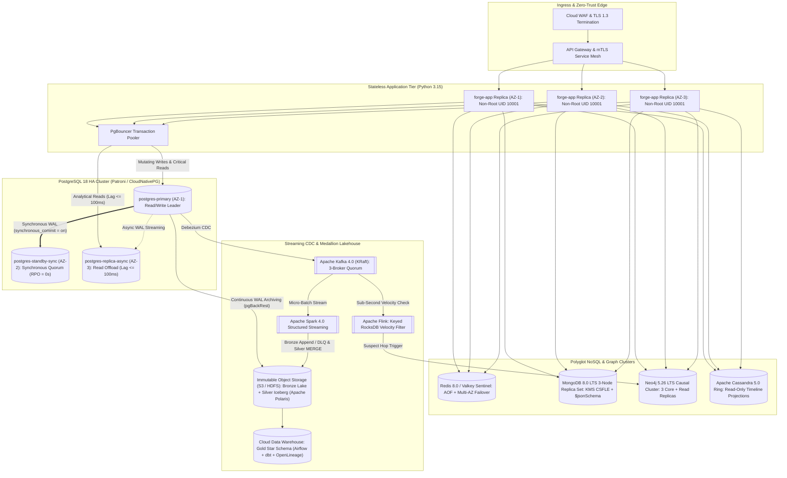

# Production Deployment, High Availability & Operations Runbook: GPMorgan Forge

**Document Identifier**: `OPS-GPMF-2026-001`  
**Platform Stack**: Python 3.15, PostgreSQL 18, CockroachDB, MongoDB 8.0 LTS, Neo4j 5.26 LTS, Redis 8.0 / Valkey, Apache Cassandra 5.0, TimescaleDB, Apache Kafka 4.0 (KRaft), Apache Flink, Apache Spark 4.0, Apache Iceberg (Apache Polaris), Trino, Airflow/dbt, OpenLineage, OpenTelemetry  
**Compliance Baseline**: Central Bank of Nigeria (CBN) IT Standards, NDPA 2023, EU GDPR, BCBS 239, PCI-DSS v4.0

---

## 1. Production Multi-AZ Topology & High Availability Architecture

In production, **GPMorgan Forge** deploys across three isolated Availability Zones (`AZ-1`, `AZ-2`, `AZ-3`) within the primary regional jurisdiction (Lagos / West Africa) paired with a multi-region active-active **CockroachDB** cluster (`RAFT_SERIALIZABLE_ZERO_RPO`) and encrypted cross-region **Apache Iceberg** Lakehouse archival.



---

## 2. Pre-Deployment Security & Infrastructure Checklist

Before promoting a release to production, verify the following mandatory controls:

1. **Secrets & Key Management Service (KMS)**:
   - Inject all database and catalog credentials (`POSTGRES_PASSWORD`, `POSTGRES_REPLICA_PASSWORD`, `REPLICATION_PASSWORD`, `MONGO_PASSWORD`, `NEO4J_AUTH`, `TIMESCALE_PASSWORD`, `POLARIS_OAUTH_CREDENTIAL`, plus Redis ACL credentials in production) via external secret managers (AWS Secrets Manager, HashiCorp Vault, or Kubernetes ExternalSecrets).
   - Provision the customer master key (`KMS_MASTER_KEY_ID=kms-ng-cbn-key-2026-01`, `FORGE_KMS_MASTER_KEY`) and KYC ZKP attestation seed (`FORGE_ZKP_ISSUER_SEED`) in Hardware Security Modules (HSM / Cloud KMS) for `AEAD_AES_256_GCM` field-level encryption and `Ed25519` ZKP credential signing.
2. **Encryption in Transit & At Rest**:
   - Enforce `TLS 1.3` (`sslmode=verify-full` for PostgreSQL 18, `tls=true` for MongoDB 8.0 LTS and Redis 8.0, `bolt+s://` for Neo4j 5.26 LTS).
   - Enable `AES-256` volume encryption on all nine persistent Compose/block volumes (`postgres_primary_data`, `postgres_replica_data`, `cockroachdb_data`, `mongodb_data`, `neo4j_data`, `redis_data`, `cassandra_data`, `timescaledb_data`, `kafka_data`) and S3/HDFS buckets.
3. **PostgreSQL 18 Production Engine Tuning (`postgresql.conf`)**:

   ```ini
   # Durability & Zero-RPO Synchronous Replication
   wal_level = logical
   synchronous_commit = on
   synchronous_standby_names = 'FIRST 1 (postgres_standby_sync)'
   archive_mode = on
   archive_command = 'pgbackrest --stanza=forge archive-push %p'

   # Memory & Cost-Based Optimiser Tuning
   shared_buffers = 8GB
   effective_cache_size = 24GB
   work_mem = 64MB
   maintenance_work_mem = 1GB
   random_page_cost = 1.1

   # Observability & Lock Safety
   shared_preload_libraries = 'pg_stat_statements'
   lock_timeout = '2s'
   idle_in_transaction_session_timeout = '10s'
   statement_timeout = '30s'
   row_security = on
   ```

---

## 3. Database Schema & Polyglot Initialization Sequence

Execute database migrations in a controlled, transactional pipeline before rolling out application containers:

### Step 1: PostgreSQL 18 Core Schema, Partitions, Indexes & Security Policies

```bash
# 1. Core 3NF/BCNF schema, domains, constraints, and immutability triggers (Portfolio 1)
psql "$POSTGRES_DSN" -v ON_ERROR_STOP=1 -f portfolio-1-database-design/schema.sql

# 2. Covering, partial, GIN indexes, and concurrent materialised views (Portfolio 2)
psql "$POSTGRES_DSN" -v ON_ERROR_STOP=1 -f portfolio-2-query-optimisation/indexes_and_views.sql

# 3. Declarative quarterly range partitions and modulus-4 hash shards (Portfolio 5)
psql "$POSTGRES_DSN" -v ON_ERROR_STOP=1 -f portfolio-5-distributed-cloud/partitioning_and_sharding.sql

# 4. Least-privilege RBAC roles, RLS policies, masked views, and NDPA erasure functions (Portfolio 5)
psql "$POSTGRES_DSN" -v ON_ERROR_STOP=1 -f portfolio-5-distributed-cloud/security_rbac_rls_privacy.sql
```

### Step 2: CockroachDB Multi-Region & TimescaleDB Hypertable Initialization

```bash
# CockroachDB active-active corridor settlement DDL
cockroach sql --url "$COCKROACH_DSN" -f portfolio-5-distributed-cloud/infra/cockroach/init-multi-region.sql

# TimescaleDB FX liquidity hypertable and continuous aggregate DDL
psql "$TIMESCALE_DSN" -v ON_ERROR_STOP=1 -f portfolio-5-distributed-cloud/infra/timescaledb/init-hypertable.sql
```

### Step 3: MongoDB 8.0 LTS Document Validators & TTL Indexes

```bash
mongosh "$MONGO_URI" --file portfolio-4-nosql/mongodb_document_model.js
```

### Step 4: Neo4j 5.26 LTS Uniqueness Constraints & Property Indexes

```bash
cypher-shell -a "$NEO4J_URI" -u "$NEO4J_USER" -p "$NEO4J_PASSWORD" \
  -f portfolio-4-nosql/neo4j_fraud_graph.cypher
```

### Step 5: Apache Cassandra 5.0 Timeline Keyspace & Table Initialization

```bash
cqlsh "$CASSANDRA_HOST" "${CASSANDRA_CQL_PORT:-9042}" \
  -f portfolio-4-nosql/cassandra_timeline_projection.cql
```

### Step 6: Trino Iceberg Schemas & Debezium Logical-Decoding CDC Connector

```bash
# Idempotently ensure Bronze, DLQ, Silver, and Gold Iceberg namespaces/tables via Trino + Polaris
# (spark-streaming's bronze_to_silver.py also self-bootstraps these tables on container startup)
trino --server "$TRINO_COORDINATOR_URI" -f portfolio-5-distributed-cloud/lakehouse/trino/init_iceberg_tables.sql

# Register the PostgreSQL pgoutput CDC connector with Debezium Kafka Connect
curl -fsS -X PUT -H "Content-Type: application/json" \
  "http://localhost:${DEBEZIUM_PORT:-8083}/connectors/forge-postgres-ledger-cdc/config" \
  --data "$(jq .config portfolio-5-distributed-cloud/lakehouse/debezium/postgres-ledger-connector.json)"
```

---

## 4. Container Image Build & Production Rollout

The multi-stage [`Dockerfile`](../Dockerfile) compiles dependencies in an isolated builder stage and produces a minimal Python 3.15 runtime image running as unprivileged user `forge` (`UID 10001`). In [`compose.yaml`](../compose.yaml), `forge-app` runs as a one-shot verification container (whereas in Kubernetes/cloud production, the same hardened image runs stateless API worker replicas behind PgBouncer):

```bash
# 1. Provision TLS 1.3 certificates (local Compose dev/staging; use Vault/ACM PKI in production)
uv run python scripts/generate_dev_tls.py

# 2. Build and tag the hardened production runtime image
docker build --target runtime -t registry.gpmorganforge.internal/forge-app:1.0.0 .

# 3. Validate the Compose production topology
docker compose -f compose.yaml --profile full config -q

# 4. Start the polyglot database and Lakehouse services
docker compose -f compose.yaml --profile core --profile nosql --profile distributed --profile lakehouse up -d
```

### Post-Deployment Smoke & Ledger Invariant Verification

Immediately after service startup, run a one-shot verification container probe:

```bash
docker compose -f compose.yaml --profile test run --rm forge-app \
  python -m gpmorgan_forge.evidence_generator --verify
```

Confirm that:

- `portfolio_1_ledger_audit.is_balanced` is `true` ($\sum \text{DEBIT} = \sum \text{CREDIT}$).
- `portfolio_1_ledger_audit.hash_chain_valid` is `true` (`tampered_log_ids = []`).
- `portfolio_3_concurrency.deadlock_prevented` is `true`.
- `portfolio_5_distributed_privacy.rbac_rls_verified` and `zkp_verified` are `true`.

---

## 5. Day-2 Zero-Downtime Operations

### 5.1 Concurrent Materialised View Refreshes

Never refresh analytical materialised views without `CONCURRENTLY` during market hours, as a standard refresh acquires an `ACCESS EXCLUSIVE` lock blocking concurrent readers:

```sql
REFRESH MATERIALIZED VIEW CONCURRENTLY mv_daily_corridor_settlement;
REFRESH MATERIALIZED VIEW CONCURRENTLY mv_customer_liquidity_360;
```

### 5.2 Quarterly Partition Pre-Creation & Cold Lakehouse Archival

1. **Pre-Create Upcoming Quarterly Partitions** (30 days before quarter start):

   ```sql
   CREATE TABLE IF NOT EXISTS transactions_part_2027_q2
       PARTITION OF transactions_partitioned
       FOR VALUES FROM ('2027-04-01 00:00:00+00') TO ('2027-07-01 00:00:00+00');
   ```

2. **Detach & Archive Expired Hot Partitions** (without `DELETE` vacuum bloat):

   ```sql
   ALTER TABLE transactions_partitioned
       DETACH PARTITION transactions_part_2026_q3 CONCURRENTLY;
   ```

   Export the detached table to immutable Parquet files in `s3://forge-datalake-bronze/archive/` for 7-year CBN statutory retention before dropping the local table.

---

## 6. Backup, Point-in-Time Recovery (PITR) & Failover Runbook

| Failure Scenario | Target RTO | Target RPO | Automated / Manual Recovery Procedure |
| :--- | :--- | :--- | :--- |
| **Single `forge-app` Container Crash** | `< 5 seconds` | `0 seconds` | Container orchestrator restarts stateless worker; active in-flight requests retry safely using Redis `SET ... NX EX` idempotency keys. |
| **Read Replica Lag Spike (`> 100 ms`)** | `0 seconds` (Instant) | `0 seconds` | `DistributedClusterRouter.route_operation` in [`distributed_privacy.py`](../src/gpmorgan_forge/distributed_privacy.py) automatically routes read queries back to `postgres-primary`, preserving Read-Your-Writes consistency. |
| **Primary Database (`AZ-1`) Outage** | `< 30 seconds` | `0 seconds` | Patroni / CloudNativePG promotes `postgres-standby-sync` (`AZ-2`), which holds every committed WAL record via `synchronous_commit = on`. |
| **Accidental Data Corruption / Operator Error** | `< 15 minutes` | `< 1 second` | Restore latest nightly base backup via `pgBackRest` and replay continuous WAL segments up to the exact transaction timestamp prior to the incident. |

### Post-Recovery Integrity Audit

After any failover or PITR restoration, run `audit_account_balances` in [`operations.py`](../src/gpmorgan_forge/operations.py) and Query 3 in [`queries.sql`](../portfolio-2-query-optimisation/queries.sql) to verify zero discrepancy between `accounts.balance` and `ledger_entries`, and full continuity of `transaction_audit_logs` SHA-256 hashes.

---

## 7. Production Observability & Compliance Monitoring

1. **Key Database Golden Signals**:
   - **Replication Lag**: Alert at `> 50 ms` warning, `> 100 ms` automatic read-replica shedding.
   - **Lock Contention & Deadlocks**: Monitor `pg_stat_database.deadlocks` (expected: `0` due to canonical ascending-UUID lock ordering) and `pg_locks` wait queues `> 500 ms`.
   - **Buffer Cache Hit Ratio**: Maintain `pg_statio_user_tables` heap and index hit ratio `> 99.0%`.
2. **Continuous Ledger, Lineage & OpenTelemetry Database Observability (`DatabaseTelemetryTracer`)**:
   - Schedule `audit_account_balances()` every 5 minutes; page on-call SREs and Compliance Officers immediately if `is_balanced = False` or `hash_chain_valid = False`.
   - Export W3C TraceContext spans (`db.system`, `db.operation.name`) via **OpenTelemetry** (`DatabaseTelemetryTracer` in [`distributed_privacy.py`](../src/gpmorgan_forge/distributed_privacy.py)) across `redis_valkey -> postgresql_cockroachdb -> kafka_kraft -> apache_flink -> neo4j_cypher -> apache_iceberg_trino`, enforcing end-to-end pipeline SLA `< 50 ms`.
   - Stream all `transaction_audit_logs`, `openlineage_events` (**BCBS 239 / NDPA 2023**), and `fraud_alerts` (`severity IN ('HIGH', 'CRITICAL')`) to the SIEM and Compliance DPO dashboard.
