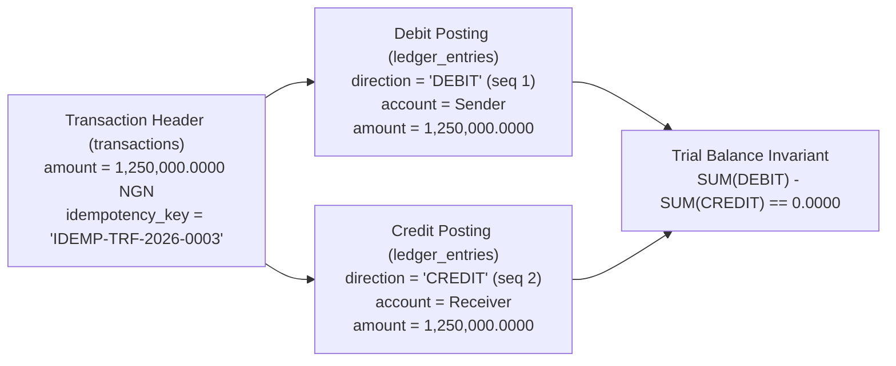

# ADR 0001: Double-Entry Immutable General Ledger & 3NF/BCNF Core Schema

- **Status**: Accepted
- **Date**: 2026-11-08
- **Deciders**: Core Banking Architecture Team
- **Related Deliverables**: [`portfolio-1-database-design/schema.sql`](../../portfolio-1-database-design/schema.sql), [`src/gpmorgan_forge/operations.py`](../../src/gpmorgan_forge/operations.py)

---

## Context

Digital banking platforms frequently fail audit scrutiny when account balances are modelled as simple mutable floating-point columns updated in-place (`UPDATE accounts SET balance = balance - 100`). In-place balance mutation without an underlying journal suffers from three critical defects:

1. **Unexplained Balance Drift**: Partial updates or application bugs can alter an account balance without leaving a corresponding contra-entry, making reconciliation impossible.
2. **Floating-Point Precision Loss**: IEEE-754 binary floating-point types (`FLOAT`/`REAL`) cannot represent base-10 fractions such as `0.10` or `0.01` exactly, causing cumulative rounding discrepancies across millions of ledger postings.
3. **Audit Tampering Risk**: Mutable transaction rows allow historical manipulation unless guarded by database-enforced append-only triggers and cryptographic hash chaining.

---

## Decision

1. **Strict 3NF/BCNF Relational Core (10 Normalized Tables in PostgreSQL 18)**: All customer (`customers`, `kyc_records`, `consent_records`), account (`accounts`, `beneficiaries`, `payment_cards`), transaction (`transactions`, `ledger_entries`), audit (`transaction_audit_logs`), and risk (`fraud_alerts`) entities are normalized to Third Normal Form (3NF) and Boyce-Codd Normal Form (BCNF), ensuring every non-trivial functional dependency $X \to Y$ has a superkey determinant $X$.
2. **Exact Base-10 Monetary Arithmetic**: Every monetary column (`balance`, `available_balance`, `daily_transfer_limit`, `amount`, `fee_amount`, `balance_before`, `balance_after`) uses `NUMERIC(19, 4)` in SQL and `decimal.Decimal` with `ROUND_HALF_EVEN` (banker's rounding) in Python 3.15.
3. **Double-Entry Journal Invariant**: Every financial movement (`transfer_funds`, `process_deposit`, `process_withdrawal`, `reverse_failed_transaction`) creates one parent row in `transactions` and two balanced child legs in `ledger_entries`: one `DEBIT` on the source account (`entry_sequence = 1`) and one `CREDIT` on the destination account (`entry_sequence = 2`), checked by `chk_ledger_entries_balance_math`. At the end of every transaction, the global invariant holds:
   $$\sum \text{DEBIT} - \sum \text{CREDIT} = 0.0000$$
4. **Trigger-Enforced Append-Only Ledger & SHA-256 Hash-Chained Audit Trail**: Both `ledger_entries` (`trg_immutable_ledger_entries`) and `transaction_audit_logs` (`trg_immutable_audit_logs`) are protected by `BEFORE UPDATE OR DELETE` triggers (`fn_prevent_immutable_mutation()`) and verified by `audit_account_balances()`.

---

## Consequences

- **Positive**: Complete historical reconstructability of any account balance at any point in time; zero floating-point rounding drift; cryptographic hash-chain tamper evidence; immediate compliance with CBN and external statutory audit standards.
- **Negative / Trade-offs**: Each transfer writes 1 transaction header + 2 ledger entries + 1 audit log + updates 2 account rows (mitigated via covering B-Tree indexes and synchronous WAL group commit).
