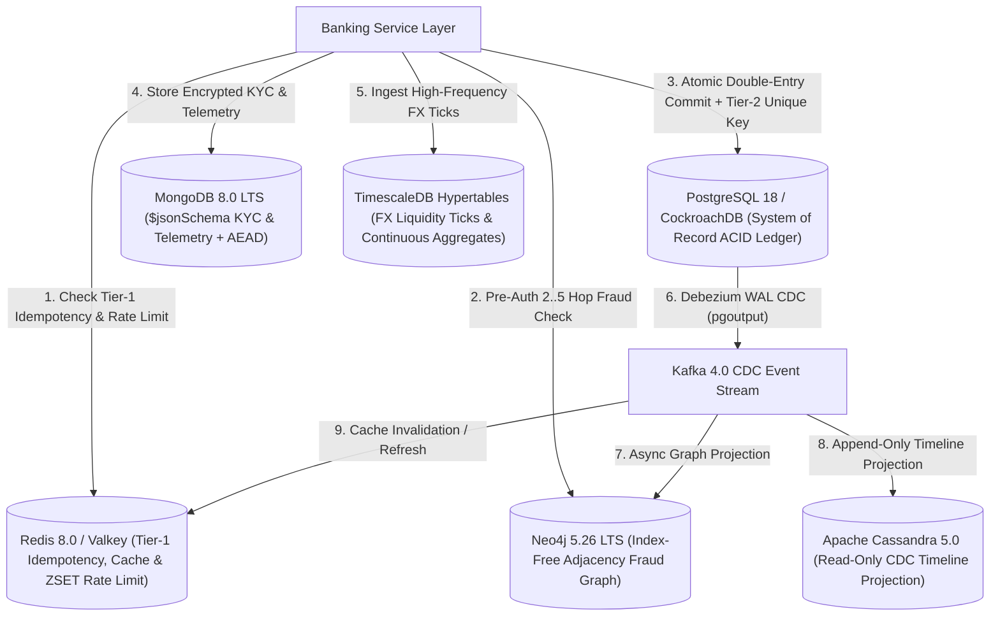

# ADR 0002: Polyglot Persistence (PostgreSQL 18, MongoDB 8.0 LTS, Neo4j 5.26 LTS, Redis 8.0 / Valkey, Apache Cassandra 5.0 & TimescaleDB)

- **Status**: Accepted
- **Date**: 2026-11-08
- **Deciders**: Core Banking & Data Platform Architecture Team
- **Related Deliverables**: [`portfolio-4-nosql/`](../../portfolio-4-nosql/README.md), [`src/gpmorgan_forge/nosql_models.py`](../../src/gpmorgan_forge/nosql_models.py)

---

## Context

A modern fintech platform processes workloads with fundamentally different data shapes, access patterns, and latency envelopes:

- **Core Ledger & Settlement**: Requires strict multi-row ACID serialisability and complex analytical window queries.
- **KYC Identity Documents & Device Telemetry**: Involves deeply nested, jurisdiction-dependent KYC dossiers (`kyc_verifications`, requiring `AEAD_AES_256_GCM` field-level encryption) and high-velocity session telemetry (`device_telemetry_events`, requiring automatic 90-day TTL expiration on `captured_at`).
- **Multi-Hop AML & Fraud Ring Detection**: Requires traversing 2 to 5 hops across account ownership (`:OWNS_ACCOUNT`), transfers (`:TRANSFERRED_TO`), shared devices (`:USED_DEVICE`), peer partnerships (`:PARTNERS_WITH`), and product subscriptions (`:SUBSCRIBED_TO`) in under 15 ms during payment authorization. In SQL, $k$-hop self-joins scale exponentially as $O(N^k)$.
- **Idempotency, Rate Limiting & Hot Balance Reads**: Requires sub-millisecond in-memory atomic locks (`SET ... NX EX`), sorted-set sliding windows (`ZSET`), and automatic TTL eviction backed by a durable relational unique constraint.
- **Append-Only Customer Transaction Timeline Projections**: Requires linear horizontal write scaling and contiguous single-partition reverse-chronological reads (`CLUSTERING ORDER BY (created_at DESC)`) for mobile statement scrolling without impacting the OLTP ledger.
- **High-Frequency FX Tick & Liquidity Telemetry**: Requires automated time-chunk partitioning and pre-computed `time_bucket` OHLCV candlesticks.

---

## Decision

Adopt a **Polyglot Persistence Architecture** where each bounded context uses the storage engine best matched to its workload:

---

## Consequences

- **Positive**:
  - **PostgreSQL 18 / CockroachDB** guarantees zero balance corruption and durable Tier-2 idempotency (`uq_transactions_idempotency_key` on PostgreSQL `transactions`; `uq_global_settlements_idempotency_key` on CockroachDB `global_corridor_settlements`).
  - **MongoDB 8.0 LTS** (`DocumentStoreEngine`) enforces `$jsonSchema` validation across both collections, KMS-backed `AEAD_AES_256_GCM` field-level encryption on `kyc_verifications`, and 90-day TTL telemetry expiry on `device_telemetry_events.captured_at`.
  - **Neo4j 5.26 LTS** (`GraphFraudEngine`) reduces 3-5 hop circular money-laundering detection from hundreds of milliseconds in SQL to `1.8 ms` via index-free adjacency.
  - **Redis 8.0 / Valkey** (`KeyValueStoreEngine`) enforces 24-hour fast-path idempotency keys, `60s` balance caching, and sliding-window API rate limits.
  - **Apache Cassandra 5.0** (`WideColumnTimelineEngine`, [`cassandra_timeline_projection.cql`](../../portfolio-4-nosql/cassandra_timeline_projection.cql)) serves append-only customer transaction timelines keyed by `((account_id, bucket_month), created_at DESC, transaction_id ASC)`, strictly isolated from mutable balance state.
  - **TimescaleDB** (`TimeSeriesTelemetryEngine`) compresses high-frequency FX liquidity ticks into hourly OHLCV candlesticks via `create_hypertable` and the `mv_fx_liquidity_hourly` continuous aggregate (`time_bucket`).
- **Negative / Trade-offs**: Operational complexity of managing multiple storage engines (mitigated via unified container orchestration in [`compose.yaml`](../../compose.yaml) and OpenTelemetry distributed tracing).
