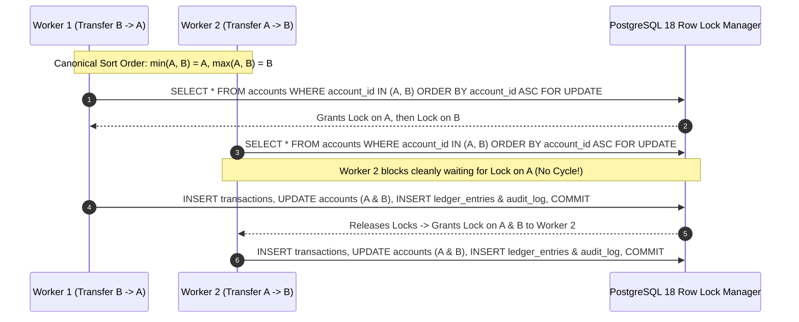

# ADR 0003: Concurrency Control, Canonical Lock Ordering & Idempotency

- **Status**: Accepted
- **Date**: 2026-11-08
- **Deciders**: Core Ledger Engineering Team
- **Related Deliverables**: [`portfolio-3-transactions-concurrency/`](../../portfolio-3-transactions-concurrency/README.md), [`src/gpmorgan_forge/concurrency.py`](../../src/gpmorgan_forge/concurrency.py)

---

## Context

Under high-concurrency payment workloads (e.g., salary disbursements, merchant settlements, or concurrent mobile retries), three classic concurrency hazards threaten ledger integrity:

1. **Lost Update Anomaly**: Two concurrent workers read the same `available_balance`, compute independent deductions in memory, and overwrite each other's updates.
2. **AB-BA Bidirectional Deadlocks**: Worker 1 transfers from Account $A \to B$ (locking $A$ then $B$) while Worker 2 simultaneously transfers from Account $B \to A$ (locking $B$ then $A$), creating a cyclic wait graph (`SQLSTATE 40P01`).
3. **Duplicate Network Retries**: Mobile clients experiencing packet loss retry transfer requests, risking double-debiting the customer.

---

## Decision

1. **Canonical Ascending-UUID Pessimistic Locking (`SELECT ... FOR UPDATE`)**: Whenever a transfer modifies two accounts, `compute_canonical_lock_schedule` in [`concurrency.py`](../../src/gpmorgan_forge/concurrency.py) sorts the pair of account UUIDs in strict ascending order, acquired sequentially via `SELECT ... FOR UPDATE` in `_lock_accounts_canonically` ([`operations.py`](../../src/gpmorgan_forge/operations.py)) or as `WHERE account_id IN (A, B) ORDER BY account_id ASC FOR UPDATE` ([`transactions_and_locks.sql`](../../portfolio-3-transactions-concurrency/transactions_and_locks.sql)). Because every worker acquires locks along a strict total order (a Directed Acyclic Graph), circular wait cycles are mathematically impossible.
2. **Optimistic Concurrency Control (OCC) via Monotonic `version` Fencing**: Every `accounts` row carries an integer `version` column incremented on every write (`transfer_funds` in [`operations.py`](../../src/gpmorgan_forge/operations.py) and `simulate_optimistic_concurrency_conflict` in [`concurrency.py`](../../src/gpmorgan_forge/concurrency.py)). If the caller's `expected_source_version` does not match the current `account.version`, an `OptimisticLockError` is raised before any balance mutation occurs.
3. **Savepoint Sub-Transaction Isolation (`SAVEPOINT`)**: Multi-recipient payroll batches (`execute_batch_transfers_with_savepoints` in [`concurrency.py`](../../src/gpmorgan_forge/concurrency.py)) wrap each leg in a database savepoint (`session.begin_nested()`) so failed legs roll back cleanly without aborting prior settled legs.
4. **Two-Tier End-to-End Idempotency Defence (Redis 8.0 / Valkey + PostgreSQL / CockroachDB)**: Every transfer requires a client-generated `idempotency_key` verified across two complementary tiers (`KeyValueStoreEngine.verify_two_tier_idempotency` in [`nosql_models.py`](../../src/gpmorgan_forge/nosql_models.py)):
   - **Tier 1 (Sub-Millisecond Fast-Path Filter)**: Cached in Redis 8.0 / Valkey (`SET forge:idemp:{key} ... NX EX 86400`) to absorb duplicate network retries in memory without touching the relational lock manager.
   - **Tier 2 (Durable Ledger Enforcement)**: Enforced by mandatory database unique constraints (`uq_transactions_idempotency_key` in PostgreSQL 18 and `uq_global_settlements_idempotency_key` in CockroachDB) so that cache TTL eviction or Redis node failover never permits duplicate financial settlement.

---

## Consequences

- **Positive**: Zero lost updates; complete elimination of AB-BA deadlocks across bidirectional transfers; resilient partial batch settlement; safe client retries under flaky mobile networks.
- **Negative / Trade-offs**: Hot settlement accounts experience brief lock queuing under burst traffic (mitigated by keeping transaction scopes under `5 ms`).
