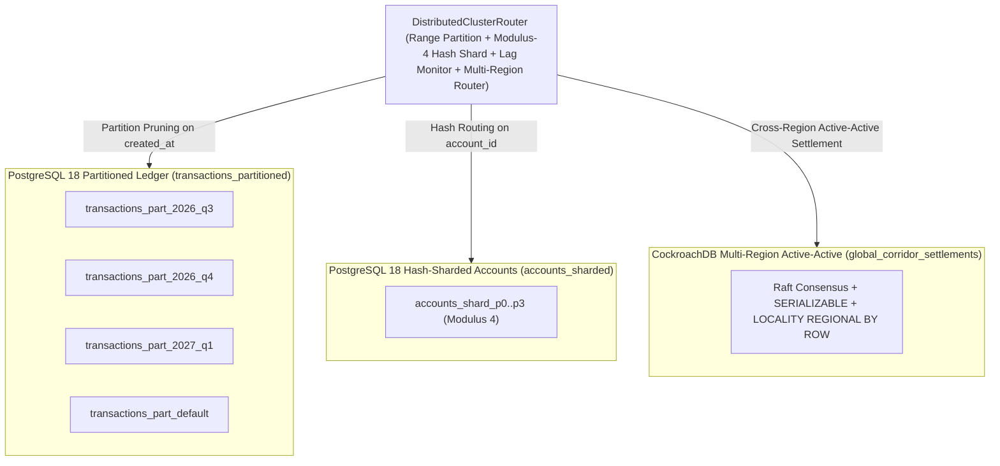

# ADR 0004: Declarative Range Partitioning, Hash Sharding, Lag-Aware Replication & CockroachDB Multi-Region Active-Active SQL

- **Status**: Accepted
- **Date**: 2026-11-08
- **Deciders**: Distributed Systems & Infrastructure Team
- **Related Deliverables**: [`portfolio-5-distributed-cloud/partitioning_and_sharding.sql`](../../portfolio-5-distributed-cloud/partitioning_and_sharding.sql), [`src/gpmorgan_forge/distributed_privacy.py`](../../src/gpmorgan_forge/distributed_privacy.py)

---

## Context

As transaction volume grows beyond hundreds of millions of rows per year across domestic (`NGN`) and cross-border (`USD`, `GBP`, `EUR`) settlement corridors:

1. A monolithic unpartitioned `transactions` table suffers from B-Tree index bloat, buffer pool thrashing, and slow `VACUUM` cycles.
2. High-concurrency salary bursts on `accounts` create B-Tree root-page contention unless distributed across horizontal hash shards.
3. Single-node databases represent a Single Point of Failure (SPOF) during hardware or Availability Zone outages, while asynchronous read replicas risk serving stale balances if replication lag spikes.
4. Multi-region cross-border settlement requires active-active survivability (`RPO = 0`) across sovereign cloud regions without single-leader cross-continent write bottlenecks.

---

## Decision

1. **Quarterly Declarative Range Partitioning (`PARTITION BY RANGE (created_at)`)**: Partition `transactions_partitioned` into quarterly child tables (`transactions_part_2026_q3`, `transactions_part_2026_q4`, `transactions_part_2027_q1`, plus `transactions_part_default`). Queries bounded by `created_at` trigger automatic PostgreSQL 18 **Partition Pruning**, scanning only the relevant quarterly child partition(s).
2. **Declarative Hash Sharding (`PARTITION BY HASH (account_id)`)**: Partition `accounts_sharded` across 4 modulus shards (`accounts_shard_p0` through `accounts_shard_p3` with `MODULUS 4, REMAINDER 0..3`) and route account keys deterministically via `DistributedClusterRouter.resolve_hash_shard` in [`distributed_privacy.py`](../../src/gpmorgan_forge/distributed_privacy.py).
3. **Lag-Aware Primary / Replica Routing (`CAP / PACELC`)**:
   - **Primary Node (`postgres-primary`)**: Handles intra-region mutating writes (`synchronous_commit = on`, `CP / PC-EC`).
   - **Read Replicas (`postgres-replica`)**: Serve analytical and statement reads when `replica_lag_ms <= 100 ms`. If replication lag exceeds `100 ms`, `DistributedClusterRouter.route_operation` in [`distributed_privacy.py`](../../src/gpmorgan_forge/distributed_privacy.py) automatically fails over reads to `postgres-primary` to guarantee **Read-Your-Writes consistency**.
4. **Multi-Region Active-Active Distributed SQL (CockroachDB Integration)**: Pair **PostgreSQL 18** (single-region sub-millisecond ACID ledger) with **CockroachDB** (`cockroachdb-multi-region`, `global_corridor_settlements` in [`partitioning_and_sharding.sql`](../../portfolio-5-distributed-cloud/partitioning_and_sharding.sql)) using per-range **Raft consensus**, `LOCALITY REGIONAL BY ROW`, and strict **`SERIALIZABLE` isolation** for zero-RPO cross-region corridor survivability (`is_cross_region=True`).

---

## Consequences

- **Positive**: Index trees stay compact in RAM; historical quarters can be detached (`ALTER TABLE ... DETACH PARTITION CONCURRENTLY`) and archived to S3/HDFS in milliseconds without `VACUUM` overhead; zero stale balance reads during replication lag spikes; zero-RPO multi-region survivability via CockroachDB Raft consensus.
- **Negative / Trade-offs**: Primary keys on range-partitioned tables must include the partition key `(transaction_id, created_at)`.
