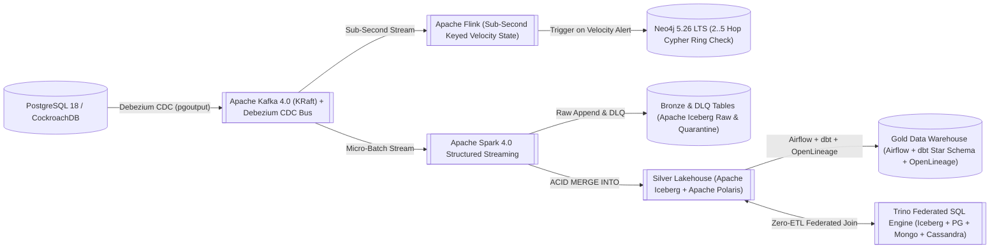

# ADR 0005: Open Table Medallion Lakehouse (Kafka 4.0 + Flink + Spark 4.0 + Apache Iceberg + Apache Polaris + Trino + Airflow/dbt + OpenLineage)

- **Status**: Accepted
- **Date**: 2026-11-08
- **Deciders**: Data Engineering & Analytics Architecture Team
- **Related Deliverables**: [`portfolio-5-distributed-cloud/`](../../portfolio-5-distributed-cloud/README.md), [`src/gpmorgan_forge/distributed_privacy.py`](../../src/gpmorgan_forge/distributed_privacy.py)

---

## Context

Banking streaming and analytical workloads span distinct latency and governance regimes:

- **Real-Time Stateful Stream Processing (Sub-Second Latency)**: High-velocity payment events require sub-second sliding-window velocity and structuring detection *before* triggering multi-hop Cypher traversals in Neo4j 5.26 LTS.
- **Data Lake (Bronze / Raw Layer, Schema-on-Read)**: High-volume, high-velocity, multi-variety data (**Volume, Velocity, Variety, Veracity**) including raw CDC transaction streams, mobile clickstreams, and KYC media stored on **AWS S3 / Hadoop HDFS** in **Apache Iceberg** open table format and processed via **Apache Spark 4.0** (micro-batch streaming and ML feature engineering) or **Hadoop MapReduce** (cost-effective historical batch backfills).
- **Catalog Versioning, Time-Travel & Federated Governance**: Central bank audits (**CBN** and **BCBS 239** Principles for Effective Risk Data Aggregation) require exact point-in-time historical reproducibility (`FOR SYSTEM_TIME AS OF` / `FOR SYSTEM_VERSION AS OF`), centralized Iceberg REST catalog governance with RBAC, short-lived storage credential vending, and native Iceberg table-level branching/tagging (**Apache Polaris**, selected as the single deployed ASF Iceberg REST catalog over **Project Nessie** to enforce zero-trust credential vending across multi-engine compute), zero-ETL federated SQL across operational and analytical stores (**Trino**), orchestrated Gold Star-Schema transformations (**Apache Airflow + dbt**), and dataset and run-level lineage (**OpenLineage**).

---

## Decision

Implement an **Open Table Medallion Lakehouse & Stateful Streaming Architecture** (`FlinkStatefulVelocityEngine`, `MedallionLakehousePipeline`, and `DatabaseTelemetryTracer` in [`distributed_privacy.py`](../../src/gpmorgan_forge/distributed_privacy.py)):

1. **Ingestion Bus (Apache Kafka 4.0 KRaft)**: Captures real-time CDC events (`publish_to_kafka`) from PostgreSQL 18 / CockroachDB and mobile telemetry streams.
2. **Real-Time Stateful Stream Processor (Apache Flink)**: Evaluates sub-second sliding-window velocity and structuring rules (`FlinkStatefulVelocityEngine.process_stream_event`) using keyed RocksDB state before triggering **Neo4j 5.26 LTS** multi-hop Cypher ring detection.
3. **Bronze & Silver Open Table Lakehouse (Apache Iceberg + Apache Polaris + Apache Spark 4.0)**: Consumes `forge.cdc.transactions` via Spark 4.0 Structured Streaming (`bronze_to_silver.py`) to append immutable raw and quarantined Iceberg tables (`bronze_transactions`, `dlq_transactions`) on S3/HDFS and `MERGE` deduplicated `silver_transactions` with ACID snapshot isolation, **Apache Polaris** REST catalog governance (RBAC, vended storage credentials, and native Iceberg table branching/tagging `main`, `audit-2026-q4`), and time-travel queries (`query_iceberg_time_travel`).
4. **Federated Query, Orchestration & Lineage Governance (Trino + Apache Airflow & dbt + OpenLineage)**: Executes federated cross-engine joins across Iceberg, PostgreSQL, MongoDB, and Cassandra (`execute_trino_federated_query`), builds Gold Star-Schema warehouse models via **Airflow + dbt**, and emits cryptographically verifiable **OpenLineage** events enforcing **BCBS 239**, **NDPA 2023**, and **GDPR**.

## Implementation Status

| Component | Status | Artifact |
| :--- | :--- | :--- |
| PostgreSQL CDC to Kafka (Debezium, `pgoutput`) | Deployable config | [`postgres-ledger-connector.json`](../../portfolio-5-distributed-cloud/lakehouse/debezium/postgres-ledger-connector.json), `wal_level=logical` in [`compose.yaml`](../../compose.yaml) |
| Spark 4.0 streaming: Bronze, data contract, dead-letter queue, idempotent `MERGE` | Deployable job | [`bronze_to_silver.py`](../../portfolio-5-distributed-cloud/lakehouse/spark/bronze_to_silver.py) |
| Gold star schema with data tests and reconciliation | Deployable dbt project (SQL executed in tests) | [`dbt_project.yml`](../../portfolio-5-distributed-cloud/lakehouse/dbt/dbt_project.yml), [`fact_corridor_settlement.sql`](../../portfolio-5-distributed-cloud/lakehouse/dbt/models/marts/fact_corridor_settlement.sql) |
| Batch orchestration and lineage | Deployable Airflow DAG | [`forge_medallion_dag.py`](../../portfolio-5-distributed-cloud/lakehouse/airflow/dags/forge_medallion_dag.py) |
| Trino federation across Iceberg, PostgreSQL, MongoDB, Cassandra | Deployable catalogs & Iceberg DDL | [`iceberg.properties`](../../portfolio-5-distributed-cloud/lakehouse/trino/catalog/iceberg.properties), [`init_iceberg_tables.sql`](../../portfolio-5-distributed-cloud/lakehouse/trino/init_iceberg_tables.sql) |
| OpenTelemetry OTLP trace collector | Deployable config | [`otel-collector-config.yaml`](../../portfolio-5-distributed-cloud/lakehouse/otel/otel-collector-config.yaml) |
| Flink velocity job | Simulated in Python only (`FlinkStatefulVelocityEngine`); the Compose JobManager has no job or TaskManager | [`distributed_privacy.py`](../../src/gpmorgan_forge/distributed_privacy.py) |
| Hadoop HDFS / MapReduce backfills | Architectural option only | None |

The deployables are validated statically and through executed dbt SQL in
[`test_lakehouse_artifacts.py`](../../tests/integration/test_lakehouse_artifacts.py); a full cluster run is not part of the automated suite.

---

## Consequences

- **Positive**: Sub-second stateful fraud velocity filtering via Apache Flink protects Neo4j from unnecessary graph traversals; Apache Iceberg + Apache Polaris provides zero-trust storage credential vending, RBAC, exact point-in-time historical reproducibility, and native table branch isolation for CBN/BCBS 239 audits; Trino eliminates brittle ETL duplication across polyglot engines; OpenLineage provides end-to-end dataset and run-level provenance; the dead-letter queue and idempotent `MERGE` make the pipeline replay-safe, and the reconciliation test proves no event is lost between layers.
- **Negative / Trade-offs**: Requires managing Iceberg metadata compaction and Apache Polaris snapshot expiration policies; the 17-service stack is heavy for a single developer machine (use Compose profiles).
