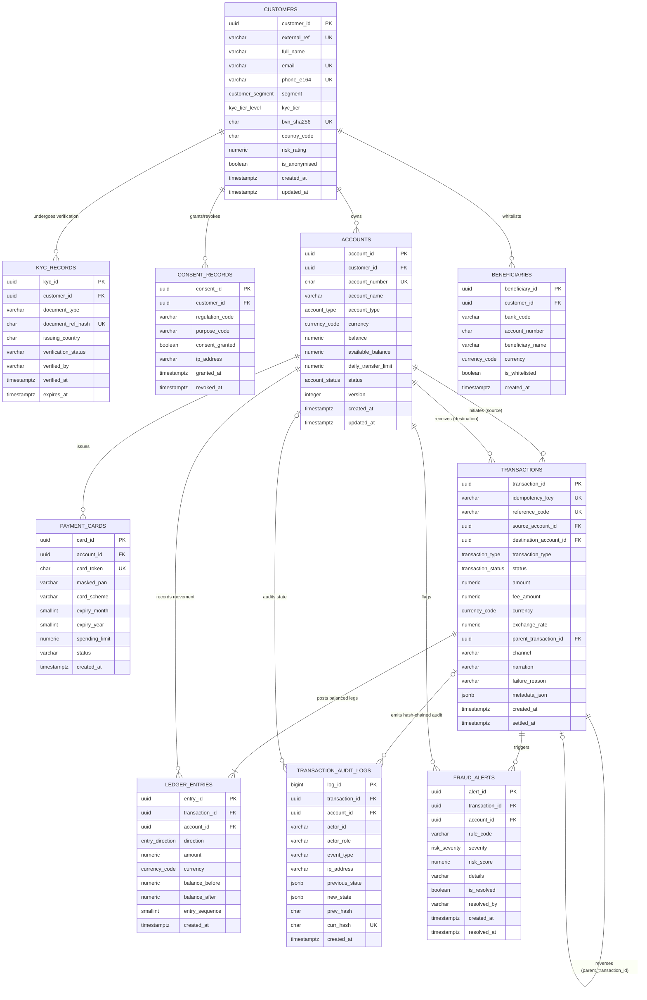
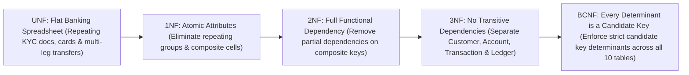
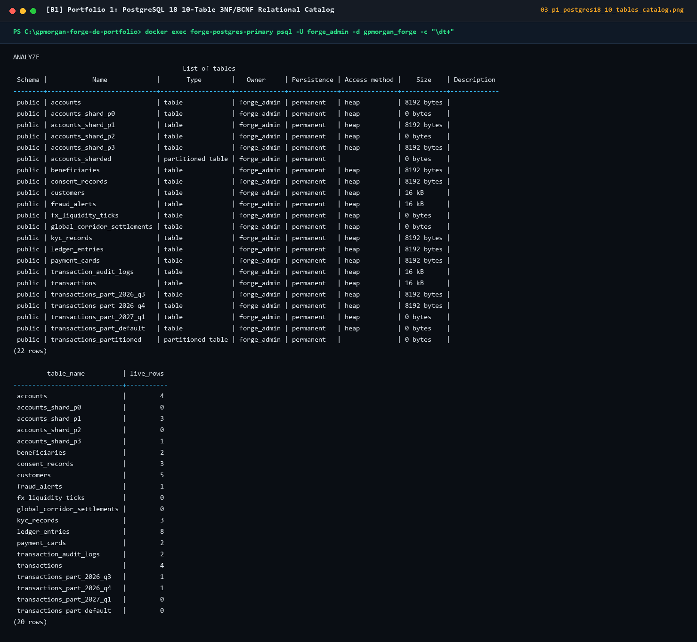
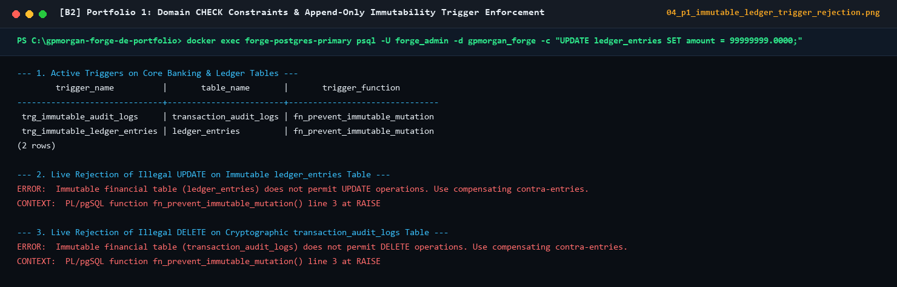
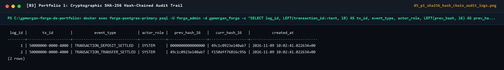
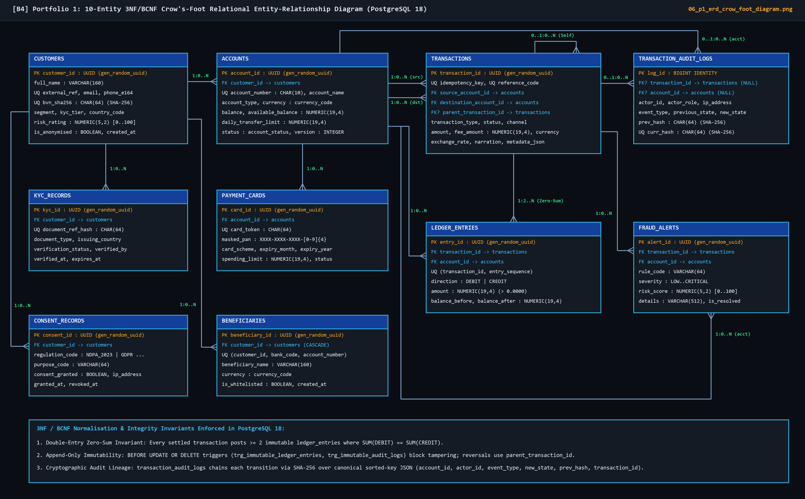

# Portfolio 1: Database Design and Modelling | GPMorgan Forge

> [!IMPORTANT]
> **Platform Domain**: Multi-Currency Core Banking, Double-Entry Ledger & Payment Processing
> **Storage Engine**: PostgreSQL 18 (3NF / BCNF Normalized Relational Core)

---

## 1. Selected Case Study & Organisation Statement

### 1.1 Organisation Name & Scenario

**GPMorgan Forge** is a multi-currency digital banking, core double-entry ledger, real-time payment rails, and financial crime intelligence platform operating across West Africa (Nigeria: NGN) and international settlement corridors (USD, GBP, EUR). The platform provides retail wallets, SME operating accounts, corporate treasury management, instant interbank transfers, card issuing, and automated anti-money-laundering (AML) graph analytics.

### 1.2 Nature of the Business & System

Modern financial technology platforms require strict **ACID transactional guarantees** for monetary state transitions alongside **polyglot persistence** for semi-structured KYC onboarding, sub-millisecond idempotency/caching, multi-hop graph fraud detection, and petabyte-scale analytical lakehouse reporting. GPMorgan Forge enforces a **zero-sum double-entry accounting invariant** ($\sum \text{Debits} = \sum \text{Credits}$) and a **cryptographic SHA-256 hash-chained audit trail** to guarantee regulatory compliance under the **Central Bank of Nigeria (CBN)**, **Nigeria Data Protection Act (NDPA) 2023**, **GDPR**, and **PCI-DSS v4.0**.

### 1.3 Users of the Database

| User Persona / Role | Access Pattern | Database Privileges & Scope |
| :--- | :--- | :--- |
| **Retail, SME & Corporate Customers** (`forge_customer`) | Check balances, fund accounts, transfer funds, manage beneficiaries & cards, manage privacy consents. | Row-Level Security (RLS) on `customers` and `accounts` restricted strictly to their own `customer_id` records (`app.current_customer_id`). |
| **Core Payment & Ledger Engine** (`forge_core_service`) | Execute atomic transfers, deposits, withdrawals, contra-entry reversals, and append ledger/audit entries. | `SELECT`, `INSERT`, `UPDATE` on operational tables; append-only (`INSERT`) on `ledger_entries` and `transaction_audit_logs`. |
| **Compliance Officers & DPOs** (`forge_compliance_dpo`) | Review KYC verification records, investigate AML fraud alerts, audit ledger integrity, process NDPA/GDPR erasure requests. | Jurisdiction-scoped RLS (`app.actor_country`) on `customers`, read access across audit/fraud tables, and authorised DPO workflow for `anonymise_customer_pii` (Portfolio 5). |
| **Financial & BI Analysts** (`forge_analyst`) | Run aggregate liquidity, cohort, and corridor volume analytics on read replicas and masked views. | Raw PII tables (`customers`, `kyc_records`, `payment_cards`) revoked; SQL access granted to **dynamically masked views** (`v_masked_customers`, `v_masked_payment_cards`) alongside analytical rollups. |
| **Database Administrators & SREs** (`forge_admin`) | Schema migrations, declarative partition management, index tuning, backup/recovery, replication monitoring. | Full DDL and operational supervision with every action recorded in immutable audit logs. |

### 1.4 Major Data Stored (Nature of Database)

1. **Customers & KYC Identity Profiles**: Customer demographics, segment classification (`RETAIL`, `SME`, `CORPORATE`, `INSTITUTIONAL`), KYC tiers (`TIER_1` to `TIER_3`), SHA-256 hashed BVN/NIN identifiers, country residency tags, and verification document metadata (`kyc_records`).
2. **Regulatory Privacy Consents**: Granular opt-in/opt-out tracking (`consent_records`) per regulation (`NDPA_2023`, `GDPR`, `CBN_AML`, `PCI_DSS`) with timestamps and IP provenance.
3. **Accounts & Multi-Currency Wallets**: Customer checking/savings/escrow/treasury accounts and institutional General Ledger (`SETTLEMENT_GL`) accounts, storing `NUMERIC(19, 4)` balances, daily limits, status flags, and optimistic concurrency `version` counters.
4. **Payment Instruments & Beneficiaries**: Tokenised payment cards (`payment_cards`) with PCI-compliant masked PANs (`XXXX-XXXX-XXXX-1234`) and whitelisted transfer counterparties (`beneficiaries`).
5. **Transactions (Transfers, Deposits, Withdrawals, Reversals)**: Payment orders (`transactions`) tracking `idempotency_key`, `reference_code`, source and destination accounts, amounts, fees, FX rates, lifecycle status (`PENDING`, `SETTLED`, `FAILED`, `REVERSED`, `FLAGGED`), and `parent_transaction_id` for compensating reversals.
6. **Immutable Double-Entry Ledger**: Atomic accounting legs (`ledger_entries`) recording `DEBIT` and `CREDIT` movements with `balance_before` and `balance_after` snapshots.
7. **Cryptographic Hash-Chained Audit Logs**: Tamper-evident event logs (`transaction_audit_logs`) chaining each record via canonical sorted-key JSON hashing (`build_audit_hash`: `SHA256(canonical_json(prev_hash, event_type, actor_id, transaction_id, account_id, new_state))`).
8. **Real-Time Fraud & AML Alerts**: Risk rules and graph anomaly detections (`fraud_alerts`) scored by severity (`LOW`, `MEDIUM`, `HIGH`, `CRITICAL`).

### 1.5 Key Database Operations Supported

- **Customer Onboarding, KYC Tiering & Privacy Consent Recording** (`onboard_customer`, `verify_kyc_document`, `record_consent` in `operations.py`; paired with Portfolio 5's `anonymise_customer_pii` erasure procedure)
- **Account Provisioning & Lifecycle Governance** (`create_account`, `set_account_status`, `issue_payment_card`, `whitelist_beneficiary`, limit enforcement)
- **Deposit & Funding Settlement** (`process_deposit` from Settlement GL to Customer Account)
- **Withdrawal & Payout Processing** (`process_withdrawal` from Customer Account to Settlement GL)
- **Atomic Fund Transfers** (`transfer_funds` with canonical pessimistic lock ordering, optimistic `version` checks, idempotency deduplication, and double-entry posting)
- **Failed Transaction Reversal via Contra-Entries** (`reverse_failed_transaction` restoring balances via compensating double-entry legs without mutating historical records)
- **Account Balance Auditing & Cryptographic Ledger Reconciliation** (`audit_account_balances` verifying live balances against `ledger_entries`, global zero-sum balance, and SHA-256 hash-chain continuity)

---

## 2. Entity-Relationship (ER) Modelling

### 2.1 Physical Entity-Relationship Diagram

The following Mermaid `erDiagram` models the 10 core relational tables, primary keys (`PK`), foreign keys (`FK`), unique keys (`UK`), and cardinalities in `portfolio-1-database-design/schema.sql`:

---

## 3. Relational Schema, Keys & Integrity Constraints

### 3.1 Key Strategy (Surrogate vs. Natural Keys)

- **Surrogate Primary Keys (`UUID`)**: All nine operational entities (`customers`, `kyc_records`, `consent_records`, `accounts`, `beneficiaries`, `payment_cards`, `transactions`, `ledger_entries`, `fraud_alerts`) use 128-bit UUIDs (`gen_random_uuid()`) as primary keys. This prevents enumeration attacks on public APIs and enables conflict-free distributed shard generation in Portfolio 5.
- **Monotonic Identity Key (`BIGINT GENERATED ALWAYS AS IDENTITY`)**: Used on `transaction_audit_logs(log_id)` to enforce a strict total ordering for cryptographic hash-chain verification.
- **Natural / Business Unique Keys (`UNIQUE`)**:
  - `customers(external_ref)`, `customers(email)`, `customers(phone_e164)`, `customers(bvn_sha256)`
  - `kyc_records(document_ref_hash)`
  - `accounts(account_number)` (NUBAN 10-digit standard enforced via regex `^[0-9]{10}$`)
  - `beneficiaries(customer_id, bank_code, account_number)`
  - `payment_cards(card_token)`
  - `transactions(idempotency_key)` and `transactions(reference_code)`
  - `ledger_entries(transaction_id, entry_sequence)`
  - `transaction_audit_logs(curr_hash)`

### 3.2 Domain, Referential & Trigger Constraints Summary

| Constraint / Trigger | Target Table | Enforcement Rule & Banking Justification |
| :--- | :--- | :--- |
| `chk_accounts_non_negative_customer_balance` | `accounts` | Ensures retail/corporate accounts never fall below `0.0000` (`balance >= 0 AND available_balance >= 0`), while permitting `SETTLEMENT_GL` accounts to hold net debit positions. |
| `chk_transactions_distinct_accounts` | `transactions` | Prevents self-transfers (`source_account_id <> destination_account_id`). |
| `chk_transactions_positive_amount` | `transactions` | Enforces strictly positive transaction amounts (`amount > 0`), non-negative fees (`fee_amount >= 0`), and positive FX conversion rates (`exchange_rate > 0`). |
| `chk_ledger_entries_balance_math` | `ledger_entries` | Mathematically verifies every ledger leg: for `DEBIT`, `balance_after = balance_before - amount`; for `CREDIT`, `balance_after = balance_before + amount`. |
| `chk_payment_cards_masked_pan` | `payment_cards` | Enforces PCI-DSS v4.0 PAN masking format (`^XXXX-XXXX-XXXX-[0-9]{4}$`), preventing accidental storage of cleartext 16-digit card numbers. |
| `trg_immutable_ledger_entries` | `ledger_entries` | Rejects `UPDATE` and `DELETE` statements on `ledger_entries` to guarantee an immutable financial ledger. |
| `trg_immutable_audit_logs` | `transaction_audit_logs` | Rejects `UPDATE` and `DELETE` statements on `transaction_audit_logs` to preserve cryptographic hash-chain integrity. |

---

## 4. Normalisation Analysis (UNF $\rightarrow$ 1NF $\rightarrow$ 2NF $\rightarrow$ 3NF $\rightarrow$ BCNF)

### 4.1 Unnormalised Form (UNF)

In legacy flat-file banking spreadsheets, a single record mixed customer identity, multiple KYC documents, account attributes, card PANs, and repeating transaction legs:
$$\text{UNF\_Record}(\underline{\text{account\_no}}, \text{cust\_name}, \text{cust\_email}, \{\text{kyc\_doc\_type}, \text{kyc\_hash}\}, \{\text{card\_pan}\}, \{\text{tx\_ref}, \text{dest\_acct}, \text{dest\_name}, \text{amount}, \text{debit\_leg}, \text{credit\_leg}\})$$

- **Anomalies in UNF**:
  - *Insertion Anomaly*: Cannot onboard a customer and verify KYC before opening an account or executing a transaction.
  - *Update Anomaly*: Updating a customer's email requires modifying hundreds of historical transaction rows.
  - *Deletion Anomaly*: Closing a temporary card or reversing a transaction risks deleting customer identity records.

### 4.2 First Normal Form (1NF)

**Rule**: Eliminate repeating groups and ensure every attribute domain contains only **atomic** (indivisible) values.

- Repeating groups $\{\text{kyc\_doc}\}$, $\{\text{card\_pan}\}$, and $\{\text{tx\_ref}, \dots\}$ are extracted into separate relations with atomic columns.
- Each double-entry leg is represented as an individual atomic row in `ledger_entries` with a single `direction` (`DEBIT` or `CREDIT`) and `amount`.

### 4.3 Second Normal Form (2NF)

**Rule**: The schema must be in 1NF, and every non-prime attribute must be **fully functionally dependent** on the *entire* candidate key (no partial dependencies on a subset of a composite key).

- Consider the composite key on `ledger_entries`: $(\text{transaction\_id}, \text{entry\_sequence})$.
  - If `narration`, `channel`, or `idempotency_key` were stored inside `ledger_entries`, they would depend solely on `transaction_id` ($\text{transaction\_id} \rightarrow \text{narration}, \text{channel}$), violating 2NF.
  - **Resolution**: `narration`, `channel`, and `idempotency_key` are placed in `transactions` (where `transaction_id` is the sole PK), while `ledger_entries` retains only attributes dependent on the specific leg $(\text{transaction\_id}, \text{entry\_sequence}) \rightarrow (\text{account\_id}, \text{direction}, \text{amount}, \text{balance\_before}, \text{balance\_after})$.

### 4.4 Third Normal Form (3NF)

**Rule**: The schema must be in 2NF, and no non-prime attribute may be **transitively dependent** on the primary key ($X \rightarrow Y \rightarrow Z$ where $Y$ is not a candidate key).

- If `accounts` stored `customer_email` and `bvn_sha256`, then:
  $$\text{account\_id} \rightarrow \text{customer\_id} \rightarrow (\text{customer\_email}, \text{bvn\_sha256})$$
- **Resolution**: Customer attributes are isolated in `customers`, referenced via `accounts.customer_id`. Similarly, beneficiary details are isolated in `beneficiaries` rather than duplicated across `transactions`.

### 4.5 Boyce-Codd Normal Form (BCNF)

**Rule**: For every non-trivial functional dependency $X \rightarrow Y$, the determinant $X$ must be a **superkey**.

- Across all 10 tables in `schema.sql`, every functional dependency has a candidate key on its left-hand side:
  - In `customers`: $\text{customer\_id} \rightarrow \text{All}$, $\text{external\_ref} \rightarrow \text{All}$, $\text{email} \rightarrow \text{All}$, $\text{phone\_e164} \rightarrow \text{All}$, $\text{bvn\_sha256} \rightarrow \text{All}$ (all 5 determinants are declared `UNIQUE NOT NULL` candidate keys).
  - In `accounts`: $\text{account\_id} \rightarrow \text{All}$ and $\text{account\_number} \rightarrow \text{All}$ (both are candidate keys).
  - In `transactions`: $\text{transaction\_id} \rightarrow \text{All}$, $\text{idempotency\_key} \rightarrow \text{All}$, $\text{reference\_code} \rightarrow \text{All}$ (all 3 are candidate keys).
- **Controlled Caching Note (ADR-0001)**: `accounts.balance` is maintained atomically in the same ACID transaction as `ledger_entries.balance_after`. This provides $O(1)$ point-lookup latency during high-frequency authorization while `audit_account_balances()` continuously verifies $\text{accounts.balance} \equiv \sum (\text{Credits} - \text{Debits})$.

---

## 5. Verification & Execution Instructions

- **SQL DDL File**: [`schema.sql`](schema.sql)
- **Seed Data File**: [`seed_data.sql`](seed_data.sql)
- **Python Domain & ORM Implementation**: [`src/gpmorgan_forge/models.py`](../src/gpmorgan_forge/models.py) and [`src/gpmorgan_forge/operations.py`](../src/gpmorgan_forge/operations.py)

### 5.1 Captured Live PostgreSQL 18 Execution Screenshots

