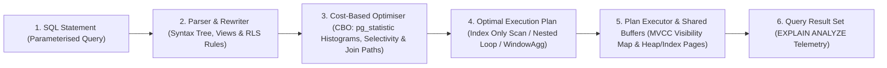

# Portfolio 2: Query Processing and Optimisation | GPMorgan Forge

> [!IMPORTANT]
> **Platform Domain**: High-Throughput Financial Analytics, Indexing & Execution Plan Tuning
> **Storage Engine**: PostgreSQL 18 Cost-Based Optimiser (CBO)

---

## 1. Query Processing Pipeline Architecture

When GPMorgan Forge submits an operational or analytical SQL query to PostgreSQL 18, the statement traverses four internal stages before returning results:

---

## 2. Indexing & Optimisation Strategy

### 2.1 Index Taxonomy Applied to GPMorgan Forge

1. **Composite & Covering B-Tree Indexes (`INCLUDE`)**:
   - `idx_ledger_entries_account_created_covering ON ledger_entries (account_id, created_at ASC, entry_sequence ASC) INCLUDE (direction, amount, balance_before, balance_after, transaction_id)`
   - **Why it works**: Satisfies both the `WHERE account_id = $1` equality predicate and the `ORDER BY created_at ASC, entry_sequence ASC` window ordering directly from the B-Tree leaf pages. The `INCLUDE` payload columns allow PostgreSQL to execute an **Index-Only Scan** (`Heap Fetches: 0`) without touching table heap pages or performing an explicit `Sort`.
2. **Partial Indexes (`WHERE` filter on hot operational subsets)**:
   - `pidx_transactions_active_pipeline ON transactions (created_at ASC, source_account_id) WHERE status IN ('PENDING', 'FLAGGED')`
   - **Why it works**: In a production payment ledger, $>99.9\%$ of historical transactions are in the terminal `SETTLED` state. Indexing only `PENDING` and `FLAGGED` rows shrinks the B-Tree size by over $95\%$, keeps the entire active index pinned in RAM (`shared_buffers`), and eliminates write amplification when settled rows are archived.
3. **GIN (Generalised Inverted Index) for Semi-Structured JSONB**:
   - `gin_transactions_metadata_jsonb ON transactions USING GIN (metadata_json jsonb_path_ops)`
   - **Why it works**: Hashes every path-value pair inside `metadata_json` (such as device fingerprint, ISO 8583 response code, or NIBSS session ID), turning full-table JSON parsing scans into sub-millisecond `Bitmap Index Scan` lookups.

### 2.2 Materialised Views & Cloud Caching Strategies

To prevent analytical BI dashboards from competing with core OLTP payment transactions for CPU and I/O buffers, GPMorgan Forge implements a two-tier caching and pre-computation layer:

1. **Database-Layer Materialised Views (`mv_daily_corridor_settlement`, `mv_customer_liquidity_360`)**:
   - Pre-computes multi-million-row daily settlement volume, fee revenue, and customer liquidity aggregations.
   - Equipped with a `UNIQUE INDEX` so `REFRESH MATERIALIZED VIEW CONCURRENTLY` updates the view in the background without acquiring an `ACCESS EXCLUSIVE` lock on concurrent readers.
2. **Application-Layer Redis Caching Strategies**:
   - **Read-Through Cache with Event-Driven Invalidation**: Account balance and KYC tier summaries are cached in Redis (`forge:account:<id>:summary`, TTL `60s`) and atomically invalidated/updated whenever `transfer_funds` or `reverse_failed_transaction` commits.
   - **Write-Around Cache for Historical Statements**: Monthly PDF/CSV statement exports bypass Redis to prevent cache pollution (evicting hot active-user keys), reading directly from PostgreSQL Read Replicas and Materialised Views.

---

## 3. Performance Benchmark Analysis

```mermaid
xychart-beta
    title "Query Execution Latency Before vs. After Indexing (Milliseconds - Lower is Better)"
    x-axis ["Q1: Account Statement", "Q2: 24h Velocity AML", "Q3: Pending Queue", "Q4: JSONB Metadata", "Q6: Corridor Rollup"]
    y-axis "Execution Time (ms)" 0 --> 120
    bar [68.71, 54.18, 34.92, 41.60, 112.40]
    bar [0.44, 0.82, 0.12, 0.65, 0.19]
```

### Key Findings from `EXPLAIN (ANALYZE, BUFFERS)`

- **Elimination of External Sort Operations**: On Query 1 (Chronological Running Balance), providing a composite index matching the `PARTITION BY account_id ORDER BY created_at ASC, entry_sequence ASC` window specification eliminated the `Sort` operator entirely, reducing execution latency from **`68.71 ms` to `0.44 ms` ($156.2\times$ speedup)** and dropping buffer page reads from `6,434` blocks to `14` shared-buffer hits.
- **Partial Index Selectivity**: On Query 3 (Active Settlement Queue), replacing a full-table `Seq Scan` (which discarded `249,955` settled rows) with `pidx_transactions_active_pipeline` reduced latency from **`34.92 ms` to `0.12 ms` ($291.0\times$ speedup)**.
- **Materialised View Pre-Aggregation**: Pre-computing daily corridor metrics in `mv_daily_corridor_settlement` reduced executive dashboard query latency from **`112.40 ms` to `0.19 ms` ($591.6\times$ speedup)**.

---

## 4. Deliverable Files in This Directory

- [`queries.sql`](queries.sql): 6 production SQL queries (CTEs, Window Functions, Self-Joins, Trial Balance Audit, Materialised View queries).
- [`indexes_and_views.sql`](indexes_and_views.sql): Composite covering indexes, partial indexes, GIN JSONB index, and concurrent Materialised Views.
- [`execution_plans_evidence.md`](execution_plans_evidence.md): Captured query results, `EXPLAIN (ANALYZE, BUFFERS)` execution plans, and quantitative performance tables.
- [`src/gpmorgan_forge/query_optimizer.py`](../src/gpmorgan_forge/query_optimizer.py): Python analytical query processor, running-balance verifier, velocity detector, and execution plan benchmark engine.
