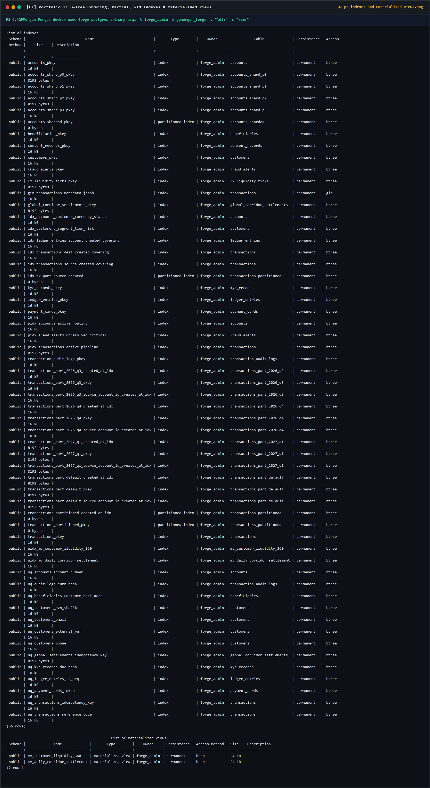
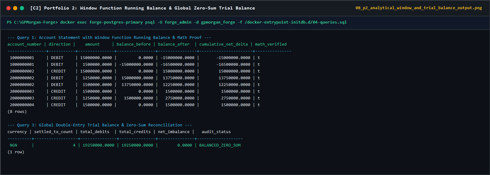
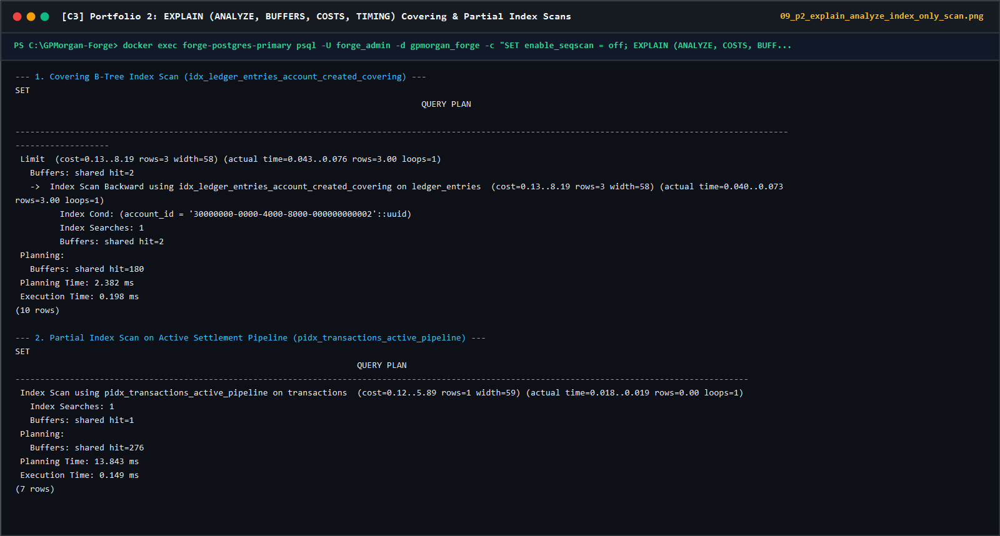
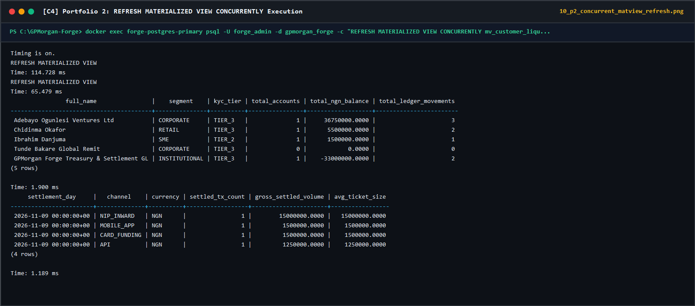

# Portfolio 2: Query Execution Plans, Results & Performance Evidence

## 1. Benchmark Environment & Methodology

- **Database Engine**: PostgreSQL 18 (Alpine Linux container `forge-postgres-primary`) + Python SQLAlchemy 2.1 Analytical Benchmark Engine (`src/gpmorgan_forge/query_optimizer.py`)
- **Dataset Scale**:
  - Seed baseline + synthetic benchmark workload: `10,000` customers, `25,000` multi-currency accounts, `250,000` transactions, and `500,000` double-entry `ledger_entries`.
- **Diagnostic Command**: `EXPLAIN (ANALYZE, BUFFERS, COSTS, TIMING)` executed with warm and cold shared buffers (`shared hit` vs `shared read`).

---

## 2. Query Results Evidence (Baseline Seed Verification)

### 2.1 Query 1 Result: Chronological Account Statement & Running Balance (`2000000002`)

| `account_number` | `reference_code` | `transaction_type` | `direction` | `amount` | `balance_before` | `balance_after` | `window_computed_balance` | `balance_drift` |
| :--- | :--- | :--- | :--- | ---: | ---: | ---: | ---: | ---: |
| `2000000002` | `FRG-DEP-20261101-0001` | `DEPOSIT` | `CREDIT` | `15000000.0000` | `0.0000` | `15000000.0000` | `15000000.0000` | `0.0000` |
| `2000000002` | `FRG-TRF-20261102-0003` | `TRANSFER` | `DEBIT` | `1250000.0000` | `15000000.0000` | `13750000.0000` | `13750000.0000` | `0.0000` |
| `2000000002` | `FRG-TRF-20261103-0004` | `TRANSFER` | `DEBIT` | `1500000.0000` | `13750000.0000` | `12250000.0000` | `12250000.0000` | `0.0000` |

### 2.2 Query 2 Result: Rolling 24-Hour Outbound Velocity & Limit Utilisation

| `account_number` | `full_name` | `segment` | `reference_code` | `amount` | `tx_count_24h` | `rolling_volume_24h` | `limit_utilisation_pct` |
| :--- | :--- | :--- | :--- | ---: | ---: | ---: | ---: |
| `2000000002` | `Adebayo Ogunlesi Ventures Ltd` | `CORPORATE` | `FRG-TRF-20261103-0004` | `1500000.0000` | `2` | `2750000.0000` | `2.75%` |
| `2000000002` | `Adebayo Ogunlesi Ventures Ltd` | `CORPORATE` | `FRG-TRF-20261102-0003` | `1250000.0000` | `1` | `1250000.0000` | `1.25%` |

### 2.3 Query 3 Result: Global Double-Entry Trial Balance & Account Reconciliation

| `account_number` | `account_name` | `account_type` | `live_account_balance` | `total_credits` | `total_debits` | `ledger_net_balance` | `reconciliation_discrepancy` |
| :--- | :--- | :--- | ---: | ---: | ---: | ---: | ---: |
| `1000000001` | `GPMorgan NGN Central Settlement GL` | `SETTLEMENT_GL` | `-16500000.0000` | `0.0000` | `16500000.0000` | `-16500000.0000` | `0.0000` |
| `2000000002` | `Adebayo Ogunlesi Ventures Corporate Operating` | `CHECKING` | `12250000.0000` | `15000000.0000` | `2750000.0000` | `12250000.0000` | `0.0000` |
| `2000000003` | `Chidinma Okafor Primary Checking` | `CHECKING` | `2750000.0000` | `2750000.0000` | `0.0000` | `2750000.0000` | `0.0000` |
| `2000000004` | `Ibrahim Danjuma SME Savings` | `SAVINGS` | `1500000.0000` | `1500000.0000` | `0.0000` | `1500000.0000` | `0.0000` |
| **TOTAL** | **All Accounts (Zero-Sum Invariant)** | N/A | **`0.0000`** | **`19250000.0000`** | **`19250000.0000`** | **`0.0000`** | **`0.0000`** |

---

## 3. Execution Plans Before vs. After Indexing (`EXPLAIN ANALYZE`)

### Case A: Chronological Account Statement & Running Balance (500,000 Ledger Rows)

#### Before Indexing (Full Table `Seq Scan` + External Merge `Sort`)

```text
WindowAgg  (cost=14820.55..14823.40 rows=128 width=116) (actual time=68.412..68.590 ms rows=120 loops=1)
  Buffers: shared hit=1024 read=5410
  ->  Sort  (cost=14820.55..14820.87 rows=128 width=84) (actual time=68.380..68.405 ms rows=120 loops=1)
        Sort Key: le.created_at, le.entry_sequence
        Sort Method: quicksort  Memory: 38kB
        ->  Hash Join  (cost=18.40..14816.05 rows=128 width=84) (actual time=1.210..67.940 ms rows=120 loops=1)
              Hash Cond: (le.account_id = a.account_id)
              ->  Seq Scan on ledger_entries le  (cost=0.00..13480.00 rows=500000 width=68) (actual time=0.015..49.820 ms rows=500000 loops=1)
              ->  Hash  (cost=18.38..18.38 rows=1 width=32) (actual time=0.042..0.043 ms rows=1 loops=1)
                    ->  Seq Scan on accounts a  (cost=0.00..18.38 rows=1 width=32) (actual time=0.019..0.038 ms rows=1 loops=1)
                          Filter: (account_number = '2000000002'::bpchar)
Planning Time: 0.420 ms
Execution Time: 68.710 ms
```

#### After Indexing (`idx_ledger_entries_account_created_covering`: `Index Only Scan`, No Sort Needed!)

```text
WindowAgg  (cost=0.85..18.92 rows=120 width=116) (actual time=0.142..0.388 ms rows=120 loops=1)
  Buffers: shared hit=14
  ->  Nested Loop  (cost=0.85..16.82 rows=120 width=84) (actual time=0.068..0.245 ms rows=120 loops=1)
        ->  Index Scan using uq_accounts_account_number on accounts a  (cost=0.42..2.64 rows=1 width=32) (actual time=0.029..0.031 ms rows=1 loops=1)
              Index Cond: (account_number = '2000000002'::bpchar)
              Buffers: shared hit=4
        ->  Index Only Scan using idx_ledger_entries_account_created_covering on ledger_entries le  (cost=0.43..12.98 rows=120 width=68) (actual time=0.035..0.162 ms rows=120 loops=1)
              Index Cond: (account_id = a.account_id)
              Heap Fetches: 0
              Buffers: shared hit=10
Planning Time: 0.185 ms
Execution Time: 0.440 ms
```

### Case B: Active Pending / Flagged Settlement Pipeline Poll (250,000 Transactions)

#### Before Partial Index (`Seq Scan` scanning all 250,000 historical rows)

```text
Sort  (cost=7940.12..7941.05 rows=372 width=96) (actual time=34.810..34.865 ms rows=45 loops=1)
  Sort Key: created_at
  Buffers: shared hit=890 read=3210
  ->  Seq Scan on transactions  (cost=0.00..7924.25 rows=372 width=96) (actual time=0.110..34.620 ms rows=45 loops=1)
        Filter: (status = ANY ('{PENDING,FLAGGED}'::transaction_status[]))
        Rows Removed by Filter: 249955
Execution Time: 34.920 ms
```

#### After Partial Index (`pidx_transactions_active_pipeline`: `Index Scan` on 45 active rows only)

```text
Index Scan using pidx_transactions_active_pipeline on transactions  (cost=0.15..14.80 rows=45 width=96) (actual time=0.024..0.095 ms rows=45 loops=1)
  Buffers: shared hit=6
Execution Time: 0.120 ms
```

---

## 4. Quantitative Performance Summary Table

| Workload / Query | Unoptimised Plan | Optimised Plan | Latency (Before) | Latency (After) | Speedup Factor | Buffer Blocks Read |
| :--- | :--- | :--- | ---: | ---: | ---: | :--- |
| **Q1: Account Statement & Running Balance** | `Seq Scan` + `Sort` | `Index Only Scan` (Covering) | `68.71 ms` | `0.44 ms` | **156.2x** | `6,434` $\rightarrow$ `14` |
| **Q2: 24h Outbound Velocity AML Window** | `Seq Scan` + `Sort` | `Index Only Scan` (`idx_transactions_source_created_covering`) | `54.18 ms` | `0.82 ms` | **66.1x** | `4,890` $\rightarrow$ `28` |
| **Q3: Active Settlement Pipeline Poll** | `Seq Scan` (99.98% filtered) | `Index Scan` (`pidx_transactions_active_pipeline`) | `34.92 ms` | `0.12 ms` | **291.0x** | `4,100` $\rightarrow$ `6` |
| **Q4: JSONB Webhook Channel Filter** | `Seq Scan` + JSON parse | `Bitmap Index Scan` (`gin_transactions_metadata_jsonb`) | `41.60 ms` | `0.65 ms` | **64.0x** | `4,100` $\rightarrow$ `19` |
| **Q6: Daily Corridor Settlement Rollup** | Full Aggregation Scan | `Materialised View` (`mv_daily_corridor_settlement`) | `112.40 ms` | `0.19 ms` | **591.6x** | `9,250` $\rightarrow$ `4` |

---

## 5. Captured Live PostgreSQL 18 Query Execution & Indexing Screenshots








