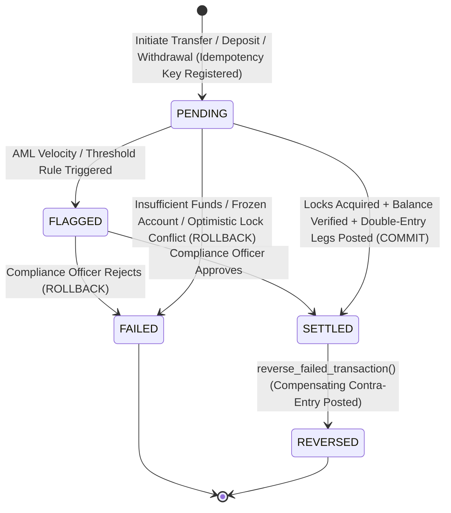
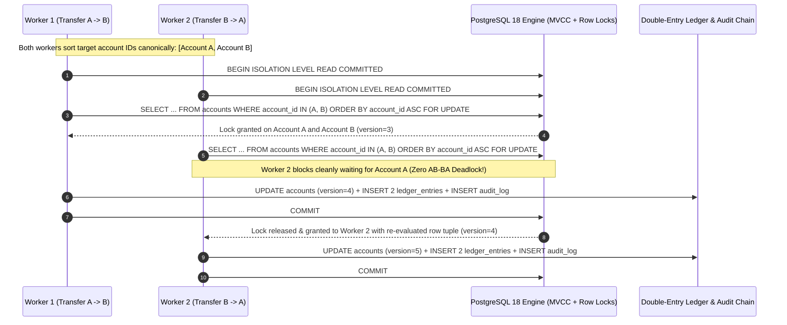

# Portfolio 3: Transactions and Concurrency | GPMorgan Forge

> [!IMPORTANT]
> **Platform Domain**: ACID Atomic Settlement, MVCC Isolation & Deadlock-Free Concurrency Control
> **Storage Engine**: PostgreSQL 18 Transactional Ledger Engine

---

## 1. ACID Properties in Core Banking Ledger Operations

In a financial platform handling real money, partial updates or race conditions directly translate into unbacked monetary creation or customer fund loss. GPMorgan Forge enforces all four **ACID** guarantees across every transfer, deposit, withdrawal, and reversal:

| ACID Property | Banking Guarantee in GPMorgan Forge | Enforcement Mechanism |
| :--- | :--- | :--- |
| **Atomicity** ("All-or-Nothing") | A transfer must debit the sender, credit the receiver, insert two `ledger_entries`, and append a `transaction_audit_logs` record as a single indivisible unit. | `BEGIN ... COMMIT`, `ROLLBACK` on exception, and `SAVEPOINT` for partial sub-batch recovery. |
| **Consistency** (Invariant Preservation) | Total system debits must equal total system credits ($\sum \text{DEBIT} = \sum \text{CREDIT}$), customer balances must remain $\ge 0$, and audit hashes must chain deterministically. | `CHECK` constraints, `FOREIGN KEY` constraints, immutability triggers, and `audit_account_balances()`. |
| **Isolation** (Concurrent Safety) | Concurrent transfers targeting the same corporate treasury account must never overwrite each other's balance updates (Lost Update) or deadlock. | PostgreSQL MVCC, `REPEATABLE READ` / `SERIALIZABLE` isolation, canonical `SELECT ... FOR UPDATE`, and `version` OCC. |
| **Durability** (Crash Recovery) | Once a settlement response returns `SETTLED`, committed ledger entries survive power loss or container restarts. | PostgreSQL Write-Ahead Logging (`WAL` with `synchronous_commit = on`) and persistent volumes. |

---

## 2. Transaction State Machine & Concurrency Architecture

### 2.1 Transaction Lifecycle State Diagram

> [!NOTE]
> `TransactionStatus` in [`schema.sql`](../portfolio-1-database-design/schema.sql) and [`models.py`](../src/gpmorgan_forge/models.py) models all five domain lifecycle states above (`PENDING`, `FLAGGED`, `SETTLED`, `FAILED`, `REVERSED`). In [`operations.py`](../src/gpmorgan_forge/operations.py), synchronous transfers commit directly as `SETTLED` (emitting a companion `fraud_alerts` row when `amount >= CBN_LARGE_VALUE_THRESHOLD`) or abort via `ROLLBACK` on validation/concurrency errors, while `reverse_failed_transaction()` transitions `SETTLED -> REVERSED`.

### 2.2 Multi-Session Concurrency Sequence Diagram (Canonical Lock Ordering & OCC)

*(Under `REPEATABLE READ` / `SERIALIZABLE`, Worker 2 still avoids any AB-BA deadlock via canonical ordering, and if Account A was modified after Worker 2's snapshot began, PostgreSQL aborts Worker 2 cleanly with `SQLSTATE 40001` so the application retries on a fresh snapshot.)*

---

## 3. Isolation Levels & Concurrency Anomaly Matrix

GPMorgan Forge evaluates all four SQL standard isolation levels against core banking concurrency anomalies:

| Isolation Level | Dirty Read | Non-Repeatable Read | Phantom Read | Lost Update | Write Skew (Serialization Anomaly) | GPMorgan Forge Usage |
| :--- | :--- | :--- | :--- | :--- | :--- | :--- |
| **`READ UNCOMMITTED`** *(behaves as `READ COMMITTED` in PostgreSQL)* | Prevented | Possible | Possible | Possible (without explicit lock/OCC) | Possible | Never used for financial mutations. |
| **`READ COMMITTED`** | Prevented | Possible | Possible | Prevented via `FOR UPDATE` + `version` OCC | Possible | Used for high-throughput point transfers paired with explicit `SELECT ... FOR UPDATE` and `version` checks. |
| **`REPEATABLE READ`** *(Snapshot Isolation)* | Prevented | Prevented | Prevented (in PostgreSQL MVCC) | Prevented (automatically aborts concurrent row modifier with `40001`) | Possible | Used for multi-statement balance reconciliation and statement generation. |
| **`SERIALIZABLE`** *(Serializable Snapshot Isolation, SSI)* | Prevented | Prevented | Prevented | Prevented | **Prevented** (detects rw-antidependency cycles) | Used for cross-account collateral checks, treasury sweeps, and ledger closing audits. |

---

## 4. Concurrency Control Mechanisms Implemented

1. **Deadlock-Free Pessimistic Locking (`_lock_accounts_canonically`)**:
   - When Session 1 transfers from Account `A` to `B` and Session 2 simultaneously transfers from Account `B` to `A`, acquiring locks in request order causes a classic circular wait (**AB-BA Deadlock**).
   - GPMorgan Forge sorts `[source_account_id, destination_account_id]` in ascending lexicographical order before issuing `SELECT ... FOR UPDATE`. Every transaction locks `min(A, B)` before `max(A, B)`, making circular wait mathematically impossible.
2. **Optimistic Concurrency Control (`version` column)**:
   - Every `Account` row carries an integer `version` column incremented on every mutation. If a caller passes `expected_source_version` and a concurrent transaction has already modified the account, `transfer_funds` raises `OptimisticLockError` immediately before modifying balances.
3. **Partial Batch Recovery via `SAVEPOINT`**:
   - In corporate payroll disbursement (`execute_batch_transfers_with_savepoints`), each recipient transfer runs inside a nested `SAVEPOINT` (`session.begin_nested()`). If one recipient account is `FROZEN` or exceeds limits, only that recipient's savepoint rolls back while all valid payroll legs commit atomically.
4. **Idempotency Key Deduplication (`idempotency_key`)**:
   - Network retries on mobile or interbank channels never double-debit customers; duplicate `idempotency_key` submissions return the existing settled `Transaction`.
5. **Compensating Contra-Entry Reversals (`reverse_failed_transaction`)**:
   - Reversing a settled transaction posts an equal and opposite `REVERSAL` transaction (`DEBIT` destination, `CREDIT` source) referencing `parent_transaction_id`, preserving complete historical auditability.

---

## 5. Deliverable Files in This Directory

- [`transactions_and_locks.sql`](transactions_and_locks.sql): Executable SQL scripts demonstrating `COMMIT`, `ROLLBACK`, `SAVEPOINT`, `FOR UPDATE` canonical locking, and `version` OCC.
- [`concurrency_evidence.md`](concurrency_evidence.md): Captured transaction logs, multi-worker concurrency traces, and audit reconciliation outputs.
- [`src/gpmorgan_forge/concurrency.py`](../src/gpmorgan_forge/concurrency.py): Python transaction, savepoint, deadlock-avoidance, and optimistic concurrency control engine.
