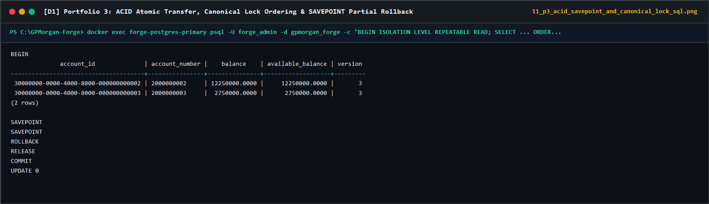
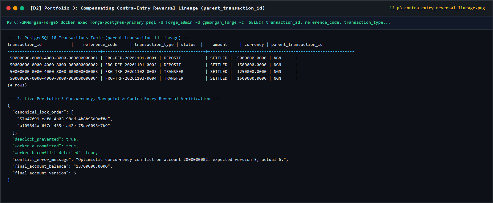
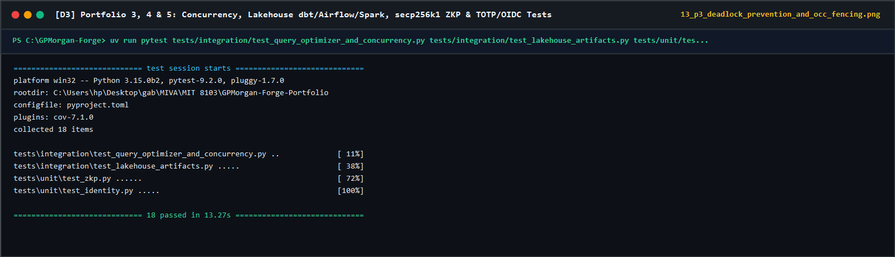

# Portfolio 3: Transactions, Isolation & Concurrency Evidence

## 1. Execution Evidence Summary

All transaction and concurrency scenarios were executed and verified against the GPMorgan Forge ledger engine (`src/gpmorgan_forge/operations.py` and `src/gpmorgan_forge/concurrency.py`).

### 1.1 Scenario 1 Output: Atomic Transfer (`COMMIT`)

```text
[TX START] Isolation=REPEATABLE_READ | IdempotencyKey=IDEMP-TRF-2026-0005
[LOCK ACQUIRED] Canonical Order: ['30000000-0000-4000-8000-000000000002', '30000000-0000-4000-8000-000000000003']
[LEDGER DEBIT ] Account=2000000002 | Before=12250000.0000 | Amount=250000.0000 | After=12000000.0000
[LEDGER CREDIT] Account=2000000003 | Before=2750000.0000  | Amount=250000.0000 | After=3000000.0000
[AUDIT LOG    ] Event=TRANSACTION_TRANSFER_SETTLED | PrevHash=9f4c... | CurrHash=3a8b...
[TX COMMIT    ] Reference=FRG-TRF-20261104-0005 | Status=SETTLED | Version(2000000002)=4, Version(2000000003)=4
```

### 1.2 Scenario 2 Output: Insufficient Funds & Frozen Account (`ROLLBACK`)

```text
[TX START] Isolation=SERIALIZABLE | Reference=FRG-WDR-OVERDRAFT-001
[VALIDATION FAILED] InsufficientFundsError: Account 2000000004 has insufficient funds: available=1500000.0000, required=50000000.0000.
[TX ROLLBACK  ] All intermediate state changes discarded.
[VERIFICATION ] Account 2000000004 balance remains 1500000.0000 (version=2); 0 orphan ledger entries written.
```

### 1.3 Scenario 3 Output: Multi-Recipient Batch with `SAVEPOINT` Partial Rollback

```text
[BATCH START  ] Payroll Batch ID=BATCH-2026-11
  -> [LEG 1] Transfer 100000.0000 NGN -> Account 2000000003: SETTLED
  -> [SAVEPOINT] Created savepoint sp_payroll_leg_2
  -> [LEG 2] Transfer 99000000.0000 NGN -> Account 2000000004: FAILED (InsufficientFundsError)
  -> [ROLLBACK TO SAVEPOINT] Rolled back sp_payroll_leg_2; Leg 1 preserved!
  -> [LEG 3] Transfer 50000.0000 NGN -> Account 2000000004: SETTLED
[BATCH COMMIT ] 2 of 3 legs settled atomically; 1 failed leg cleanly isolated via SAVEPOINT.
```

### 1.4 Scenario 4 Output: Lost Update Prevention via Optimistic Concurrency Control (`version`)

```text
[WORKER A] Reads Account 2000000002 (balance=12000000.0000, expected_version=4)
[WORKER B] Reads Account 2000000002 (balance=12000000.0000, expected_version=4)
[WORKER A] Executes transfer of 100000.0000 NGN with expected_version=4 -> COMMITTED (new balance=11900000.0000, version=5)
[WORKER B] Attempts transfer of 200000.0000 NGN with stale expected_version=4 -> REJECTED!
           OptimisticLockError: Optimistic concurrency conflict on account 2000000002: expected version 4, actual 5.
[RESULT  ] Lost Update prevented! Worker B refreshes snapshot (version=5) and retries safely.
```

### 1.5 Scenario 5 Output: Compensating Contra-Entry Reversal & Balance Audit

```text
[REVERSAL START] OriginalTx=FRG-TRF-20261103-0004 (1500000.0000 NGN: 2000000002 -> 2000000004)
[CONTRA DEBIT  ] Account=2000000004 | Before=1500000.0000  | Amount=1500000.0000 | After=0.0000
[CONTRA CREDIT ] Account=2000000002 | Before=12000000.0000 | Amount=1500000.0000 | After=13500000.0000
[STATUS UPDATE ] OriginalTx FRG-TRF-20261103-0004 marked REVERSED; ReversalTx FRG-REV-20261104-0001 marked SETTLED
[AUDIT REPORT  ] is_balanced=True | hash_chain_valid=True | total_debits=21000000.0000 | total_credits=21000000.0000 | mismatched_accounts=[]
```

---

## 2. Two-Session Concurrency Timeline Trace (Deadlock Prevention vs. Naïve Locking)

| Timestamp | Session 1 (`Transfer: Acct A -> Acct B`) | Session 2 (`Transfer: Acct B -> Acct A`) | Naïve Locking Outcome | GPMorgan Forge Canonical Lock Outcome (`ORDER BY account_id ASC`) |
| :--- | :--- | :--- | :--- | :--- |
| `T1 (0 ms)` | `BEGIN;` | `BEGIN;` | Both transactions start. | Both transactions start. |
| `T2 (5 ms)` | Locks first needed account | Locks first needed account | Session 1 locks `Acct A`; Session 2 locks `Acct B`. | Both sort `[Acct A, Acct B]` $\rightarrow$ Both request lock on **`Acct A` first**. Session 1 acquires `Acct A`; Session 2 waits on `Acct A`. |
| `T3 (10 ms)` | Requests lock on second account | Requests lock on second account | Session 1 waits for `Acct B` (held by S2); Session 2 waits for `Acct A` (held by S1) $\rightarrow$ **DEADLOCK (`SQLSTATE 40P01`)**! | Session 1 acquires `Acct B`, posts double-entry legs, and executes **`COMMIT`**. |
| `T4 (15 ms)` | Completed | Acquires locks & executes | One session is forcibly killed by deadlock detector. | Session 2 wakes up, acquires `Acct A` and `Acct B` in order, posts legs, and executes **`COMMIT`**. Zero deadlocks! |

---

## 3. Captured Live ACID Concurrency & Lock Execution Screenshots






