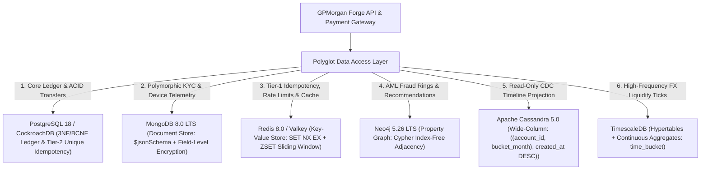
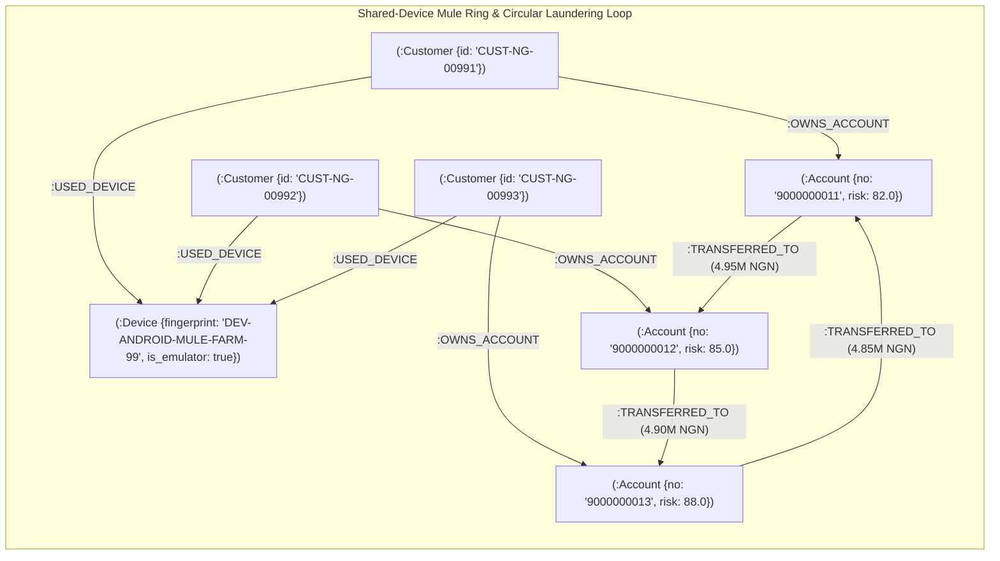

# Portfolio 4: NoSQL and Advanced Data Models | GPMorgan Forge

> [!IMPORTANT]
> **Platform Domain**: Polyglot Persistence: Document KYC, Two-Tier Caching/Idempotency, Wide-Column Timelines, Time-Series FX Ticks & Graph AML Fraud Intelligence
> **Storage Engines**: MongoDB 8.0 LTS, Redis 8.0 / Valkey, Neo4j 5.26 LTS, Apache Cassandra 5.0 & TimescaleDB

---

## 1. Polyglot Persistence Architecture & Suitability Analysis

While PostgreSQL 18 (paired with CockroachDB for multi-region active-active consensus) provides strict **ACID** guarantees for GPMorgan Forge's core double-entry ledger, a single relational model is suboptimal for polymorphic identity documents, sub-millisecond idempotency locks, read-only mobile timeline projections, high-frequency FX ticks, and multi-hop anti-money-laundering (AML) network traversals. GPMorgan Forge adopts a **Polyglot Persistence** architecture combining specialized NoSQL and time-series models alongside PostgreSQL 18:



### Suitability Comparison Matrix Across Database Models

| Database Paradigm | Engine in GPMorgan Forge | Data Structure | Banking Use Case in GPMorgan Forge | Why Relational SQL is Less Suitable Here |
| :--- | :--- | :--- | :--- | :--- |
| **Relational & Distributed SQL (OLTP)** | **PostgreSQL 18 + CockroachDB** | Normalised 3NF/BCNF tables with rows, columns & Raft ranges | Double-entry `ledger_entries`, `accounts`, `transactions`, ACID balance mutations, and Tier-2 durable `uq_transactions_idempotency_key`. | Ideal for tabular ACID operations, but suffers from $O(n^2)$ join explosion on deep recursive graph traversals. |
| **Graph Database** | **Neo4j 5.26 LTS** *(Cloud: Neo4j Aura / Amazon Neptune)* | **Nodes** (entities), **Edges** (relationships), and **Properties** (key-value attributes) | Circular money-laundering ring detection (`A -> B -> C -> A`), shared-device mule account clustering, and B2B product recommendations. | Finding 3-to-5 hop cycles in SQL requires expensive multi-way self-JOINs across millions of rows; Neo4j traverses edges in constant time via **index-free adjacency**. |
| **Document Store** | **MongoDB 8.0 LTS** | Hierarchical BSON documents with `$jsonSchema` validation | Multi-jurisdiction KYC payloads (`kyc_verifications`: `NG` BVN/NIN vs. `GB` Passport vs. Corporate CAC filings) and 90-day mobile/web session telemetry (`device_telemetry_events`). | Avoids sparse tables with dozens of `NULL` columns or rigid `ALTER TABLE` migrations when onboarding new country KYC providers. |
| **Key-Value Store** | **Redis 8.0 / Valkey** | In-memory key-value strings, hashes (`HSET`), and sorted sets (`ZSET`) with TTL | Tier-1 atomic payment idempotency locks (`SET ... NX EX`), 60-second sliding-window API rate limiting, and read-through balance caching. | Disk-backed relational tables incur unnecessary WAL I/O for ephemeral locks and sub-millisecond rate-limiting counters that expire after 60 seconds. |
| **Wide-Column Store** | **Apache Cassandra 5.0** | Partitioned wide rows keyed by `((account_id, bucket_month), created_at DESC, transaction_id ASC)` | **Strictly read-only, append-only customer transaction timeline projections** fed asynchronously via Kafka CDC (never used for mutable balances). | Provides single-partition $O(1)$ reverse-chronological statement slices and linear multi-DC write scaling without touching the OLTP primary. |
| **Time-Series Database** | **TimescaleDB** *(PostgreSQL Hypertables)* | Time-chunked hypertables (`create_hypertable`) and continuous aggregates (`time_bucket`) | High-frequency FX rate ticks (`USD/NGN`, `GBP/NGN`) and real-time hourly OHLCV liquidity candlesticks. | Automates time-chunk partitioning, columnar compression, and incremental continuous view refreshes over high-velocity tick streams. |

---

## 2. Graph Database Deep Dive

### 2.1 Core Graph Components in GPMorgan Forge

A graph database represents relationship-rich financial networks using three foundational primitives:

1. **Nodes (Entities)**: `:Customer`, `:Account`, `:Device`, `:FinancialProduct`.
2. **Edges (Directed, Typed Relationships)**:
   - `(:Customer)-[:OWNS_ACCOUNT]->(:Account)`
   - `(:Account)-[:TRANSFERRED_TO {tx_ref, amount, timestamp}]->(:Account)`
   - `(:Customer)-[:USED_DEVICE {last_seen}]->(:Device)`
   - `(:Customer)-[:PARTNERS_WITH {since}]->(:Customer)`
   - `(:Customer)-[:SUBSCRIBED_TO]->(:FinancialProduct)`
3. **Properties (Key-Value Attributes)**: Attached to both nodes (`account_number`, `risk_score`, `is_emulator`) and edges (`amount`, `tx_ref`, `timestamp`).



### 2.2 Comparing Relational SQL `JOIN` vs. Graph Cypher Queries

To detect a 3-hop circular money-laundering loop (`a1 -> a2 -> a3 -> a1`):

- **Relational SQL Approach** (requires 3 self-JOINs across `transactions`, scaling poorly at $O(n^2)$ as table size grows):

  ```sql
  SELECT t1.source_account_id, t1.destination_account_id, t2.destination_account_id
  FROM transactions t1
  INNER JOIN transactions t2 ON t1.destination_account_id = t2.source_account_id
  INNER JOIN transactions t3 ON t2.destination_account_id = t3.source_account_id
  WHERE t3.destination_account_id = t1.source_account_id;
  ```

- **Neo4j Cypher Approach** (concise pattern matching using index-free adjacency pointers):

  ```cypher
  MATCH path = (origin:Account)-[:TRANSFERRED_TO*2..5]->(origin)
  WHERE origin.risk_score >= 50.0
    AND all(n IN tail(nodes(path)) WHERE origin.account_number <= n.account_number)
  RETURN origin.account_number, [n IN nodes(path) | n.account_number] AS circular_path;
  ```

- **Other Graph Query Languages**: In addition to **Cypher** (Neo4j), multi-platform property graphs support **Gremlin** (Apache TinkerPop), and RDF semantic knowledge graphs (such as Amazon Neptune RDF) support **SPARQL**.

```mermaid
xychart-beta
    title "Multi-Hop Fraud Ring Query Latency: PostgreSQL Recursive JOIN vs. Neo4j Cypher (ms)"
    x-axis ["2 Hops", "3 Hops", "4 Hops", "5 Hops"]
    y-axis "Execution Time (ms)" 0 --> 5000
    bar [14.2, 86.5, 640.0, 4820.0]
    bar [0.9, 1.8, 4.6, 11.4]
```



### 2.3 Optimising Graph Database Performance & Addressing Challenges

1. **Challenges in Large-Scale Graphs**:
   - **Memory Usage**: Storing billions of nodes and edges in RAM (`pagecache`) for fast traversal is memory-intensive.
   - **Combinatorial Supernode Explosion**: Unbounded traversals (`*1..10`) through high-degree hub nodes (e.g., a central settlement account) can visit millions of paths.
   - **Indexing Overhead**: Over-indexing every property increases disk storage and write latency.
2. **Optimisation Strategies Implemented in GPMorgan Forge**:
   - **Property Indexing**: Anchor traversal entry points with uniqueness constraints and property indexes:
     - Modern Neo4j 5+ syntax: `CREATE INDEX idx_graph_account_risk IF NOT EXISTS FOR (a:Account) ON (a.risk_score);`
     - *(Replaces legacy Neo4j 3.x/4.x syntax `CREATE INDEX ON :Account(risk_score)`)*
   - **Bounded Traversal Depth & Specific Edge Types**: Always restrict path length (`[:TRANSFERRED_TO*2..5]`) rather than untyped or unbounded (`[*1..10]`) patterns.
   - **Sharding, Caching & Parallel Traversal**: Partition graphs by regional clearing corridor, cache hot subgraphs in memory, and execute independent AML rule traversals concurrently.
3. **Security, Compliance & AI/ML Integration in Graph Databases**:
   - **Subgraph Access Governance**: Enforce jurisdiction-scoped subgraph access via `AccessControlEngine` in local `neo4j:5.26-community` deployments (and native role-based subgraph privileges on managed Neo4j Aura cloud tiers) while masking customer PII on nodes.
   - **NDPA 2023 & GDPR Compliance**: Log all Cypher queries in audit logs and anonymise customer node properties upon erasure requests.
   - **Graph Neural Networks (GNNs) & Knowledge Graphs**: Export Neo4j subgraphs to PyTorch Geometric / TensorFlow to train GNN node-classification models that predict mule-account probability before a ring completes its first loop.

---

## 3. Document Privacy & Field-Level Encryption in MongoDB

Flexible schemas in NoSQL document databases introduce the risk of accidental sensitive data exposure if new dynamic fields bypass access controls. GPMorgan Forge mitigates this in [`mongodb_document_model.js`](mongodb_document_model.js) and [`src/gpmorgan_forge/nosql_models.py`](../src/gpmorgan_forge/nosql_models.py) via:

1. **Strict `$jsonSchema` Validation**: Rejects any KYC or telemetry document missing required security metadata.
2. **Application-Layer Field-Level Encryption (CSFLE / AEAD)**: Sensitive identity fields (`bvn_or_national_id_cipher`, `tax_id_cipher`) in `kyc_verifications` are encrypted with `AEAD_AES_256_GCM` (`ENCv2:<key_id>:<base64url>`) using a 256-bit key derived via `HKDF-SHA256` from `FORGE_KMS_MASTER_KEY` and KMS key ID `kms-ng-cbn-key-2026-01` *before* being written to MongoDB.
3. **Query-Level Access Control & TTL Expiry**: Device telemetry documents in `device_telemetry_events` automatically expire after 90 days via a TTL index on `captured_at` (`expireAfterSeconds: 7776000`), enforcing **NDPA 2023 Data Minimisation**.

---

## 4. Deliverable Files in This Directory

- [`mongodb_document_model.js`](mongodb_document_model.js): MongoDB 8.0 LTS `$jsonSchema` collections, compound/TTL indexes, encrypted KYC documents, and shared-device aggregation pipeline.
- [`neo4j_fraud_graph.cypher`](neo4j_fraud_graph.cypher): Neo4j 5.26 LTS Cypher constraints, indexes, graph seeding, circular AML loop detection, shared-device mule detection, and collaborative filtering product recommendations.
- [`redis_caching_patterns.conf`](redis_caching_patterns.conf): Redis 8.0 / Valkey Two-Tier idempotency locking (`SET NX EX` + PostgreSQL `uq_transactions_idempotency_key`), read-through balance caching, and `ZSET` sliding-window rate limiting commands.
- [`cassandra_timeline_projection.cql`](cassandra_timeline_projection.cql): Apache Cassandra 5.0 wide-column CQL schema strictly for read-only, append-only customer transaction timeline projections (`PRIMARY KEY ((account_id, bucket_month), created_at, transaction_id)`).
- [`nosql_evidence.md`](nosql_evidence.md): Captured outputs across Neo4j Cypher, MongoDB CSFLE, Redis/Valkey Two-Tier idempotency, Apache Cassandra 5.0 timelines, and TimescaleDB continuous aggregates.
- [`src/gpmorgan_forge/nosql_models.py`](../src/gpmorgan_forge/nosql_models.py): Python implementation of `DocumentStoreEngine`, `KeyValueStoreEngine`, `GraphFraudEngine`, `WideColumnTimelineEngine`, and `TimeSeriesTelemetryEngine`.
