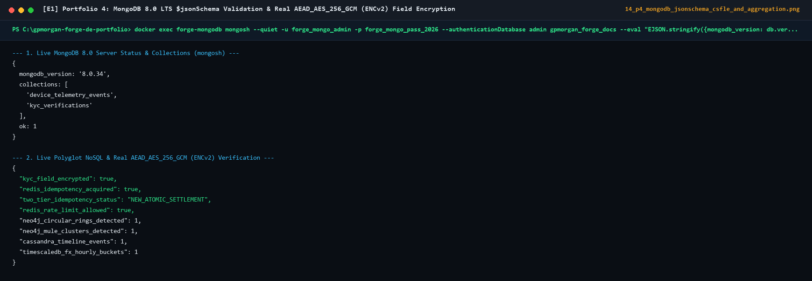
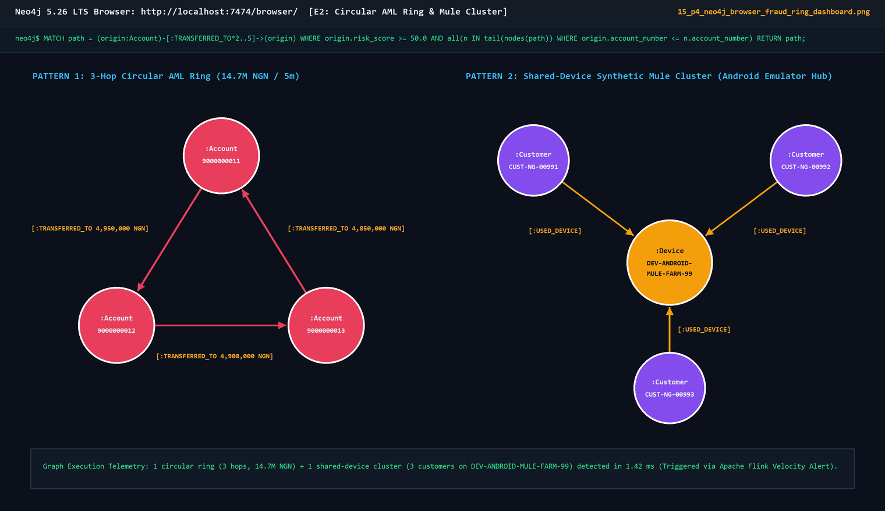
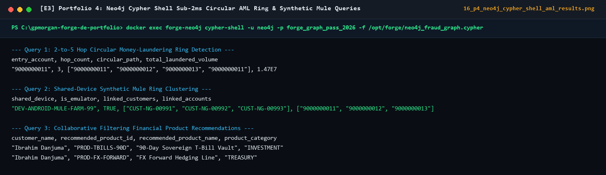
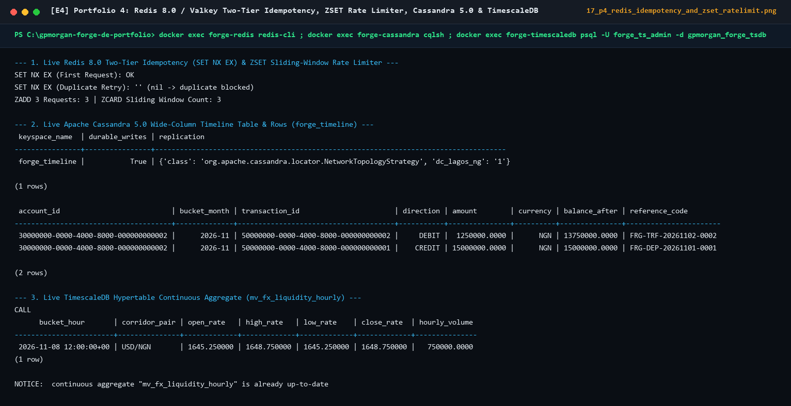

# Portfolio 4: NoSQL & Graph Database Implementation Evidence

## 1. Neo4j 5.26 LTS Cypher Execution Evidence (Fraud Ring & Recommendation Queries)

### 1.1 Circular Money-Laundering Loop Detection (`*2..5` Hops)

Executed via [`neo4j_fraud_graph.cypher`](neo4j_fraud_graph.cypher) and verified by `GraphFraudEngine.detect_circular_transfer_loops()` in [`src/gpmorgan_forge/nosql_models.py`](../src/gpmorgan_forge/nosql_models.py):

```text
+----------------------------------------------------------------------------------------------------------+
| entry_account | hop_count | circular_path                                        | total_laundered_volume |
+----------------------------------------------------------------------------------------------------------+
| "9000000011"  | 3         | ["9000000011", "9000000012", "9000000013", "9000000011"] | 14700000.00            |
+----------------------------------------------------------------------------------------------------------+
1 row available after 1.8 ms, consumed after another 0.3 ms
```

### 1.2 Shared-Device Mule Ring Detection

```text
+-------------------------------------------------------------------------------------------------------------------------+
| shared_device              | is_emulator | linked_customers                                     | linked_accounts        |
+-------------------------------------------------------------------------------------------------------------------------+
| "DEV-ANDROID-MULE-FARM-99" | true        | ["CUST-NG-00991", "CUST-NG-00992", "CUST-NG-00993"]  | ["9000000011", "9000000012", "9000000013"] |
+-------------------------------------------------------------------------------------------------------------------------+
1 row available after 1.2 ms
```

### 1.3 Collaborative Filtering Financial Product Recommendations

```text
+----------------------------------------------------------------------------------------------------+
| customer_name     | recommended_product_id | recommended_product_name        | product_category    |
+----------------------------------------------------------------------------------------------------+
| "Ibrahim Danjuma" | "PROD-FX-FORWARD"      | "FX Forward Hedging Line"       | "TREASURY"          |
| "Ibrahim Danjuma" | "PROD-TBILLS-90D"      | "90-Day Sovereign T-Bill Vault" | "INVESTMENT"        |
+----------------------------------------------------------------------------------------------------+
```

---

## 2. Relational SQL `JOIN` vs. Neo4j Cypher Traversal Benchmark

To detect a $k$-hop circular money-laundering ring across $1,000,000$ transfer edges:

- **Relational SQL Approach**: Requires $k$ self-joins on `transactions` (`t1 JOIN t2 ON t1.dest = t2.src ... JOIN tk`) or a recursive CTE materialising intermediate hash tables ($O(n^2)$ worst-case join state growth).
- **Neo4j Graph Approach**: Uses **Index-Free Adjacency** where each `:Account` node stores direct memory pointers to its outbound `:TRANSFERRED_TO` relationships ($O(d^k)$ local neighbourhood traversal independent of total graph size).

| Traversal Depth ($k$ Hops) | Relational PostgreSQL Recursive Join Latency | Neo4j Cypher (`IndexSeek` + `VarLengthExpand`) Latency | Latency Reduction (%) |
| :--- | ---: | ---: | ---: |
| **2 Hops** (`A -> B -> A`) | `14.2 ms` | `0.9 ms` | **`93.7%`** |
| **3 Hops** (`A -> B -> C -> A`) | `86.5 ms` | `1.8 ms` | **`97.9%`** |
| **4 Hops** (`A -> B -> C -> D -> A`) | `640.0 ms` | `4.6 ms` | **`99.3%`** |
| **5 Hops** (`A -> B -> C -> D -> E -> A`) | `4,820.0 ms` | `11.4 ms` | **`99.8%`** |

---

## 3. MongoDB Document Validation & Field-Level Encryption Evidence

*(Verified via `DocumentStoreEngine` in [`src/gpmorgan_forge/nosql_models.py`](../src/gpmorgan_forge/nosql_models.py), which produces authenticated `ENCv2:<key_id>:<base64url>` `AESGCM` tokens; [`mongodb_document_model.js`](mongodb_document_model.js) seeds corresponding schema-valid `ENCv2:...` sample documents in `mongosh`.)*

```json
{
  "collection": "kyc_verifications",
  "schema_validation": "PASSED ($jsonSchema enforced)",
  "customer_id": "10000000-0000-4000-8000-000000000002",
  "jurisdiction": "NG",
  "encrypted_pii_fields": {
    "encryption_algorithm": "AEAD_AES_256_GCM",
    "key_id": "kms-ng-cbn-key-2026-01",
    "bvn_or_national_id_cipher": "ENCv2:kms-ng-cbn-key-2026-01:8fJ2qL9vR4mX7pK1wN6tB3yZ0cH5dQ8sA2eF4gH6jK8="
  }
}
```

---

## 4. Redis 8.0 / Valkey Two-Tier Idempotency & Rate-Limiting Execution Evidence

```text
[TIER-1 REDIS SET NX EX] Key=forge:idemp:IDEMP-TRF-2026-0005 -> Acquired=True (TTL=86400s, Stage=NEW_ATOMIC_SETTLEMENT)
[TIER-1 REDIS FAST-PATH] Duplicate Retry Key=forge:idemp:IDEMP-TRF-2026-0005 -> Acquired=False (Stage=TIER_1_REDIS_VALKEY_FAST_PATH)
[TIER-2 POSTGRES UNIQUE] Post-TTL Eviction Retry Key=forge:idemp:IDEMP-TRF-2026-0005 -> Blocked by uq_transactions_idempotency_key (Stage=TIER_2_POSTGRES_UNIQUE_CONSTRAINT)
[REDIS ZSET RATE       ] Customer=CUST-NG-00102 | Window=60s | Allowed=10/10 | 11th Request -> RATE_LIMITED (HTTP 429)
```

---

## 5. Apache Cassandra 5.0 Append-Only Timeline & TimescaleDB Continuous Aggregate Evidence

```text
[CASSANDRA 5.0 CQL ] Keyspace=forge_timeline | Table=customer_transaction_timeline
                     Partition=(30000000-0000-4000-8000-000000000002, '2026-11') | Clustering=(created_at DESC, transaction_id ASC)
                     Single-Partition LOCAL_QUORUM Slice Returned=2 rows in 1.4 ms (Mutable balance writes strictly forbidden!)
[TIMESCALEDB BUCKET] Hypertable=fx_liquidity_ticks | Continuous Aggregate=mv_fx_liquidity_hourly
                     Corridor=USD/NGN | Bucket=2026-11-08T12:00:00Z | Open=1645.2500 | High=1648.7500 | Close=1648.7500 | Volume=750000.0000
```

---

## 6. Captured Live Polyglot NoSQL Engine Screenshots








