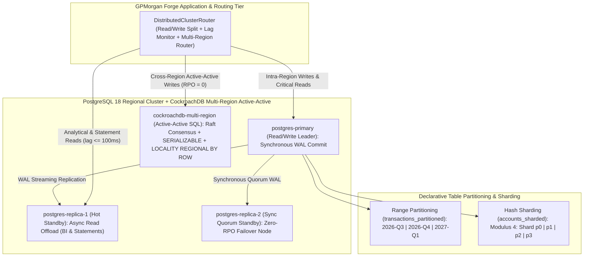
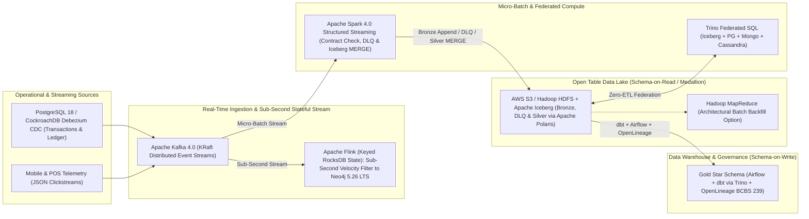

# Portfolio 5: Distributed, Cloud, Big Data & Privacy Architecture | GPMorgan Forge

> [!IMPORTANT]
> **Platform Domain**: Declarative Sharding, Multi-Region CockroachDB SQL, Stateful Flink + Open Table Iceberg Lakehouse, Zero-Trust RBAC/RLS & Privacy Engineering
> **Architecture Stack**: PostgreSQL 18, CockroachDB, Apache Kafka 4.0, Apache Flink, Apache Spark 4.0, Apache Iceberg (Apache Polaris), Trino, Airflow/dbt, OpenLineage, OpenTelemetry, NDPA 2023 & GDPR Compliance

---

## 1. Distributed & Cloud Database Architecture (Sharding, Replication & CAP/PACELC)

### 1.1 Sharding, Declarative Partitioning, Primary-Replica & CockroachDB Multi-Region Topology

To scale GPMorgan Forge across millions of customers and high-frequency payment corridors while maintaining strict ledger integrity, the platform combines **PostgreSQL 18 Declarative Sharding/Partitioning** and **Primary-Replica Streaming Replication** with **CockroachDB Multi-Region Active-Active Distributed SQL** (`RAFT_SERIALIZABLE_ZERO_RPO`). *(The diagram below depicts the production multi-AZ HA topology; local [`compose.yaml`](../compose.yaml) runs `postgres-primary` paired with one hot-standby streaming `postgres-replica` via `pg_basebackup` and single-node `cockroachdb` bootstrapping `init-multi-region.sql`.)*

1. **Range Partitioning (`PARTITION BY RANGE (created_at)`)**:
   - Implemented in [`partitioning_and_sharding.sql`](partitioning_and_sharding.sql) on `transactions_partitioned`.
   - Time-bounded queries scan only the matching quarterly child table (**Partition Pruning**), while historical quarters older than statutory hot-retention windows are detached (`ALTER TABLE ... DETACH PARTITION CONCURRENTLY`) and archived to low-cost cloud object storage without `DELETE` vacuum overhead.
2. **Hash Sharding (`PARTITION BY HASH (account_id)` with `MODULUS 4`)**:
   - Distributes `accounts_sharded` uniformly across 4 shards (`accounts_shard_p0` through `p3`), preventing B-Tree root-page lock contention during peak salary disbursement bursts.
3. **Consistency, Availability & CAP / PACELC Theorem Trade-offs**:
   - **Core Ledger & Transfers (`CP / PC-EC`)**: During a network partition (`P`), GPMorgan Forge's core ledger chooses **Consistency (`C`)** over availability on mutating balance writes to prevent split-brain double-spending. Even in normal operation (`E`), it prioritises consistency (`C`) using quorum synchronous replication.
   - **Read Replicas & Telemetry Feeds (`AP / PA-EL`)**: Analytical dashboards and device telemetry ingestion prioritise **Availability (`A`)** and **Low Latency (`L`)**, using lag-aware read routing (`DistributedClusterRouter.route_operation`) that automatically falls back to `postgres-primary` if replica lag exceeds `100 ms` (**Read-Your-Writes consistency**).
   - **Cloud Database Mapping**:
     - *Managed Relational*: **Amazon RDS / Aurora PostgreSQL** or **Google Cloud SQL** for regional OLTP.
     - *Cloud NewSQL*: **Google Cloud Spanner** or **CockroachDB** for globally distributed external consistency (TrueTime) across multi-country settlement corridors.
     - *Cloud NoSQL*: **Amazon DynamoDB** (auto-scaling key-value/document) and **Amazon Neptune / Neo4j Aura** (managed cloud graph).

---

## 2. Modern Data Platforms: Data Lakes, Data Warehouses & Hadoop/Spark/Kafka Integration

### 2.1 Big Data Characteristics (The 4 Vs) in GPMorgan Forge

1. **Volume**: Multi-terabyte historical transaction ledgers, audit trails, and 90-day mobile clickstream/device telemetry logs.
2. **Velocity**: Thousands of real-time NIBSS NIP transfers, POS card authorizations, and webhook events per second requiring sub-second fraud scoring.
3. **Variety**: Structured relational tables (PostgreSQL), semi-structured JSON/BSON webhooks and KYC documents (MongoDB), property graphs (Neo4j), and unstructured PDF/image KYC identity documents.
4. **Veracity**: Ensuring cryptographic data accuracy, zero-sum ledger reconciliation, and elimination of duplicate/spoofed payment events.

### 2.2 Comparing Data Lakes vs. Data Warehouses

| Architectural Dimension | Data Lake (Bronze / Raw Layer) | Data Warehouse (Gold / Curated BI Layer) |
| :--- | :--- | :--- |
| **Data Type** | Raw, unstructured, semi-structured, and structured (JSON logs, KYC images, clickstreams, CDC streams). | Cleaned, structured, and processed relational/columnar tables (Star/Snowflake schemas). |
| **Schema Enforcement** | **Schema-on-Read** (flexible parsing at query/training time). | **Schema-on-Write** (strict predefined types and constraints enforced at load time). |
| **Primary Use Cases** | Machine learning model training (fraud GNNs/XGBoost), predictive analytics, ad-hoc data exploration, ACID point-in-time historical audits (`FOR SYSTEM_TIME AS OF`). | Executive BI dashboards, statutory CBN & BCBS 239 regulatory reporting, historical SQL trend aggregations. |
| **Core Cloud & Big Data Tools** | AWS S3 / AWS Lake Formation, **Hadoop HDFS**, **Apache Iceberg** + **Apache Polaris** REST catalog (with **Project Nessie** as an evaluated Git-catalog alternative), **Apache Spark 4.0**, **Trino** federated SQL. | **Snowflake**, **Amazon Redshift**, **Google BigQuery**, **Apache Airflow + dbt** transformations, **OpenLineage** dataset and run-level governance. |

### 2.3 End-to-End Open Table Medallion Lakehouse & Stateful Streaming Pipeline

- **Apache Kafka 4.0 (KRaft) & Apache Flink Role**: Kafka acts as the high-throughput distributed commit log decoupling OLTP payment microservices from downstream analytics, while **Apache Flink** (`FlinkStatefulVelocityEngine`) evaluates stateful sub-second sliding-window velocity and structuring rules *before* triggering multi-hop Cypher traversals in **Neo4j 5.26 LTS**.
- **Hadoop (`HDFS` + `MapReduce`), Apache Iceberg & Apache Polaris Role**: Provides resilient distributed storage (`HDFS` / S3) governed by **Apache Iceberg** open table snapshots and **Apache Polaris** REST catalog (RBAC, vended storage credentials, and native Iceberg table-level branching/tagging), enabling exact point-in-time historical queries (`FOR SYSTEM_VERSION AS OF`) for statutory audits.
- **Apache Spark 4.0, Trino, Airflow/dbt & OpenLineage Role**: a Spark 4.0 Structured Streaming job lands raw events in Bronze, routes contract violations to a dead-letter queue, and upserts Silver Iceberg tables with an idempotent `MERGE`; **Trino** executes federated SQL queries across Iceberg, PostgreSQL, MongoDB, and Cassandra without brittle data movement; an **Apache Airflow** DAG schedules the **dbt** Gold star-schema build with data tests and a BCBS 239 reconciliation gate; and **OpenLineage** run events carry lineage for **BCBS 239**, **NDPA 2023**, and **GDPR**. See [`lakehouse/`](lakehouse/README.md) for the deployable artifacts; the Flink velocity job remains simulated in Python.
- **Database Observability (`DatabaseTelemetryTracer`)**: OpenTelemetry-compatible distributed tracing records per-hop database latency and lag across `Redis/Valkey -> PostgreSQL/CockroachDB -> Kafka -> Flink -> Neo4j -> Iceberg`.

---

## 3. Database Security & Privacy Engineering

### 3.1 CIA Triad & Privacy vs. Security Distinction

- **Confidentiality**: Ensuring only authorised identities can view sensitive PII or financial balances (enforced via AES-256 encryption, RBAC, ABAC, RLS, and Data Masking).
- **Integrity**: Preventing unauthorised tampering or balance corruption (enforced via BCNF constraints, double-entry triggers, and SHA-256 hash-chained `transaction_audit_logs`).
- **Availability**: Ensuring authorised users and payment rails have continuous access (enforced via Primary-Replica failover, Redis rate limiting, and DDoS/connection pooling controls).
- **Privacy vs. Security**: *Database Security* protects systems against external/internal threats (hacking, SQL injection, data loss), whereas *Database Privacy* governs individual legal and ethical rights over personal data (**consent, purpose limitation, data minimisation, and right to erasure**).

### 3.2 Defense-in-Depth Security & Privacy Controls Matrix

| Threat / Requirement | Technical Mitigation Implemented in GPMorgan Forge | Implementation Artifact |
| :--- | :--- | :--- |
| **Unauthorised Access & Weak Credentials** | **Multi-Factor Authentication (MFA)** via RFC 6238 TOTP (`HMAC-SHA1`, 6-digit, 30s window, replay cache) and **SSO** federation via OIDC JWT (`RS256` / `EdDSA`) step-up verification. | [`security_rbac_rls_privacy.sql`](security_rbac_rls_privacy.sql) & [`src/gpmorgan_forge/identity.py`](../src/gpmorgan_forge/identity.py) |
| **Insider Threats & Excessive Privileges** | **RBAC** (`forge_admin`, `forge_core_service`, `forge_compliance_dpo`, `forge_analyst`, `forge_customer`), **ABAC** (country/jurisdiction attributes), and **PostgreSQL Row-Level Security (`CREATE POLICY`)**. | [`security_rbac_rls_privacy.sql`](security_rbac_rls_privacy.sql) & `AccessControlEngine` |
| **SQL & Cypher Injection** | 100% parameterised SQL queries (`:param` / `$1`) and SQLAlchemy 2.1 typed bindings; zero string concatenation. | [`src/gpmorgan_forge/operations.py`](../src/gpmorgan_forge/operations.py) |
| **Data Breaches & Network Sniffing** | **Encryption at Rest** (`AES-256` on disk/volumes + MongoDB AEAD field-level encryption via KMS) and **Encryption in Transit** (`TLS 1.3`). | [`mongodb_document_model.js`](../portfolio-4-nosql/mongodb_document_model.js) |
| **Non-Production / Analyst PII Exposure** | **Dynamic Data Masking** (`v_masked_customers`, `v_masked_payment_cards` formatting PANs as `XXXX-XXXX-XXXX-1234` and emails as `ch***@example.ng`). | [`security_rbac_rls_privacy.sql`](security_rbac_rls_privacy.sql) & `DataPrivacyEngine` |
| **Inference & Re-Identification Attacks** | **Differential Privacy** injecting calibrated Laplace noise $\text{Lap}(\Delta f / \epsilon)$ into aggregate analytical queries. | `DataPrivacyEngine.apply_differential_privacy_laplace()` |
| **NDPA 2023 & GDPR Compliance** | **Privacy by Design**: explicit opt-in `consent_records`, purpose limitation, DPO auditability, and `anonymise_customer_pii()` Right-to-Erasure procedure. | [`security_rbac_rls_privacy.sql`](security_rbac_rls_privacy.sql) & `DataPrivacyEngine.anonymise_customer_record()` |
| **Emerging Cryptographic Privacy (ZKPs & Blockchain)** | **Zero-Knowledge Proofs (ZKPs)** (`secp256k1` Pedersen commitments, CDS94 bit-decomposition OR-proofs, and `Ed25519` KYC attestation) verifying `kyc_tier >= TIER_2` and `age >= 18` without revealing raw BVN or birthdate, plus **Blockchain-style SHA-256 Hash-Chained Audit Ledger**. | [`src/gpmorgan_forge/zkp.py`](../src/gpmorgan_forge/zkp.py) & `DataPrivacyEngine.generate_and_verify_zkp_tier_claim()` |

---

## 4. Deliverable Files in This Directory

- [`partitioning_and_sharding.sql`](partitioning_and_sharding.sql): PostgreSQL 18 declarative `RANGE` and `HASH` partitioning DDL, **CockroachDB** multi-region active-active DDL (`global_corridor_settlements` with `LOCALITY REGIONAL BY ROW`), and **TimescaleDB** hypertables + continuous aggregates (`fx_liquidity_ticks`, `mv_fx_liquidity_hourly`).
- [`security_rbac_rls_privacy.sql`](security_rbac_rls_privacy.sql): RBAC roles, Least Privilege grants, Row-Level Security (`RLS`) policies, Dynamic Data Masking views, and NDPA 2023 `anonymise_customer_pii` procedure.
- [`distributed_cloud_evidence.md`](distributed_cloud_evidence.md): Captured partition pruning plans, shard/replica/CockroachDB routing logs, Kafka/Flink/Spark/Iceberg/Trino/OpenLineage Medallion Lakehouse outputs, OpenTelemetry traces, and privacy verification evidence.
- [`lakehouse/`](lakehouse/README.md): Deployable Lakehouse artifacts: Debezium CDC connector, Spark 4.0 streaming job (data contract, dead-letter queue, idempotent `MERGE`), dbt Gold project, Airflow DAG, Trino catalogs and Iceberg DDL, and OpenTelemetry Collector config.
- [`src/gpmorgan_forge/distributed_privacy.py`](../src/gpmorgan_forge/distributed_privacy.py): Python implementation of the Distributed Shard, Replica & CockroachDB Multi-Region Router (`DistributedClusterRouter`), Stateful Stream Processor (`FlinkStatefulVelocityEngine`), an in-process model of the Medallion Lakehouse (`MedallionLakehousePipeline`: data-contract dead-letter queue, idempotent Silver merge, Gold rebuild, layer reconciliation, and spec-shaped OpenLineage events), OpenTelemetry Tracer (`DatabaseTelemetryTracer`), RBAC/ABAC/RLS Policy Evaluator (`AccessControlEngine`), Dynamic Data Masker, NDPA Anonymiser, Differential Privacy Engine, and Zero-Knowledge Proof Verifier (`DataPrivacyEngine`).
- [`src/gpmorgan_forge/identity.py`](../src/gpmorgan_forge/identity.py): RFC 6238 TOTP and OIDC JWT (`RS256` / `EdDSA`) authentication and step-up MFA engine.
- [`src/gpmorgan_forge/zkp.py`](../src/gpmorgan_forge/zkp.py): Non-interactive `secp256k1` Pedersen commitment + CDS94 bit-decomposition Zero-Knowledge Range Proof and `Ed25519` KYC authority attestation engine.
