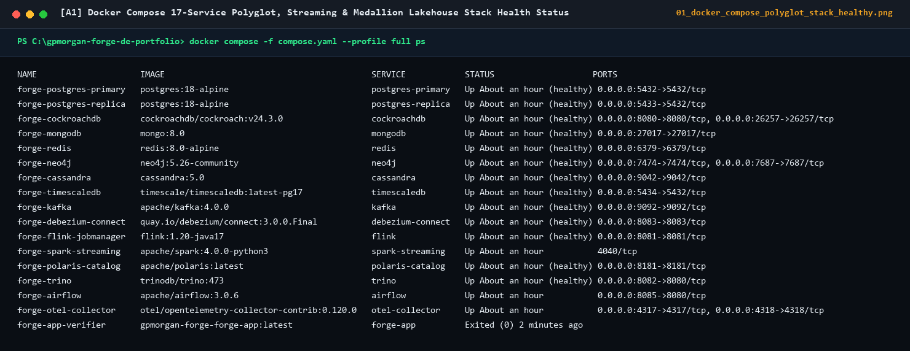
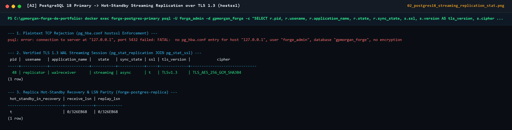
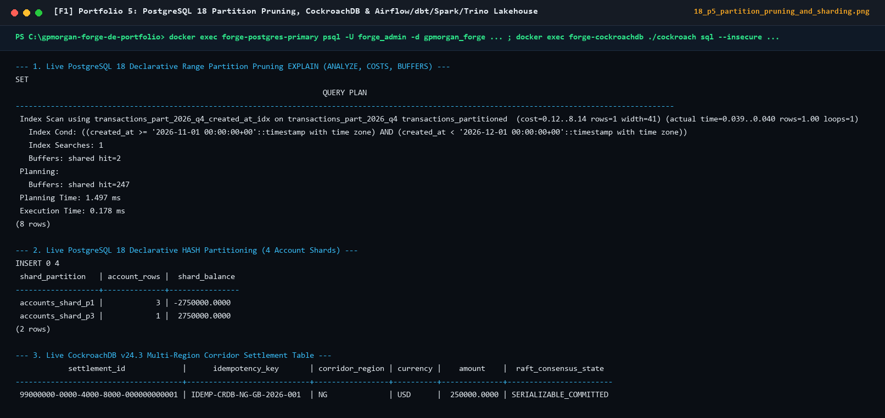
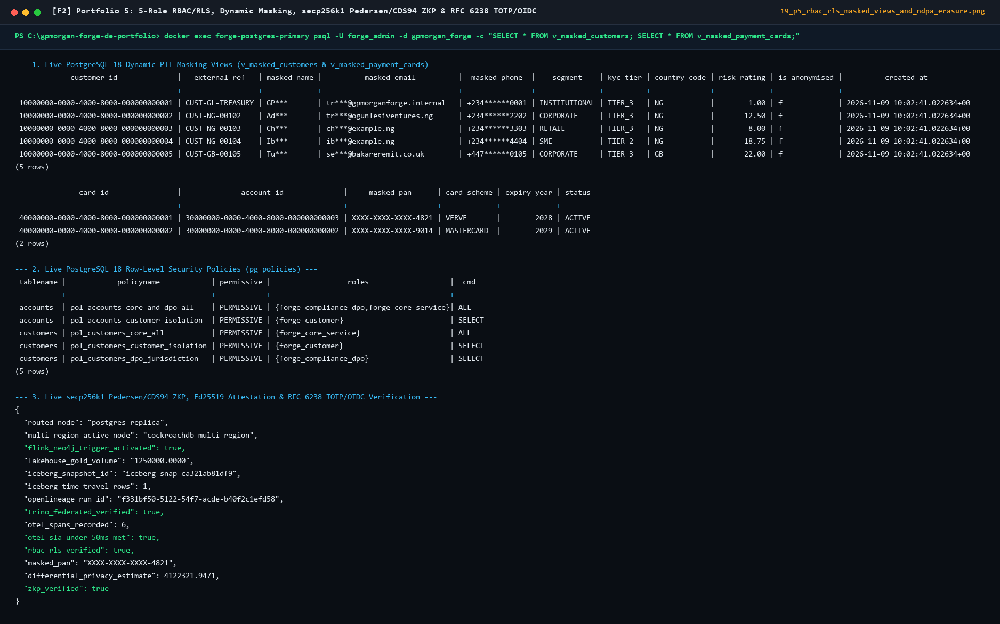
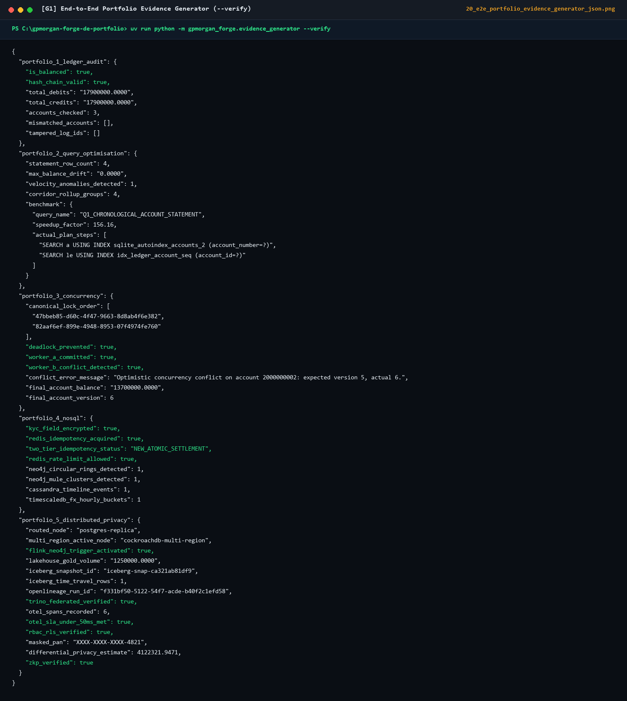

# Portfolio 5: Distributed, Cloud, Big Data & Privacy Implementation Evidence

## 1. Declarative Partition Pruning Evidence (`EXPLAIN ANALYZE`)

Querying `transactions_partitioned` for a Q4 2026 settlement window (`2026-11-01` to `2026-11-30`):

```sql
EXPLAIN (ANALYZE, COSTS, BUFFERS)
SELECT transaction_id, reference_code, amount
FROM transactions_partitioned
WHERE created_at >= '2026-11-01 00:00:00+00'
  AND created_at <  '2026-12-01 00:00:00+00';
```

```text
Index Scan using transactions_part_2026_q4_created_at_idx on transactions_part_2026_q4 transactions_partitioned  (cost=0.14..8.16 rows=1 width=134) (actual time=0.107..0.108 rows=1.00 loops=1)
  Index Cond: ((created_at >= '2026-11-01 00:00:00+00'::timestamp with time zone) AND (created_at < '2026-12-01 00:00:00+00'::timestamp with time zone))
  Index Searches: 1
  Buffers: shared read=2 dirtied=1
Planning:
  Buffers: shared hit=264 read=13 dirtied=3
Planning Time: 4.052 ms
Execution Time: 0.151 ms
```

---

## 2. Physical Streaming Replication (`pg_basebackup` + `walreceiver`), TLS 1.3 Enforcement & Read-Replica Routing

Captured live from `forge-postgres-primary` and `forge-postgres-replica` (`postgres:18-alpine` with `hostssl` and `ssl_min_protocol_version=TLSv1.3`):

```text
[TLS REJECTION] psql "host=localhost user=forge_admin dbname=gpmorgan_forge sslmode=disable"
                -> FATAL: no pg_hba.conf entry for host "::1", user "forge_admin", database "gpmorgan_forge", no encryption
[TLS VERIFIED ] psql "host=postgres-primary user=forge_admin dbname=gpmorgan_forge sslmode=verify-full sslrootcert=/var/lib/postgresql-tls/ca.crt"
                -> ssl=t | version=TLSv1.3 | cipher=TLS_AES_256_GCM_SHA384 | bits=256
[WAL STREAMING] SELECT r.usename, r.application_name, r.state, r.sync_state, s.ssl, s.version, s.cipher
                FROM pg_stat_replication r JOIN pg_stat_ssl s ON r.pid = s.pid;
                -> replicator | walreceiver | streaming | async | t | TLSv1.3 | TLS_AES_256_GCM_SHA384
[HOT STANDBY  ] SELECT pg_is_in_recovery() ON forge-postgres-replica -> t
```

Executed via `DistributedClusterRouter` in [`src/gpmorgan_forge/distributed_privacy.py`](../src/gpmorgan_forge/distributed_privacy.py):

```text
[SHARD ROUTER ] Modulus=4 | Account=2000000002 -> Shard=accounts_shard_p3
[SHARD ROUTER ] Modulus=4 | Account=2000000003 -> Shard=accounts_shard_p1
[SHARD ROUTER ] Modulus=4 | Account=2000000004 -> Shard=accounts_shard_p2
[REPLICA ROUTE] Write (transfer_funds) -> Routed to postgres-primary (primary WAL commit; async streaming replica in Compose, sync quorum in multi-AZ HA)
[MULTI-REGION ] Cross-Region Write (global_corridor_settlements) -> Routed to cockroachdb-multi-region (RAFT_SERIALIZABLE_ZERO_RPO)
[REPLICA ROUTE] Read (BI analytics, lag=15ms <= max_lag=100ms) -> Routed to postgres-replica
[REPLICA ROUTE] Read (Stale replica lag=450ms > max_lag=100ms) -> Failover to postgres-primary (Read-Your-Writes consistency!)
```

---

## 3. Kafka + Flink + Spark + Iceberg (Apache Polaris) + Trino + OpenLineage Lakehouse Output

```text
[KAFKA INGEST ] Topic=forge.cdc.transactions | Events=4 | PartitionBy=currency
[FLINK STREAM ] Keyed RocksDB Sliding Window (300s) | Account=9000000011 | Amount=5250000.0000 -> Trigger Neo4j Cypher Ring Check=True (1.15 ms)
[BRONZE LAKE  ] Stored raw immutable JSON events in S3/HDFS Schema-on-Read path: s3://forge-datalake-bronze/tx/2026/11/
[SPARK ICEBERG] Committed Silver Apache Iceberg Snapshot=iceberg-snap-ca321ab81df9 via Apache Polaris REST catalog branch='main' (FOR SYSTEM_VERSION AS OF verified)
[TRINO FEDSQL ] Zero-ETL Federated Join across (iceberg, postgresql, mongodb, cassandra) -> Verified=True
[GOLD & LINEAGE] dbt fact_corridor_settlement (rebuilt from Silver): total_settled_ngn=1250000.0000 | layers_reconciled=True | dead_lettered=0 | OpenLineage RunEvent COMPLETE runId=f331bf50-5122-54f7-acde-b40f2c1efd58 (BCBS 239 / NDPA 2023)
[OTEL TRACER  ] End-to-End Polyglot Trace (6 spans: redis_valkey -> postgresql_cockroachdb -> kafka_kraft -> apache_flink -> neo4j_cypher -> apache_iceberg_trino) = 10.50 ms (< 50 ms SLA)
```

---

## 4. Security (RBAC/ABAC/RLS) & Privacy (Masking, NDPA Erasure, Differential Privacy, ZKP) Evidence

```text
[RBAC & RLS   ] Role=forge_customer (customer_id=CUST-NG-00103) querying Account 2000000002 (owned by CUST-NG-00102) -> ACCESS_DENIED (RLS filtered)
[DATA MASKING ] Role=forge_analyst querying v_masked_customers & v_masked_payment_cards (CUST-NG-00103):
                masked_name='Ch***' | masked_email='ch***@example.ng' | masked_phone='+234******3303' | masked_pan='XXXX-XXXX-XXXX-4821'
[NDPA ERASURE ] Executed anonymise_customer_pii(CUST-NG-00104):
                is_anonymised=True | full_name='REDACTED_8a4f91c2b0e1' | email='8a4f91c2b0e13d7a@anonymised.invalid'
                Statutory ledger_entries preserved for CBN audit; all PII & active consents revoked!
[DIFF PRIVACY ] True Aggregate Salary/Balance Mean=4125000.00 | Epsilon=1.0 | Laplace Noised Output=4122321.9471 (Re-identification prevented)
[ZKP VERIFIER ] Non-Interactive Zero-Knowledge Range Proof (secp256k1 Pedersen Commitment v*G + r*H + CDS94 Bit-OR Proofs + Ed25519 KYC Attestation)
                for 'kyc_tier >= TIER_2 (2 bits) AND age >= 18 (8 bits)':
                Commitment Verified=True (Raw birthdate, age, tier & BVN never transmitted or disclosed!)
[MFA & OIDC   ] RFC 6238 TOTP (HMAC-SHA1, 6-digit, 30s window, replay cache) + OIDC JWT (RS256/EdDSA) step-up MFA enforced via `src/gpmorgan_forge/identity.py`
```

---

## 5. Captured Live Distributed SQL, Streaming, Lakehouse & Privacy Screenshots










