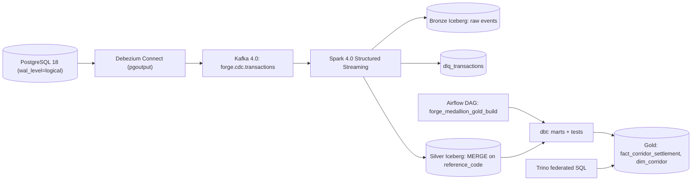

# Lakehouse Implementation: Debezium, Spark, Polaris, Trino, dbt & Airflow

This directory holds the **deployable** artifacts behind the Medallion Lakehouse described in
[ADR-0005](../../docs/adr/0005-lakehouse-kafka-spark-architecture.md). The in-process
`MedallionLakehousePipeline` in [`distributed_privacy.py`](../../src/gpmorgan_forge/distributed_privacy.py)
reproduces the same semantics so they can be unit-tested without a cluster.



## Components

| Path | Role |
| --- | --- |
| [`debezium/postgres-ledger-connector.json`](debezium/postgres-ledger-connector.json) | Transactional CDC of `public.transactions` via logical decoding, unwrapped and routed to `forge.cdc.transactions`; credentials come from environment config providers. |
| [`spark/bronze_to_silver.py`](spark/bronze_to_silver.py) | Continuous Kafka → Bronze → Silver job that self-bootstraps the Polaris warehouse and Bronze/DLQ/Silver Iceberg v2 tables on startup, enforces a data contract with dead-letter routing, and runs idempotent `MERGE INTO` with checkpointing. |
| [`dbt/dbt_project.yml`](dbt/dbt_project.yml) | Gold star schema (`dim_corridor`, `fact_corridor_settlement`) built through Trino on Iceberg, with generic tests, source freshness, and a BCBS 239 reconciliation test. |
| [`airflow/dags/forge_medallion_dag.py`](airflow/dags/forge_medallion_dag.py) | Hourly batch orchestration: freshness gate → `dbt build --select +marts` → reconciliation test, with retries and exponential backoff. |
| [`trino/catalog/iceberg.properties`](trino/catalog/iceberg.properties) | Iceberg (Polaris REST, vended credentials), PostgreSQL, MongoDB, and Cassandra catalog connectors for zero-ETL federation. |
| [`trino/init_iceberg_tables.sql`](trino/init_iceberg_tables.sql) | Idempotent Trino DDL mirroring the Bronze, dead-letter, and Silver Iceberg v2 tables for standalone Trino/dbt provisioning. |
| [`otel/otel-collector-config.yaml`](otel/otel-collector-config.yaml) | OTLP receiver and memory-limited batch pipeline for the database tracer. |

## Data engineering patterns

| Pattern | Where |
| --- | --- |
| Medallion layering (Bronze immutable, Silver validated, Gold modelled) | Spark job, dbt models |
| Change data capture | Debezium connector |
| Data contract and dead-letter queue | `violates_contract()` in Spark, `validate_lakehouse_event_contract()` in Python |
| Idempotent upsert (replay-safe, at-least-once tolerant) | `MERGE INTO` on `reference_code` |
| Gold rebuilt from Silver, never patched | dbt `table` materialisation |
| Settlement-state filtering (Silver keeps every state, Gold counts only `SETTLED`) | `status` column, dbt `where status = 'SETTLED'` |
| Data quality gates and source freshness | dbt `data_tests`, `sources.yml` freshness |
| Completeness reconciliation (BCBS 239) | `assert_gold_reconciles_to_silver.sql`, `reconcile_layers()` |
| Orchestration separate from streaming | Airflow owns batch Gold only; Spark streams continuously |
| Lineage | OpenLineage `RunEvent` with Airflow provider and the Python pipeline |
| Secrets via environment, never in config | `${env:...}` (Debezium), `${ENV:...}` (Trino) |

## Running the stack

```bash
# 1. Generate local TLS 1.3 certificates required by postgres-primary and postgres-replica
uv run python scripts/generate_dev_tls.py

# 2. Pull multi-GB Lakehouse images sequentially and start the full stack
docker compose --parallel 1 -f compose.yaml --profile full pull
docker compose -f compose.yaml --profile full up -d

# 3. (Optional when spark-streaming is running) Explicitly verify/create Iceberg tables via Trino
docker compose -f compose.yaml exec -T trino trino < portfolio-5-distributed-cloud/lakehouse/trino/init_iceberg_tables.sql

# 4. Register the Debezium CDC connector
curl -X PUT -H "Content-Type: application/json" \
  http://localhost:8083/connectors/forge-postgres-ledger-cdc/config \
  --data "$(jq .config portfolio-5-distributed-cloud/lakehouse/debezium/postgres-ledger-connector.json)"
```

The Airflow UI is served on `AIRFLOW_PORT` (default `8085`), Trino on `TRINO_PORT` (default `8082`), and Apache Polaris REST catalog on `POLARIS_PORT` (default `8181`, with Quarkus health probes on internal management port `:8182/q/health`).
On startup, [`spark/bronze_to_silver.py`](spark/bronze_to_silver.py) idempotently provisions the `forge_lakehouse` Polaris warehouse, `forge_lakehouse` / `forge_dwh` namespaces, and Bronze/DLQ/Silver Iceberg v2 tables, and skips empty micro-batches until Debezium emits CDC events; [`trino/init_iceberg_tables.sql`](trino/init_iceberg_tables.sql) provides matching idempotent Trino DDL when running Trino/dbt independently.

> **Scope note**: the test suite validates these artifacts statically and executes the dbt SQL against
> SQLite; it does not start Airflow, Spark, or Trino. End-to-end cluster runs require the Compose stack.
